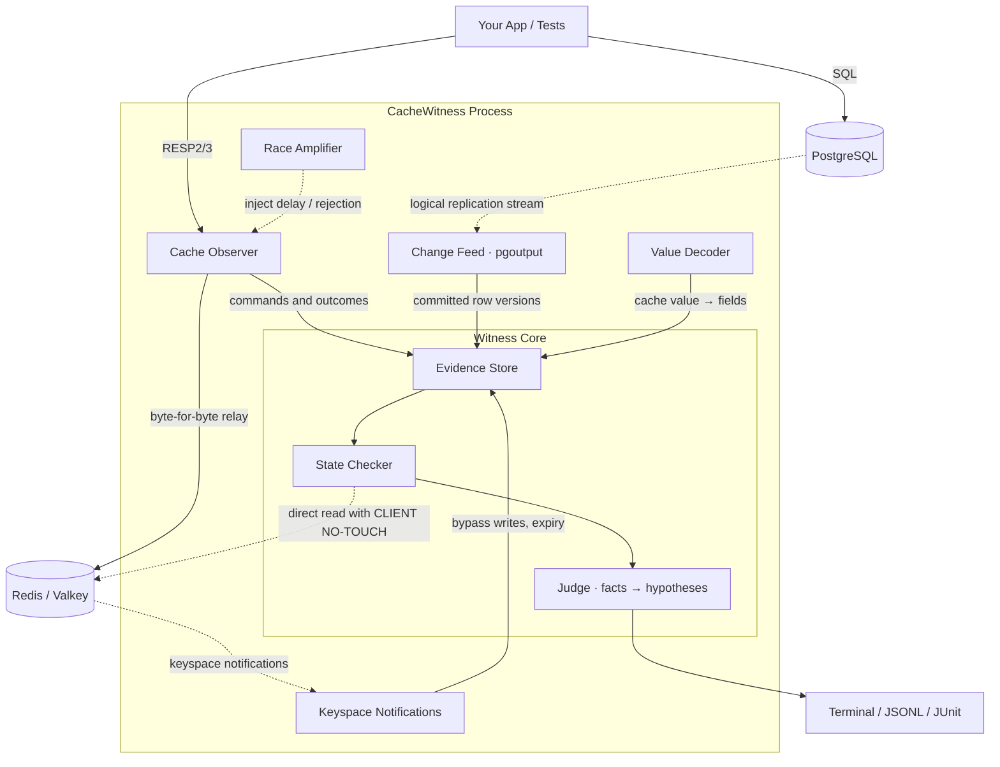

<div align="center">

**English** · [简体中文](docs/readme/README_zh.md) · [한국어](docs/readme/README_ko.md)

# CacheWitness

**Proves when your Redis cache disagrees with PostgreSQL, and shows the evidence**

**Watch the cache. Prove what you saw.**

</div>

---

## Introduction

   **CacheWitness** is an open-source Rust developer tool for existing PostgreSQL + Redis applications. Without touching your application code, it **confirms cache consistency violations, shows the evidence of how each one came about, and reproduces race conditions in CI**. In one line: **"It confirms that your cache is holding a wrong value, and shows you the evidence of how it got there."**

   Cache-aside with Redis in front of the database is the default architecture for web backends. But cache inconsistency **fails silently, with no errors and no latency**, so APM and monitoring never see it, and it is often discovered by customers (9 of 21 public incidents). Millisecond-scale race conditions are also hard to reconstruct from logs. As a result, most postmortems end with a workaround: "shorten the TTL" or "remove the cache".

   **CacheWitness solves this by observing a protocol proxy in front of the cache and the database's logical replication stream together.** It determines which committed database version each cached value corresponds to, and shows the events that led to that value as a timeline where every event carries a time interval. What it observed, it confirms; causal links it could not observe, it presents **only as hypotheses**. CacheWitness is built on a clear philosophy: **"Don't replace the cache. Prove whether it is correct right now. And say so when you don't know."**

   Meta checks cache consistency in-house with Polaris, and Uber measures cache staleness in-house. CacheWitness aims to bring **the same capability to your Postgres + Redis, without changing application code**. The first goal is to catch violations in CI and staging, before release.

---

## The Problem

Cache inconsistency is **"a state where the database has committed a new value, but the cache keeps an old value for longer than you allow"**. The real problem is not that it happens, but that it persists unnoticed and is hard to trace back.

| Type | Mechanism | CacheWitness verdict |
|---|---|---|
| Failed invalidation | DEL fails (network, permissions, OOM) and is never retried | Confirmed |
| Stale refill | An old value is SET again after the commit and the DEL | Confirmed (why it was old is a hypothesis) |
| Stale-set race | Reader reads old value → writer commits and DELs → reader SETs the old value | Hypothesis |
| Replica-lag refill | After DEL, a lagging read replica supplies the old value | Hypothesis |
| Invalidate before commit | DEL before commit → another request refills with the old value | Order confirmed, causation hypothesized |
| Missing invalidation | A code path that changed the database never clears the cache | Hypothesis |
| Partial invalidation | Only some of the keys tied to a row are cleared | Confirmed (when tied keys are declared) |
| Stale negative cache | "Not found" was cached, then the row was INSERTed | Confirmed (when the negative value is declared) |
| Rolled-back write left in cache | The cache was filled before commit, then the transaction rolled back | Hypothesis |
| Write-through reordering | An older version's SET arrives after a newer version's SET | Confirmed |

In particular, **even the standard "DEL after commit" pattern is not safe.** This has been known since Facebook's 2013 memcache paper, but there has been no tool that shows whether it **actually happens in your code**.

---

## Quick Start

> The interface below is planned. The project is currently at the prototype stage, and commands and configuration may change.

### 1. Configuration

CacheWitness reads `cawit.yaml` at the project root (the CLI is `cawit`), which declares **how cache keys map to database tables, and your consistency policy**. The only change in your application is **the Redis URL**.

```yaml
policy:
  default:
    mode: invalidate_on_write   # invalidate_on_write | write_through | ttl_only
    max_staleness: 500ms        # maximum staleness your service allows
    observation_grace: 300ms    # how long the tool waits for CDC lag and the like

mappings:
  - key: "app:user:{id}"        # the real key format, including prefixes
    table: public.users
    pk: [id]
    value: { format: json }
    fields: { name: name, email: email, updatedAt: updated_at }  # cache field → column
    ignore: [cachedAt]

report:
  values: redact                # keep real values out of reports (default)
```

This lets you configure:

- Consistency policy: invalidate on write, write-through, or TTL only

- The staleness your service allows, and the tool's observation grace period (these are separate)

- Key templates mapped to tables and primary keys, and cache fields mapped to database columns

- Whether reports may include real values

Keys that cannot be mapped (list or aggregate caches) are listed separately as **"unmapped"** in the report, so nothing is hidden.

### 2. Environment Check (Doctor)

```bash
# Check wal_level, replication privileges, publication, Redis version, and permission to enable keyspace notifications
cawit doctor --pg $DATABASE_URL --redis redis://localhost:6379
```

> "No code changes" means **no application code changes**. The database needs `wal_level=logical`, a replication privilege, and a publication. CacheWitness only uses temporary replication slots.

### 3. Run in CI

CacheWitness has two modes with different purposes.

```bash
# check mode: wrap existing tests and check for deterministic bugs (missing/failed invalidation, wrong keys, ...)
cawit check --config cawit.yaml -- npm run test:integration

# race mode: wrap a concurrent load and widen race windows to check for race conditions
cawit race --config cawit.yaml --amplify stale-set --seed 42 -- k6 run load.js
```

The result is one of **PASS (exit code 0) / FAIL (1) / INCONCLUSIVE (2)**. If too many writes to mapped keys could not be observed (writes that bypass the proxy, unsupported commands, ...), CacheWitness does not call the run "clean"; it reports INCONCLUSIVE. A confirmed violation is always a FAIL, regardless of coverage.

> Sequential tests do not create race conditions. Use race mode to check for them. Tests that roll back every test case (such as Django's `TestCase`) never commit, so they cannot be checked; CacheWitness detects this and tells you.

### 4. Report

Each violation is split into **confirmed facts, cause hypotheses, and missing evidence**.

```
FAIL  STALE_STATE  app:user:2128   stale for ≥ 812ms (allowed 500ms)   observation: COMPLETE

  Confirmed facts
    DB      commit v2                  17:12:03.481  [+0.0, +0.4]ms
    conn#1  DEL → 1 (ok)                             [+6.4, +6.9]ms
    conn#2  SET (matches v1, ttl 3600s)              [+13.1, +13.6]ms   ← after commit and DEL (order confirmed)
    check   cache = v1                               +812ms
    stale reads served: 37

  Cause hypotheses
    SUSPECTED  STALE_SET_RACE      evidence: GET miss on the same key on conn#2 at [-3.6, -3.2]ms (before commit)
    SUSPECTED  REPLICA_LAG_REFILL  cannot be ruled out

  Missing evidence
    SQL read time, read target (primary/replica), request ID

  Suggested fixes
    invalidation marker + Lua compare-and-set, or leases
```

---

## Design Philosophy

### 1. The "Witness" Architecture

CacheWitness is not a cache. It is **a witness watching your cache**.

- It relays the Redis protocol (RESP2/RESP3) byte for byte, and feeds only a copy to its parser.
- It distinguishes **seeing a command** from **the state actually changing** (failed NX, aborted MULTI/EXEC, and so on).
- It receives database changes, with commit time and LSN, from the PostgreSQL logical replication stream.
- It finds **writes that bypass the proxy** by reconciling Redis keyspace notifications with the proxy's records. It never assumes that every write goes through the proxy.
- Its checking connection uses `CLIENT NO-TOUCH`, so observation does not change the cache's eviction behavior.

**Result:**

Your cache and application code stay as they are, and you get a record of which database version each cached value matches and how it got there.

### 2. Facts and Hypotheses Are Kept Apart

The same observations can come from different causes. For example, a stale-set race and a replica-lag refill can look identical to the proxy and the change stream.

So CacheWitness **only claims what it knows.**

- **Evidence model:** a cause starts as `UNKNOWN`, becomes `SUSPECTED` as evidence accumulates, and is `CONFIRMED` only when observation alone proves it
- **Time intervals:** every event is recorded as a `[t_min, t_max]` interval; when intervals overlap, the order is not decided
- **Watermarks:** a verdict is made only after both observation channels are known to have caught up to the verdict time
- **Observation state:** each key records `COMPLETE` / `PARTIAL` / `GAP_DETECTED` and so on; incomplete observation means INCONCLUSIVE

### 3. Races Are Not Left to Chance (Race Amplifier)

Race conditions only show up when they happen to fire.

CacheWitness **widens the race window on purpose.**

- **Stale-set induction:** delays forwarding of the SET on the same key after a GET miss
- **Invalidation-failure tolerance:** rejects DEL with some probability, then checks whether consistency **recovers**
- **Seed-based:** injection decisions are derived from `(seed, key, per-key sequence)`, so the same seed gives the same decision to the n-th command on the same key. The execution order itself is not reproduced
- **Delay attribution:** each violation records the delay injected into the commands involved

### 4. Why Rust

Not because it is "fast", but because of **the conditions a process sitting in the request path must meet**.

- **Predictable tail latency:** a proxy with no GC pauses
- **Bounded memory:** per-key retention and allocation stay under control
- **A single static binary:** drops straight into CI runners and sidecars
- **Memory safety:** for code that parses user traffic, this is a security requirement

---

## Key Features

- **🔍 No application code changes:** attach by changing only the Redis URL and a config file
- **🧾 Evidence-based verdicts:** reports split into confirmed facts, cause hypotheses, and missing evidence
- **👥 Stale read counting:** measures not just cache state but how many times stale values were actually read
- **🎯 Race amplification mode:** reproduce race conditions in CI and fail the build

> **Current limit (measured on Twenty CRM):** detecting stale cache state and reproducing whether a race can happen need no application code changes. **Quantifying how likely a stale value is to persist currently does need a delay hook inside the app's cache refill path.** A proxy that delays cache writes distorts the risk for clients that share one Redis connection per process (up to 10-30x in our measurements). See [`docs/design/phase1-results.md`](docs/design/phase1-results.md) (Korean).
- **🛡️ Minimal data exposure:** real values are redacted in reports by default
- **📄 CI-friendly reports:** terminal, JSONL, JUnit XML

---

## Architecture Overview

CacheWitness acts as a **witness** between the cache and the database.



1. **Cache Observer:** a Redis protocol proxy. It pairs requests and responses per connection in FIFO order and records the outcome of each command.
2. **Change Feed:** receives row versions and commit times from the PostgreSQL logical replication stream.
3. **Keyspace Notifications:** a second observation channel that detects writes bypassing the proxy, writes inside scripts, and expiry and eviction.
4. **Value Decoder:** decodes cached values into fields that can be compared with database columns.
5. **Evidence Store:** keeps per-key events and versions on a time basis, within a memory limit.
6. **State Checker:** once the allowed staleness has passed and both watermarks are past that point, reads the cache directly and determines the facts.
7. **Judge:** builds cause hypotheses on top of the facts, and confirms them only when the evidence is sufficient.

---

## Prototype Results

The core hypotheses were checked with a roughly 970-line prototype (a Rust detector plus a Node reproduction harness).
Environment: 2-core, 7 GB Linux container, PostgreSQL 16, Redis 7.0, node-redis (RESP3), 300 ms grace period.

- **Cache-aside with no injected bugs:** under a load built to provoke races (200 hot keys, 32 workers, read:write about 2.3:1), a separate oracle found 3 keys still holding stale values after a 20-second run, and the prototype detected all 3. The count of transient races during the run (41) was counted by the tool itself and has not been independently verified.
- **Injected bug tests:** no false positives were observed on correct patterns and background traffic, but the scenarios were written by the same person, so no accuracy claim is made from this.
- **Observation cost:** adding a proxy hop is expensive (GET p50 0.28 → 0.74 ms versus direct Redis). The extra cost of the observation logic itself could not be distinguished from a plain relay proxy within measurement noise. Resident memory was 25 MB.

> The proxy adds latency to every command, so measured rates are not production rates. Also, the injected scenarios and the classification rules were written by the same person, so classification accuracy may be overstated. The next phase re-measures it against independent ground truth. See chapter 5 of [`docs/PLAN.md`](docs/PLAN.md) (Korean) for the detailed interpretation.

---

## Scope

| Area | First public release (v0.x) | Considered after v1.0 |
|---|---|---|
| Database | PostgreSQL | MySQL |
| Cache | Redis, Valkey (single node) | Redis Cluster |
| Value formats | JSON, gzip/zstd decompression, simple pickle (basic types only) | Ruby Marshal, pickled model objects, msgpack, user decoders |
| Key mapping | 1:1 table declarations, tied keys | Composite keys, list/aggregate caches |
| Modes | check, race | Optional instrumentation (OpenTelemetry traces), production monitoring (separate product) |
| Transport | Plain TCP | TLS (`rediss://`) |

**What CacheWitness does not do:**

- It does not guarantee or automatically repair cache consistency.
- It does not replace your cache or provide a new one.
- It will not become a general-purpose Redis proxy (sharding, connection pooling).
- It does not claim causal links inside your application that it could not observe.

---

## Documentation

| Document | Contents |
|---|---|
| [`docs/PLAN.md`](docs/PLAN.md) | Final development plan (Korean): motivation, verdict model, design details, phase gates, rejected alternatives |

---

## ⚠️ Disclaimer & Liability

**Please read carefully.**

**CacheWitness is currently a personal project at the design and prototype stage.**

This software is provided **"as is", without warranty of any kind**, express or implied, including but not limited to the warranties of merchantability, fitness for a particular purpose, and non-infringement. By using this software, you agree to the following:
1. **Use at your own risk:** You are solely responsible for determining whether using or redistributing this software is appropriate.
2. **No liability:** In no event shall the authors or copyright holders be liable for any claim, damages, or other liability arising from or in connection with the use of this software.
3. **Not recommended for production:** Before 1.0, it is designed for CI and staging only. Do not route production traffic through the proxy.

If you plan to use CacheWitness in production, **we strongly recommend performing your own thorough testing and security review.**

---

## License

This project is distributed under the **Apache License 2.0**.
