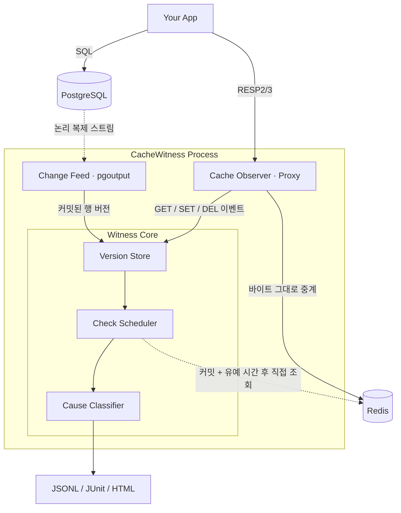

<div align="center">

# CacheWitness

**Redis 캐시와 PostgreSQL 사이의 불일치를 탐지하고, 원인을 설명하는 도구**

**캐시 위트니스**

</div>

---

## 소개 (Introduction)

   **CacheWitness**는 애플리케이션 코드를 고치지 않고 Redis 캐시와 PostgreSQL 사이의 데이터 불일치를 탐지하고, **그 원인을 이벤트 순서로 설명하는** Rust 오픈소스 도구입니다. 한 줄로 말하면 **“캐시가 틀린 값을 들고 있을 때, 언제·어느 요청 때문에·어떤 무효화가 빠져서 그렇게 됐는지 알려주는 도구”**입니다.

   Redis를 DB 앞에 두는 cache-aside 구조는 웹 백엔드의 기본값입니다. 하지만 캐시 불일치는 **에러도 지연도 없이 조용히 틀리기 때문에** APM과 모니터링에 잡히지 않고, 대부분 고객 신고로 발견됩니다. ms 단위의 경쟁 조건은 로그로 재구성하기도 어렵습니다. 그래서 대부분의 회고는 “TTL을 짧게” 또는 “캐시를 걷어낸다”는 우회책으로 끝납니다.

   **CacheWitness는 이 문제를, 캐시 앞의 프로토콜 프록시와 DB의 논리 복제 스트림을 함께 관찰함으로써 해결합니다.** 캐시에 들어간 값이 DB의 몇 번째 버전인지 판정하고, 그 값이 들어오기까지의 이벤트를 ms 단위 타임라인으로 재구성해 원인을 분류합니다. CacheWitness는 다음과 같은 명확한 철학을 바탕으로 설계되었습니다. **“캐시를 바꾸지 않는다. 지금 캐시가 맞는지 증명한다.”**

   Meta(Polaris)와 Uber는 이런 캐시 일관성 검사 도구를 사내에 직접 만들어 씁니다. CacheWitness의 목표는 **같은 능력을 여러분의 Postgres + Redis에, 코드 변경 없이** 제공하는 것입니다. 1차 목표는 CI·스테이징 환경에서 캐시 경쟁 조건을 출시 전에 찾아내는 것이고, 2차 목표는 운영 환경의 캐시 신선도(staleness) 측정입니다.

---

## 해결하는 문제 (The Problem)

캐시 불일치란 **“DB에는 새 값이 커밋됐는데, 캐시에는 이전 값이 허용 시간보다 오래 남아 있는 상태”**입니다. 문제는 발생 자체보다, 아무도 모르게 지속되고 원인을 되짚기 어렵다는 점입니다.

| 유형 | 발생 메커니즘 | CacheWitness 분류 |
|---|---|---|
| 무효화 누락 | DB를 바꾼 코드 경로 중 하나가 캐시를 지우지 않음 | `MISSING_INVALIDATION` |
| 무효화 실패 | DEL이 네트워크·권한·OOM으로 실패했는데 재시도 없음 | `INVALIDATION_FAILED` |
| stale-set 경쟁 | 리더가 이전 값을 읽음 → 라이터가 커밋·DEL → 리더가 이전 값을 SET | `STALE_SET_RACE` |
| 커밋 전 무효화 | 트랜잭션 커밋 전에 DEL → 다른 요청이 이전 값으로 재충전 | `INVALIDATE_BEFORE_COMMIT` |
| 복제 지연 재충전 | DEL 후 지연된 리드 레플리카에서 읽어 이전 값을 채움 | `STALE_READ_AFTER_INVALIDATION` |
| 커밋 후 재충전 | 커밋 이후 무효화 없이 이전 값이 SET됨 | `STALE_FILL_AFTER_COMMIT` |
| TTL로 자가 회복 | 허용 범위의 TTL 안에서만 낡음 (오류 아님) | `BOUNDED_BY_TTL` (정보) |

특히 **“커밋 후 DEL”이라는 표준 패턴도 안전하지 않습니다.** 교과서대로 짠 cache-aside 코드도 동시성이 높으면 stale-set 경쟁을 만듭니다. CacheWitness는 이것이 **여러분의 코드에서 실제로 일어나는지**를 보여줍니다.

---

## 빠른 시작 (Quick Start)

> 아래는 계획된 인터페이스입니다. 현재는 프로토타입 단계이며, 명령과 설정 형식은 바뀔 수 있습니다.

### 1. 설정 (Configuration)

CacheWitness는 프로젝트 루트의 `cachewitness.yaml` 파일로 **캐시 키와 DB 테이블의 대응 관계**를 선언합니다. 사용자가 바꾸는 것은 **앱의 Redis URL 하나와 이 설정 파일 하나**뿐입니다.

```yaml
mappings:
  - key: "user:{id}"          # 키 템플릿
    table: public.users
    pk: [id]
    value: { format: json }   # json (이후 hash, msgpack, gzip+json)
    fields: { name: name, version: version }  # 캐시 필드 → 컬럼
    ignore: [cached_at]
    ttl_tolerance: 5s         # 이 이하 TTL은 ‘허용된 낡음’
```

이를 통해 다음과 같은 것들을 설정할 수 있습니다:

- 키 템플릿과 테이블·기본 키의 대응

- 값 형식과 캐시 필드 ↔ DB 컬럼 매핑, 비교에서 제외할 필드

- “허용된 낡음”으로 간주할 TTL 상한

매핑 초안은 `cachewitness init`이 DB 스키마와 샘플 트래픽을 보고 제안합니다. 대응할 수 없는 키(목록·집계 캐시)는 보고서에 **“미매핑”**으로 따로 나열해, 누락을 숨기지 않습니다.

### 2. 감시 실행 (Watch)

```bash
# 설정 초안 만들기
cachewitness init --pg $DATABASE_URL --redis redis://localhost:6379

# 상주 감시 (로컬/스테이징): 앱의 Redis URL을 :6380으로 바꾸면 됩니다
cachewitness watch --config cachewitness.yaml --listen :6380
```

> DB 쪽에는 `wal_level=logical`과 복제 권한이 필요합니다. CI 모드는 임시 복제 슬롯만 사용합니다.

### 3. CI에서 실행 (Run in CI)

```bash
# 테스트를 감싸 실행하고, 위반이 있으면 종료 코드 1
cachewitness run --amplify races --seed 42 -- npm run test:integration

# 실패한 실행을 같은 시드로 다시 실행
cachewitness run --amplify races --seed 42 --only user:2128 -- npm run test:integration
```

```yaml
# GitHub Actions
- uses: cachewitness/action@v0
  with:
    config: cachewitness.yaml
    amplify: races
    command: npm run test:integration
    fail-on: error        # info(BOUNDED_BY_TTL)는 통과
```

### 4. 결과 확인 (Report)

위반마다 **원인 유형, 관련 연결, 커밋 기준 타임라인**이 함께 나옵니다.

```
ERROR  STALE_SET_RACE  user:2128  (신뢰도: 높음)
  DB 최신: v2 (커밋 17:12:03.481)   캐시: v1   지속: 309ms 이상
  타임라인 (커밋 기준)
     -3.4ms  conn 2  GET miss        ← 리더가 커밋 전에 DB를 읽음
      0.0ms  DB     COMMIT v2
     +6.6ms  conn 1  DEL             ← 무효화는 정상
    +13.4ms  conn 2  SET v1 (ttl 3600s)  ← 구버전을 다시 씀
  권장: 버전 비교 후 SET(Lua 스크립트) 또는 lease 패턴
```

```bash
cachewitness report violations.jsonl --html report.html
```

---

## 설계 철학 (Design Philosophy)

### 1. “증인(Witness)” 아키텍처

CacheWitness는 캐시가 아니라 **캐시를 지켜보는 증인**입니다.

- Redis 프로토콜(RESP2/RESP3)을 그대로 중계하고, 복사본만 파서에 넣습니다.
- 파싱에 실패해도 중계는 멈추지 않습니다(fail-open).
- DB 변경은 PostgreSQL 논리 복제 스트림에서 커밋 시각·LSN과 함께 받습니다.

**결과:**

기존 캐시와 앱 코드는 그대로 두고, 캐시 값이 DB의 어느 버전인지와 그 값이 들어온 경위를 기록할 수 있습니다.

### 2. 탐지가 아니라 설명

“캐시와 DB가 다르다”는 사실만으로는 고칠 수 없습니다.

CacheWitness는 불일치마다 **원인**을 분류합니다.

- **원인 분류:** 관찰된 DEL·SET·커밋 순서로 무효화 누락, 무효화 실패, 경쟁 조건 등을 가름
- **신뢰도 표기:** 이벤트 간격이 시계 오차보다 작으면 판정 신뢰도를 낮춰 표시
- **표준 해법 안내:** 원인별로 버전 비교 SET, 커밋 후 훅, 재시도 큐 등 고치는 방법을 제시

### 3. 경쟁을 우연에 맡기지 않는다 (Race Amplifier)

경쟁 조건은 우연히 터질 때만 보입니다.

CacheWitness는 **경쟁 창을 일부러 넓힙니다.**

- **stale-set 유도:** GET 미스 뒤 캐시 채우기 SET을 0~N ms 지연
- **무효화 실패 내성:** DEL을 지연하거나 확률적으로 거부
- **시드 기반:** 주입하는 지연을 시드로 고정해, 실패한 실행을 같은 조건으로 다시 돌림

### 4. 왜 Rust인가

“빠르다”가 아니라, **요청 경로에 끼어드는 프로세스가 지켜야 할 조건** 때문입니다.

- **예측 가능한 꼬리 지연:** GC 일시정지가 없는 프록시
- **메모리 상한:** 키별 버퍼 크기를 고정하고 할당을 제어
- **단일 정적 바이너리:** CI 러너·사이드카에 그대로 투입
- **메모리 안전성:** 사용자 트래픽을 파싱하는 코드에서 곧 보안 요구사항

---

## 주요 기능 (Key Features)

- **🔍 무수정 도입:** 앱 코드는 그대로, Redis URL과 설정 파일만 바꿔서 붙임
- **🧭 원인 분류:** 불일치마다 원인 유형, 관련 연결, ms 단위 타임라인 제공
- **⚡ 낮은 관찰 비용:** 프로토콜 파싱과 이벤트 기록은 중계 경로 밖에서 처리
- **🎯 경쟁 증폭 모드:** CI에서 경쟁 조건을 재현하고 실패 처리
- **📄 CI 친화 리포트:** JSONL, JUnit XML, HTML 타임라인 보고서
- **📊 신선도 측정 (계획):** Prometheus로 낡은 읽기 비율, 불일치 지속 시간, 원인별 카운트

---

## 아키텍처 개요 (Architecture Overview)

CacheWitness는 캐시와 DB 사이에서 **증인** 역할을 합니다.



1. **Cache Observer:** Redis 프로토콜 프록시. 요청·응답을 연결별 FIFO로 짝지어 GET 히트/미스, DEL 성공/실패를 기록합니다.
2. **Change Feed:** PostgreSQL 논리 복제 스트림에서 행 버전과 커밋 시각을 받습니다.
3. **Version Store:** 키별 행 버전과 캐시 이벤트를 메모리 상한 안에서 보관합니다.
4. **Check Scheduler:** DB 커밋 또는 구버전 SET 관찰 후 유예 시간이 지나면 캐시를 직접 조회해 판정합니다.
5. **Cause Classifier:** 이벤트 순서로 원인과 신뢰도를 결정합니다.

---

## 사전 검증 (Prototype Results)

약 970줄 프로토타입(Rust 탐지기 + Node 재현 하네스)으로 핵심 가설을 확인했습니다.
환경: 2코어·7GB Linux 컨테이너, PostgreSQL 16, Redis 7.0, node-redis(RESP3), 유예 시간 300ms.

- **버그를 넣지 않은 cache-aside:** 핫키 200개, 워커 32개로 20초 실행하자 실제 stale-set 경쟁이 41건 발생했습니다. 대부분은 다음 쓰기에 덮였고, **끝까지 남은 3건은 모두 원인과 함께 탐지**했습니다.
- **주입 버그 테스트:** 버그 6종 × 40건에서 경쟁이 실제로 발생하지 않은 1건을 제외하고 모두 정확히 분류했고, 정상 패턴 160건과 백그라운드 트래픽 6,570건에서 오탐은 0건이었습니다.
- **관찰 비용:** 단순 중계 프록시와 비교해 관찰로 인한 추가 비용은 측정 노이즈 수준이었으며, 상주 메모리는 25MB였습니다.

> 주입 시나리오와 분류 규칙을 같은 사람이 만들었으므로 분류 정확도는 과대평가되었을 수 있습니다. 제3자 버그 코퍼스로 재검증할 계획입니다.

---

## 범위 (Scope)

| 항목 | v0.x (CI 모드) | v1.0 |
|---|---|---|
| DB | PostgreSQL | + MySQL |
| 캐시 | Redis, Valkey | + Redis Cluster |
| 값 형식 | JSON 문자열 | + Hash, msgpack, gzip |
| 키 매핑 | 테이블 1:1 선언 | 다중 테이블, 복합 키 |
| 실행 환경 | 로컬·CI, 단일 호스트 | 스테이징, 사이드카 |

**CacheWitness가 하지 않는 것:**

- 캐시 일관성을 직접 보장하거나 자동으로 수정하지 않습니다.
- 캐시를 대체하거나 새 캐시를 제공하지 않습니다.
- 샤딩·커넥션 풀링을 하는 범용 Redis 프록시가 되지 않습니다.
- v1.0까지 CDN·브라우저 캐시·프로세스 내부 캐시는 다루지 않습니다.

---

## ⚠️ 면책 조항 및 책임 제한 (Disclaimer & Liability)

**반드시 주의 깊게 읽어주세요.**

**CacheWitness는 현재 설계·프로토타입 단계의 개인 프로젝트입니다.**

본 소프트웨어는 **어떠한 형태의 보증도 없이 “있는 그대로(as is)” 제공**됩니다. 여기에는 상품성, 특정 목적 적합성, 비침해에 대한 보증이 포함되며 이에 국한되지 않습니다. 본 소프트웨어를 사용함으로써, 귀하는 다음 사항에 동의하게 됩니다.
1. **자기 책임 하에 사용:** 본 소프트웨어의 사용 또는 재배포 적합성에 대한 책임은 전적으로 사용자에게 있습니다.
2. **책임 부인:** 저작자 또는 권리 보유자는, 본 소프트웨어의 사용 또는 이와 관련하여 발생하는 어떠한 청구, 손해, 책임에 대해서도 책임을 지지 않습니다.
3. **운영 환경 사용 비권장:** 1.0 이전에는 CI·스테이징 용도로만 설계되었습니다. 운영 트래픽을 프록시로 통과시키지 마십시오. 복제 슬롯을 방치하면 DB 디스크가 찰 수 있습니다.

운영 환경에서 CacheWitness를 사용할 계획이라면, **반드시 자체적인 철저한 테스트와 보안 검토를 수행할 것을 강력히 권장합니다.**

---

## 라이선스 (License)

이 프로젝트는 **Apache License 2.0** 하에 배포됩니다.
