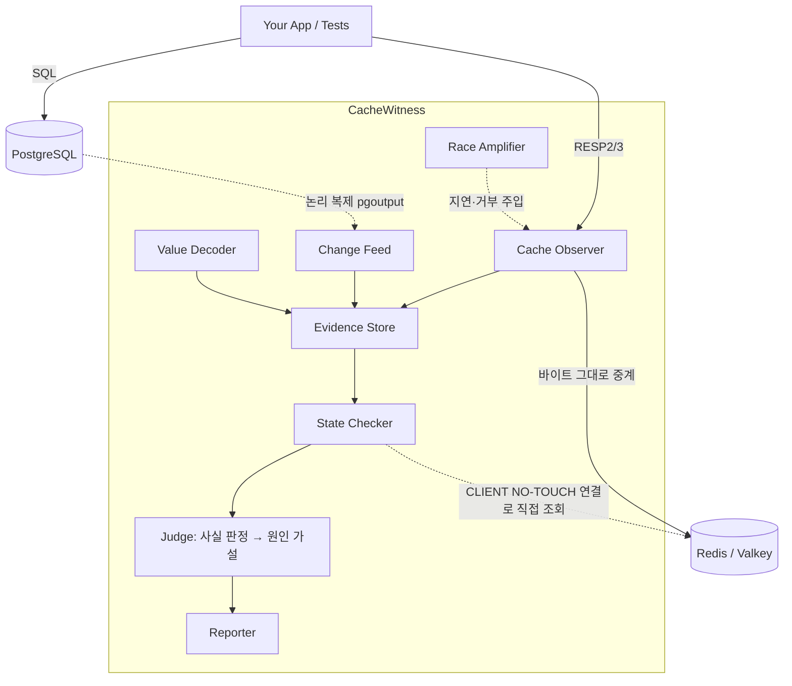

# CacheWitness 최종 개발 계획

확정일: 2026년 10월 15일
이전 버전: 2026년 10월 14일 개발 계획서 (외부 검토 2건 반영 전)
개정: 2026년 10월 15일 — 3차 검토 반영, 프로토타입 소스 검토 결과 반영
개정: 2026년 10월 16일 — **제품 정의 변경** (0·1단계 실측 결과에 따라, 사용자 결정)

> 이 문서는 10월 14일 계획서를 대체한다. 세 차례의 독립 검토에서 **타당하다고 판단한 지적만** 반영했고, 받아들이지 않은 지적과 그 이유는 16장에 남겼다. 구현 중 이 문서와 충돌하는 결정을 내리면, 이 문서를 먼저 고친다.

---

## 0. 이전 계획 대비 핵심 변경

| 영역 | 10월 14일 계획 | 확정 계획 | 근거 |
|---|---|---|---|
| 제품 약속 | 불일치를 탐지하고 **원인을 설명**한다 | 불일치는 **확정**하고, 원인은 **증거와 함께 가설로** 제시한다 | 프록시와 CDC만으로는 원인이 다른 실행들이 같은 관측 기록을 남긴다 (6.1) |
| 판정 구조 | 원인 분류표 7단계 + 신뢰도(높음·보통·낮음) | 사실 판정 계층 + 원인 가설 계층, 상태는 `UNKNOWN → SUSPECTED → CONFIRMED` | 관측하지 못한 것을 근거로 원인을 확정하지 않는다 |
| CI 결과 | 통과 / 실패 | 통과 / 실패 / **판정 불가(INCONCLUSIVE)** | 관측 범위 밖의 쓰기가 있으면 "정상"이라고 말할 수 없다 |
| 시간 | 이벤트마다 시각 하나 | 이벤트마다 **시간 구간**, 겹치면 `ORDER_UNCERTAIN` | 서로 다른 시스템 사이의 순서는 하나의 시각으로 확정되지 않는다 |
| 허용 기준 | `ttl_tolerance` 하나 + 유예 시간 300ms | `max_staleness`, `observation_grace`, 만료 정책을 분리 | 서비스의 허용치와 도구의 관찰 지연이 섞여 있었다 |
| CI 모드 | 기존 통합 테스트를 감싸 경쟁까지 탐지 | **check 모드**(결정적 버그)와 **race 모드**(부하 + 증폭)로 분리 | 순차 실행 테스트에서는 경쟁 조건이 생기지 않는다 |
| 원인 유형 | 7종 | + 롤백된 쓰기의 잔존, 부정 캐시(negative cache) 잔존, 부분 무효화, write-through 순서 역전 | 검토에서 누락으로 지적됨. 잘못된 키 무효화는 원인 판정이 아니라 증거 줄로만 보여준다 |
| 범위 | v1.0에 MySQL, Redis Cluster, Hash·msgpack·gzip, SARIF, 운영 지표 | PostgreSQL + Redis/Valkey 단일 노드 + JSON + 1:1 매핑에서 정확성부터 증명 | 1인 개발에서 조합 테스트 비용이 기능 구현 비용보다 크다 |
| 데이터 노출 | 보고서에 DB 행과 캐시 값을 그대로 기록 | 기본값은 값 가림(redact), 명시적으로 켤 때만 원본 출력 | 기업 도입의 차단 요인 |
| 관측 완전성 | 근거 없이 "모든 쓰기가 프록시를 지난다"고 가정 | Redis keyspace notifications를 2차 관측 채널로 두고 프록시 기록과 교차 검증 | 프록시를 우회한 쓰기는 프록시가 볼 수 없다 (9.1) |
| 판정 시점 | 커밋 + 유예 시간(300ms) | 양쪽 관측 채널의 **진행 표시(watermark)**가 판정 시점을 넘은 뒤에만 판정 | 수집 지연에 따라 판정이 흔들리지 않게 한다 (9.5) |
| 테스트 DB 수명주기 | DB 하나를 전제 | TRUNCATE, DB 재생성, 병렬 테스트 워커 처리 | check 모드가 실제 테스트 스위트에 붙기 위한 조건 (7.1, 9.2) |
| 종료 코드 | 성공 / 실패 | 0 통과 / 1 실패 / 2 판정 불가, 판정 불가 처리는 정책으로 선택 | CI에서 세 상태가 두 상태로 접히는 문제 (9.6) |
| 앱 코드 무수정의 범위 (1단계 실측) | 탐지·재현·위험 정량화 모두 무수정 | **낡은 상태 탐지와 경쟁 재현은 무수정. 위험 정량화(낡은 값이 남을 확률)는 현재 앱의 재충전 경로에 지연 훅이 필요하다** | Redis 연결을 공유하는 클라이언트에서 프록시 증폭기는 위험을 최대 10~30배 부풀렸다 (9.9, `docs/design/phase1-results.md` 5.6). 무수정 정량화의 후보(DB 쪽 선택 지연)는 미검증 |
| **제품 정의 (2026-10-16)** | 앱 코드 수정 없이 캐시 불일치를 확정하는 탐지 도구 | **캐시 동시성 버그를 순서까지 통제해 재현하고, 고친 뒤 고쳐졌음을 증명하는 테스트 도구.** 낡은 상태 탐지(관측 엔진)는 보조 기능 | 실제 앱(Twenty)에서 결정적 무효화 누락은 드물었고(1,528건 중 1건), 확률적 위험 측정은 실행마다 갈렸다(같은 조건 6.5% 대 0.17%). 동기화 지점으로 순서를 강제하자 수정 전 20/20 실패, 올바른 수정 20/20 통과였고, 그럴듯한 수정 두 개를 걸러냈다 (`docs/design/phase1-results.md` 5.7·5.8) |
| 일정 | 9개월, 5단계 | **관문(gate)을 통과해야 다음 단계로 가는** 6단계, 약 38주 + 여유분 | 가장 큰 불확실성을 가장 싸게 먼저 제거한다 |

---

## 1. 개요

**CacheWitness**는 PostgreSQL + Redis 애플리케이션의 **캐시 동시성 버그를 순서까지 통제해 재현하고, 고친 뒤 고쳐졌음을 CI에서 증명**하는 Rust 오픈소스 테스트 도구다.

- **한 줄 정의**: "캐시 경쟁을 매번 같은 순서로 일으키고, 수정이 그 경쟁을 정말 막는지 증명하는 도구"
- **주력 기능 (verify 모드)**: 앱의 캐시 재충전 경로에 작은 **동기화 훅**을 걸고, 시나리오 실행기가 요청의 순서를 강제한다(예: 리더가 DB를 읽은 직후 멈춤 → 라이터가 커밋·무효화 → 리더 해제). 결과는 Redis와 DB를 대조해 판정한다. 확률이 아니라 매번 같은 결과가 나오므로 CI 회귀 테스트로 쓸 수 있다.
- **보조 기능 (check 모드)**: Redis 프로토콜 관찰 프록시 + PostgreSQL 논리 복제 스트림으로, 앱 코드 수정 없이 낡은 캐시 상태를 사실로 확정한다.
- **대상**: 캐시 라이브러리·ORM 개발자, 캐시 코드를 직접 짜는 팀.
- **1차 용도**: CI에서의 회귀 테스트와 수정 검증.
- **하지 않는 것**: 운영 환경 상시 감시(별도 후속 제품으로 분리), 캐시 자동 수정, 캐시 대체.
- **기간**: 관문 6개, 약 38주 + 여유분. 매 관문에서 중단·전환 여부를 다시 판단한다 (13장).

**이름 체계** (ripgrep이 명령어로 `rg`를 쓰는 것과 같은 방식)

| 용도 | 이름 |
|---|---|
| 프로젝트, 저장소, README 제목 | CacheWitness |
| CLI 명령, 바이너리 | `cawit` |
| crate | `cawit`, 내부 크레이트는 `cawit-*` (8.2) |
| npm 패키지 (바이너리 배포용) | `cawit` |
| 설정 파일 | `cawit.yaml` |
| 환경 변수 | `CAWIT_*` |

2026-10-15 기준 `cawit`과 `cachewitness`는 crates.io와 npm에서 비어 있고, `cawit`은 PyPI와 Homebrew에도 없다. **GitHub의 `cawit`은 다른 사람의 개인 계정이 이미 쓰고 있다** (2011년 생성, 공개 저장소 0개). 그래서 GitHub Action은 `cawit/action`으로 둘 수 없고, 조직을 만든다면 `cachewitness`를 쓴다.

---

## 2. 주제와 동기

### 2.1 주제를 고른 과정

이 주제는 "Rust로 다시 짠다"가 아니라 **"왜 지금까지 이걸 자동으로 해주는 도구가 없었나"**라는 기준으로 후보 30여 개를 걸러낸 끝에 남았다.

1. **1차 탐색**: 개발도구, 데이터·인프라, 문서·미디어, 산업 버티컬, AI·임베디드 5개 영역을 조사했다. "빠른 재작성" 자리는 uv, Polars, RustFS 등이 이미 차지하고 있었다.
2. **기준 변경**: 성능 우위 대신 **"기존 시스템을 대체하지 않고, 그 위에서 결과가 맞는지 검증한다"**로 방향을 바꿨다.
3. **선택**: 남은 후보 9개 중 CacheWitness만 "빅테크가 사내에 만들었지만 오픈소스는 없다"는 패턴에 해당했다. Meta는 Polaris와 일관성 추적 도구를 사내에 만들었고, Uber는 DB와 캐시의 행 타임스탬프로 캐시 신선도를 사내에서 측정한다.
4. **검증**: 장애 사례 21건 수집, 경쟁·수요 조사, 약 970줄 프로토타입 실험. 다만 이 단계의 결론은 13장의 0~1단계 관문에서 **다시** 검증한다.

### 2.2 왜 이 문제인가

- **누구나 겪는다**: 캐시를 DB 앞에 두는 cache-aside 구조는 웹 백엔드의 기본값이다.
- **조용히 틀린다**: 에러도 지연도 없어서 APM·모니터링에 잡히지 않는다. 공개 사례 21건 중 9건(43%)은 고객·사용자 신고로 발견됐다.
- **오래간다**: 에러형 장애는 16분~5.5시간 만에 잡혔지만, 조용한 불일치는 며칠에서 수년간 지속된 사례가 있다.
- **원인 추적이 비싸다**: ms 단위 경쟁 조건은 로그로 재구성하기 어렵다.
- **대응이 우회책에 머문다**: 대부분의 회고는 "TTL 단축"이나 "캐시 제거"로 끝난다.

**알려진 사실과 새로 제공하는 가치를 구분한다.** "커밋 후 DEL"이 stale-set 경쟁을 만든다는 것은 2013년 Facebook memcache 논문(lease) 이후 알려진 사실이다. CacheWitness가 새로 주는 것은 이 지식이 아니라, **그 문제가 여러분의 코드에서 실제로 일어나는지를 증거로 보여주는 능력**이다. 홍보와 글은 이 구분을 지킨다.

### 2.3 개발자 관점의 동기

- 실시간 게이트웨이(wsPrism)를 만들며 쌓은 프로토콜 프록시와 Tokio 비동기 스트리밍 경험을 쓸 수 있다.
- 범용 게이트웨이는 레드오션이지만, **"프록시 자리에서 정확성을 검증한다"**는 자리는 비어 있다.
- 두 프로젝트가 공유하는 것은 기술 기반(tokio, 프록시 설계 경험)이지 제품 기능이 아니다. 시간 배분은 17장의 열린 질문으로 남긴다.

---

## 3. 문제 정의

### 3.1 불일치의 정의

키 `k`가 행 `r`에 매핑되어 있다고 하자. `r`의 커밋된 버전을 `v1, v2, …`, 최신 버전 `vn`의 커밋 시각을 `Tc`라고 한다.

- **낡은 상태(stale state)**: `Tc + max_staleness` 이후에도 캐시에 있는 `k`의 값이 `vn`이 아닌 버전과만 일치하는 상태.
- **낡은 읽기(stale read served)**: `Tc + max_staleness` 이후의 GET 히트가 `vn`이 아닌 버전의 값을 돌려준 사건.
- **불명 값(unknown value)**: 캐시 값이 관측된 어떤 커밋 버전과도 일치하지 않는 상태. 관찰 시작 전 값, 롤백된 트랜잭션의 값, 매핑 오류 가운데 하나다.

**사용자 피해는 낡은 읽기로 나타난다.** 낡은 상태는 원인 분석의 출발점이고, 낡은 읽기 횟수는 피해의 크기다. 둘 다 측정한다.

### 3.2 불일치의 유형

| 유형 | 발생 메커니즘 | 공개 사례 | v0 탐지 |
|---|---|---|---|
| 무효화 누락 | DB를 바꾼 코드 경로 중 하나가 캐시를 지우지 않음 | Tithe.ly, PyPI | 가설 |
| 잘못된 키 무효화 | 캐시 키와 다른 키(접두사, 버전 등)를 지움 | — (신규) | 원인 판정 없이 증거 줄로만 표시 |
| 부분 무효화 | 한 행에 묶인 여러 키 중 일부만 지움 | — (신규) | 가설 |
| 무효화 실패 | DEL이 네트워크·권한·OOM으로 실패했는데 재시도 없음 | Meta, PostHog, WordPress #40052 | **확정** |
| stale-set 경쟁 | 리더가 옛 값을 읽음 → 라이터가 커밋·DEL → 리더가 옛 값을 SET | Jira DC, django-cachalot | 구버전 SET은 확정, 경쟁은 가설 |
| 커밋 전 무효화 | 커밋 전에 DEL → 다른 요청이 옛 값으로 재충전 | Drizzle ORM #5828 | 순서는 확정, 인과는 가설 |
| 복제 지연 재충전 | DEL 후 지연된 레플리카에서 읽어 옛 값을 채움 | Uber CacheFront | 구버전 SET은 확정, 원인은 가설 |
| 롤백된 쓰기의 잔존 | 커밋 전에 캐시를 채웠는데 트랜잭션이 롤백됨 | — (신규) | 불명 값으로 가설 |
| 부정 캐시 잔존 | "없음"을 캐시한 뒤 행이 INSERT됨 | — (신규) | 매핑에 부정 값 정의 시 확정 |
| write-through 순서 역전 | 새 버전의 SET 뒤에 옛 버전의 SET이 도착함 | — (신규) | 확정 |
| 직렬화·버전 불일치 | 배포 중 캐시 포맷이 바뀜 | Slack 2023, GitLab, Onfido | 범위 밖 (v1 이후) |
| 다계층 전파 실패 | CDN·L1·리전 간 무효화가 일부만 도달 | Wikimedia, Twitter 2008 | 범위 밖 |

**알려진 한계**: 공개 사례에서 가장 많은 유형인 직렬화 불일치는 v0에서 다루지 않는다. 13장 1단계에서 "공개 사례 21건 중 v0가 잡을 수 있었던 건수"를 세어 이 문서에 기록한다.

---

## 4. 시장과 경쟁

### 4.1 기존 도구

| 도구 | 하는 일 | 공개 여부 | CacheWitness와의 차이 |
|---|---|---|---|
| Meta Polaris | 무효화 이벤트 후 캐시를 조회해 클라이언트가 관찰할 수 있는 불일치를 측정 | 사내 전용 | 같은 개념의 오픈소스판 |
| Uber CacheFront | DB와 캐시의 행 타임스탬프 차이로 신선도 측정 ("Cache Inspector"라는 이름과 "TTL 24시간" 수치는 원문 미확인) | 사내 전용 | 원인 증거와 경쟁 재현 |
| [Cachet](https://github.com/Abhishek-Mallick/cachet) | 샤딩 OLTP용 통합 읽기 캐시가 스스로의 정합성을 검증 | Apache-2.0 | 자기 캐시만 검증한다. 기존 앱의 Redis에는 붙지 않는다 |
| Readyset, pgcache | 복제 스트림으로 캐시를 직접 유지 | 일부 공개 | 예방형. 캐시를 교체해야 한다 |
| Debezium, Redis RDI | CDC로 캐시 무효화 | 공개 | 무효화만 하고 검증은 하지 않는다 |
| 재조정 배치 (Kestra 블루프린트 등) | DB 키 기준으로 Redis를 조회해 비교 | 공개·직접 구현 | 사실 탐지는 비슷하지만, 증거 타임라인과 경쟁 재현은 없다 |
| Datadog, RedisInsight | 히트율·지연·메모리 | 상용 | 정확성은 보지 않는다 |

**차별점은 탐지가 아니라 증거와 재현이다.** "캐시와 DB가 다르다"는 사실만 원하면 재조정 배치를 하루면 짤 수 있다. CacheWitness가 존재할 이유는 (1) 위반이 생기기까지의 이벤트 증거와 (2) CI에서 경쟁을 의도적으로 재현하는 기능, 둘뿐이다. 따라서 판정이 틀리면 존재 이유가 사라진다. 6장의 원칙이 엄격한 이유다.

**Cachet과의 관계**: Cachet README는 "프록시는 쓰기가 무엇을 건드렸는지 추론할 뿐"이라는 취지로 프록시 방식을 비판한다. CacheWitness는 DB 쪽 사실을 프록시가 아니라 논리 복제로 얻으므로 이 비판을 피한다. 메인테이너와는 경쟁보다 상호 링크를 모색한다.

### 4.2 수요 판단

- **고통은 실재한다**: 사내 도구를 만든 빅테크 사례가 있고, Redis 공식 블로그도 "검증 경로는 각자 추가하라"고 안내한다.
- **하지만 개발자가 도구를 찾지는 않는다**: 반응의 상당수가 "TTL을 짧게", "CDC로 무효화하면 끝"이다.
- **결론**: 수요의 질은 중간이고 양은 약하다. 시작점은 "도구가 필요하다"는 설득이 아니라, **"여러분의 코드에서, 여러분이 정한 정책을 위반하는 일이 실제로 일어난다"는 증명**이다.

### 4.3 사용자: 첫 실험 사용자와 최종 고객을 구분한다

| 순서 | 대상 | 이유 |
|---|---|---|
| 첫 실험 사용자 ① | 캐시 라이브러리·ORM 메인테이너 (Drizzle, cache-manager, cachalot 등) | 값 포맷을 그들이 정해서 매핑이 쉽고, 테스트 스위트가 있으며, 이미 기록된 버그가 있다. 한 번 고치면 그 라이브러리의 모든 사용자에게 효과가 퍼진다 |
| 첫 실험 사용자 ② | cache-aside를 직접 구현한 오픈소스 백엔드, JSON 직렬화 생태계(Node/TS) 우선 | 코드와 테스트 환경에 접근하기 쉽고, v0의 JSON 디코더로 읽을 수 있다 |
| 최종 고객 ① | 엔지니어 50~500명 규모, PostgreSQL + Redis cache-aside를 직접 짠 팀 | 가격·권한·피처 플래그·상품 상세처럼 낡은 값이 곧 손실인 데이터 |
| 최종 고객 ② | 플랫폼·SRE 팀 | TTL 연장 근거, 인프라 전환(Redis→Valkey, 레플리카 도입) 시 회귀 검사 |
| 대상 아님 | TTL이 짧아도 되는 소규모 서비스, 관리형 캐시(Readyset·RDI) 사용 팀, 초기의 금융권 핵심 인프라 팀 | 권한·보안 승인 비용이 초기 단계에 맞지 않는다 |

잔액은 대개 캐시하지 않는다. 재고는 Redis가 원본(DECR)인 경우가 많아 cache-aside가 아니다. 대표 예시에서 뺀다.

---

## 5. 사전 검증 결과: 무엇이 입증되었나

실험 환경: 2코어·7GB Linux 컨테이너, PostgreSQL 16(`wal_level=logical`, test_decoding 폴링), Redis 7.0, node-redis 6.3(RESP3), 유예 시간 300ms.

### 5.1 입증된 것

- **표준 cache-aside에서도 경쟁이 실제로 발생한다.** 핫키 200개, 워커 32개, 20초 실행에서 읽기 82,024건, 쓰기 35,182건, 캐시 채우기 27,128건이 발생했다. **끝까지 남은 불일치 3건**은 별도 오라클(`natural.js`가 실행 종료 후 Redis와 DB를 직접 비교)이 확인했고, 프로토타입은 3건을 모두 탐지했다. 쓰기 1,000건당 약 0.085건이다.
- **"stale-set 경쟁 41건(38개 키)"은 도구 자신이 센 숫자다.** 프로토타입 소스를 검토한 결과, 오라클은 종료 시점만 비교하므로 41건은 독립적으로 확인되지 않았다(쓰기 1,000건당 약 1.2건). 0단계에서 정답 하네스로 다시 센다.
- **관찰 로직 자체의 비용은 단순 중계 프록시와 측정 노이즈 범위 안에서 구분되지 않았다.** 상주 메모리는 25MB, 바이너리는 2.4MB였다.

### 5.2 아직 입증되지 않은 것

| 질문 | 현재 상태 | 해소 단계 |
|---|---|---|
| 원인 분류가 독립적인 정답과 일치하는가 | 주입 시나리오와 규칙을 같은 사람이 만들었다. **0단계 결과: 버그 없는 환경에서 원인의 13%를 틀리게 단정했다. 낡은 상태 탐지는 종료 시점 낡은 키 157개를 모두 잡았다** (`docs/design/phase0-results.md`) | 0단계 |
| 멀티플렉싱 클라이언트에서 요청 귀속이 성립하는가 | **소스 확인 결과, `natural.js`는 워커 32개가 node-redis 연결 8개를 나눠 쓴다(연결당 4개).** 보고서의 "conn 2가 커밋 전에 읽음"은 같은 연결의 다른 워커일 수 있다. `harness.js`도 리더 클라이언트 하나를 동시 작업 16개가 공유한다 | 0단계 |
| stale-set 경쟁의 실제 발생 횟수 | 41건은 도구가 센 값이고 오라클은 종료 시점만 비교했다. **0단계 결과: 도구는 폴링 지연 때문에 실제 옛 값 SET의 3~50%만 셌다. 과대가 아니라 과소 집계였다** | 0단계 |
| 주입 시나리오가 분류 규칙과 독립적인가 | `replica_lag` 시나리오는 DEL 이전에 읽어 둔 값을 DEL 이후 미스 뒤에 쓰는 방식으로, 규칙 4번의 조건을 그대로 재현하도록 만들어져 있다 | 0단계 |
| 실제로 클라이언트가 낡은 값을 몇 번 받았는가 | 집계하지 않았다 | 0단계 |
| 현실적인 읽기:쓰기 비율에서 얼마나 발생하는가 | 실험 비율은 약 2.3:1로, 경쟁을 강하게 유발하는 조건이다 | 0단계 |
| 실제 애플리케이션에 매핑할 수 있는가 | 측정하지 않았다 | 1단계 |
| 주입 버그 테스트의 precision·recall | 의도한 버그와 실제 발생한 버그를 구분한 confusion matrix가 없다 (stale-set 1건은 경쟁이 발생하지 않았으므로 39/39로 집계해야 한다) | 0단계 |
| 다른 환경에서의 프록시 오버헤드 | 클라이언트·프록시·Redis가 2코어를 나눠 쓴 조건이다 | 2단계 |

### 5.3 프록시 비용의 정확한 해석

| 비교 | GET p50 | GET p99 | 처리량 (파이프라인 1) | 처리량 (파이프라인 16) |
|---|---|---|---|---|
| Redis 직접 → CacheWitness | 0.28 → 0.74ms (**+164%**) | 1.60 → 2.67ms (**+67%**) | 84k → 49k/s (**−42%**) | 624k → 380k/s (**−39%**) |
| 단순 중계 → CacheWitness | +1.4% | 차이 없음 | 45k → 49k/s (+9%, 노이즈) | 416k → 380k/s (−9%, 노이즈와 구분 불가) |

**결론**: 프록시를 한 단계 거치는 비용은 크다. 관찰 로직이 추가하는 비용은 이 측정으로는 판단할 수 없을 만큼 작다. CI·스테이징 도구로는 수용 가능하지만, 이 데이터로 운영용 저지연 프록시로서의 경쟁력을 주장하지 않는다.

### 5.4 데모 메시지 (수정)

- 쓰지 않는 표현: "교과서 코드가 20초에 41번 틀린다". 일반 서비스의 발생률처럼 읽힌다.
- 쓰는 표현: **"경쟁을 유발하도록 구성한 부하에서, 교과서대로 짠 cache-aside가 낡은 값을 다시 써넣었고, 그중 일부는 끝까지 남았다. 그 증거를 보여준다."** 발생률 수치는 0단계에서 정답 하네스로 다시 잰 값만 쓴다. 읽기:쓰기 비율별 발생률 곡선을 함께 공개한다.
- **관찰자 효과를 함께 적는다.** 프록시가 명령마다 0.3~0.5ms를 더하므로 경쟁 창의 크기가 달라진다. CacheWitness로 측정한 발생률은 운영 환경의 발생률이 아니다. 보고서에도 이 문구를 넣는다.

---

## 6. 제품 정의와 설계 원칙

### 6.1 제품이 약속하는 것

**2026-10-16 개정.** 주력 약속은 verify 모드다.

| 구분 | 내용 |
|---|---|
| **재현한다 (verify, 주력)** | 알려진 캐시 경쟁 패턴(stale-set, 커밋 전 무효화, 무효화 실패 등)을 동기화 훅으로 **매번 같은 순서로** 일으킨다. 훅에 실제로 도달했는지 매번 확인한다(조작 확인) |
| **증명한다 (verify, 주력)** | 같은 시나리오에서 수정 전은 실패하고 수정 후는 통과함을 보인다. 낡은 값이 남지 않을 뿐 아니라, 캐시가 다시 최신 값으로 채워지는지(수정이 캐시를 아예 막지는 않는지)도 확인한다 |
| **약속하지 않는다 (verify)** | 모르는 경쟁을 찾아내는 것. verify는 알려진 순서를 강제하는 회귀 테스트다. 운영 환경에서의 발생 확률 |

아래는 보조 기능인 check 모드(관측 엔진)의 약속이다.

| 구분 | 내용 |
|---|---|
| **확정한다** | 캐시 값이 DB의 어느 커밋 버전과 일치하는지, 그 상태가 허용 시간을 넘겼는지, 낡은 값이 몇 번 읽혔는지, 관찰된 명령의 실행 결과(성공·거부·취소), 시간 구간이 겹치지 않는 이벤트 사이의 순서 |
| **증거와 함께 가설로 제시한다** | 왜 그 값이 들어왔는가 (경쟁, 복제 지연, 오래 열린 스냅샷, 무효화 누락 등) |
| **약속하지 않는다** | 관측하지 못한 애플리케이션 내부의 인과관계(어느 SQL 결과가 어느 SET이 됐는지)를 무수정 모드에서 확정하는 것 |

**왜 원인 확정을 약속하지 않는가.** 다음 두 실행은 프록시와 primary CDC에 똑같은 기록을 남긴다.

```
t1  conn A  GET k → nil
t2  DB      COMMIT v2
t3  conn B  DEL k
t4  conn A  SET k v1
```

- 실행 1: A가 t2 **전에** primary에서 v1을 읽었다 → stale-set 경쟁
- 실행 2: A가 t2 **후에** 지연된 레플리카에서 v1을 읽었다 → 복제 지연 재충전

관측 기록이 같으면 어떤 알고리즘으로도 둘을 구분할 수 없다. 같은 기록을 남기는 원인은 이 둘만이 아니다.

- **오래 열린 스냅샷**: REPEATABLE READ 이상의 격리 수준에서는 커밋 이후에 읽어도 이전 스냅샷의 값이 나온다.
- **앱 내부 L1 캐시**: 프로세스 메모리에 남은 낡은 값으로 Redis를 다시 채운다.

보고서의 "배제 불가" 목록은 이 구분 불가 집합 전체를 기준으로 쓴다. Redis 레플리카에서 읽는 앱은 **범위 밖**이다. 검사기는 마스터를 조회하므로 낡은 읽기 횟수가 맞지 않는다.
 이는 알고리즘의 성능 문제가 아니라 관측 가능성의 한계다. 게다가 커넥션 풀에서는 한 요청의 GET과 SET이 서로 다른 연결로 가고, 멀티플렉싱 클라이언트(node-redis, ioredis, Lettuce 기본 설정)에서는 한 연결에 여러 요청이 섞인다. 그래서 "같은 연결의 GET miss 다음 SET이니 같은 요청"이라는 추론도 확정할 수 없다.

### 6.2 설계 원칙

1. **관찰한 사실과 추론을 분리한다.** 보고서는 언제나 "확정된 사실", "원인 가설", "부족한 증거" 세 칸으로 나뉜다.
2. **모르면 모른다고 말한다.** 원인의 기본 상태는 `UNKNOWN`이다. 증거가 쌓이면 `SUSPECTED`로, 관측만으로 증명할 수 있을 때만 `CONFIRMED`로 올린다. "관측되지 않았다"는 사실만으로 원인을 확정하지 않는다.
3. **관측 범위를 데이터로 표현하고, 그 근거를 따로 관측한다.** 키마다 관측 상태(9.6)를 둔다. `COMPLETE`는 가정이 아니라 keyspace notifications와 프록시 기록의 교차 검증으로 얻는다(9.1). 탐지하지 못했다는 이유로 "정상"이라고 보고하지 않는다.
4. **시간은 구간이다.** 모든 이벤트는 `[t_min, t_max]`로 기록하고, 구간이 겹치면 순서를 확정하지 않는다. 판정은 시간이 아니라 진행 표시(watermark)를 기준으로 한다(9.5).
5. **서비스 정책과 도구 사정을 섞지 않는다.** `max_staleness`(서비스가 허용하는 낡음), `observation_grace`(도구가 CDC 지연 등을 기다리는 시간), 만료 정책은 별개의 설정이다.
6. **데이터 노출을 최소화한다.** 보고서 기본값은 값 가림이다.
7. **경계를 먼저 만든다.** 디코더, 변경 수집기, 명령 해석기, 판정 규칙, 보고서 형식은 트레이트와 레지스트리 뒤에 둔다. MySQL, msgpack, Cluster 같은 확장이 코어 경로를 고치지 않고 붙도록 한다 (8.2).
8. **관찰자는 관찰 대상을 바꾸지 않는다.** 검사 연결은 `CLIENT NO-TOUCH`로 LRU/LFU 통계를 건드리지 않고, 검사량을 제한하고 측정한다.

### 6.3 비목표

- 캐시 일관성을 직접 보장하거나 자동으로 수정하지 않는다 (Readyset·RDI의 영역).
- 캐시를 대체하지 않는다 (Cachet의 영역).
- 범용 Redis 프록시(샤딩, 커넥션 풀링)가 되지 않는다.
- v1.0까지 운영 환경 상시 감시, CDN·브라우저·프로세스 내부 캐시, 목록·집계 캐시는 다루지 않는다.

---

## 7. 사용 모드

**2026-10-16 개정.** verify 모드가 주력이다. race 모드의 확률적 위험 측정은 하지 않는다(실행마다 결과가 갈려 CI에서 쓸 수 없다). 프록시 증폭기는 "경쟁이 생길 수 있는가"를 보는 탐색용으로만 남긴다.

| 모드 | 명령 | 무엇을 잡는가 | 전제 조건 | 단계 |
|---|---|---|---|---|
| **verify (주력)** | `cawit verify <시나리오>` | 알려진 캐시 경쟁 패턴의 결정적 재현, 수정 전 실패·수정 후 통과 증명 | 앱 재충전 경로에 동기화 훅 (언어별 작은 라이브러리) | v0.1 |
| **check (보조)** | `cawit check -- <테스트 명령>` | 결정적 버그: 무효화 누락·실패, 부분 무효화, write-through 순서 역전, 롤백된 쓰기의 잔존, 부정 캐시 잔존 | 테스트가 실제로 커밋해야 한다 | v0.3 |
| ~~race~~ | — | 확률적 위험 측정은 하지 않는다. 프록시 증폭기는 탐색용(경쟁 가능성 확인)으로만 v0.3 이후 검토 | — | 축소 |
| 운영 감시 | — | 신선도 SLO | — | 별도 후속 제품 |

### 7.1 check 모드가 전제를 확인하는 방법

- **트랜잭션 롤백 테스트**(Django `TestCase`, Rails transactional tests, Spring `@Transactional` 테스트)는 커밋이 없으니 WAL에 아무것도 나오지 않는다. 캐시 SET은 관찰되는데 커밋이 하나도 없으면 "롤백 방식 테스트로 보임"을 경고하고, 결과를 `INCONCLUSIVE`로 둔다. 프레임워크별로 커밋하는 테스트로 바꾸는 방법(`TransactionTestCase` 등)을 안내한다.
- **순차 테스트**에서는 경쟁이 생기지 않는다. check 모드는 경쟁 탐지를 약속하지 않고, 보고서에 "경쟁 조건은 race 모드에서 검증"이라고 적는다.
- **테스트 DB 수명주기**: 테스트 사이의 `TRUNCATE`는 테이블 전체 tombstone으로 처리한다. Django의 `test_<name>` 생성이나 Prisma `migrate reset`처럼 DB가 새로 만들어지면, DB가 준비된 뒤에 슬롯과 publication을 붙이고(attach-on-ready) 관측 기준점을 새로 잡는다(9.2).
- **병렬 테스트 워커**: Django `--parallel`, pytest-xdist, Jest 워커는 워커마다 DB 사본, Redis DB 번호, 키 접두사를 따로 쓴다. 이름 패턴에 맞는 DB마다 관측을 붙이고, 키 템플릿에 워커 변수(`{worker}`)를 둔다(9.3).

### 7.2 verify 모드의 구성

1단계 실험(`sync.sh`, `sync-scenario.js`, 지금은 git 기록에만 있음)이 원형이고, 2단계에서 `cawit verify` + `lab/twenty/verify.sh`로 대체했다.

- **동기화 훅**: 앱의 캐시 재충전 경로에서 "DB를 읽은 직후"에 거는 함수 하나 (`cawit.syncPoint("refill:after-read", key)`). 평소에는 아무것도 하지 않고, 실행기가 장전했을 때만 신호를 보내고 해제를 기다린다. 신호는 테스트용 Redis 리스트로 주고받는다(언어와 무관). 첫 대상은 Node/TS, 다음은 Python.
- **시나리오 실행기**: 요청과 대기를 순서대로 적은 시나리오를 실행한다. 예: "서버 A에 쓰기 → 장전 → A에 읽기 → 훅 도달 대기 → 서버 B에 쓰기 → 해제 → 판정 → 한 번 더 읽고 재충전 확인". 기본 시나리오 라이브러리(stale-set, 커밋 전 무효화, 무효화 실패 후 미회복, 레플리카 지연 재충전)를 제공한다.
- **판정**: 끝난 뒤 Redis 값과 DB 값을 비교한다. 기대 결과를 시나리오가 알고 있으므로 판정은 단순하다. 관측 엔진(MONITOR·keyspace 알림, WAL)은 실패했을 때 "어떤 순서로 무슨 일이 있었나"를 보여주는 설명 도구로 쓴다.
- **조작 확인**: 훅에 도달하지 않은 회차는 결과를 버린다(`NOT_REACHED`).
- **경쟁 도구와의 관계**: 범용 결정적 동시성 테스트 도구(JVM의 Lincheck·Fray, .NET의 Coyote, RocksDB의 SyncPoint, TiKV의 fail-rs, Go의 failpoint)가 있다. CacheWitness의 차별점은 실제 DB와 Redis를 붙인 상태에서 요청 단위로 **캐시 경쟁 패턴**을 재현하고 판정하는, 캐시 특화 시나리오와 판정이다.

---

## 8. 아키텍처

### 8.1 구성



### 8.2 모듈 경계 (크레이트와 트레이트)

| 크레이트 | 책임 | 확장 경계 |
|---|---|---|
| `cawit-resp` | RESP2/3 증분 파서 | — |
| `cawit-observer` | 중계, 요청·응답 짝짓기, 명령 실행 결과 판정 | `CommandInterpreter` 레지스트리: 명령별로 영향받는 키와 결과를 해석. 새 명령은 등록만 한다 |
| `cawit-feed` | DB 변경 수집 | `ChangeFeed` 트레이트: PostgreSQL 구현, 이후 MySQL 구현 |
| `cawit-decode` | 캐시 값을 필드로 디코딩 | `ValueDecoder` 레지스트리: JSON 구현, 이후 pickle, Marshal, msgpack, WASM |
| `cawit-mapping` | 키 템플릿 ↔ 행, 필드 ↔ 컬럼 | — |
| `cawit-store` | 키별 이벤트·버전 보관, 메모리 상한 | — |
| `cawit-judge` | 사실 판정, 원인 가설 | `CauseRule` 레지스트리: 규칙마다 필요한 증거, 확정 조건, 가설 조건을 선언 |
| `cawit-amplify` | 지연·거부 주입, 결정 기록 | `Perturbation` 트레이트 |
| `cawit-report` | 터미널, JSONL, JUnit | `ReportSink` 트레이트, 값 가림 정책은 공통 계층에서 적용 |
| `cawit` | CLI 바이너리, 설정, 조립 | — |

### 8.3 이벤트 모델

모든 관측은 하나의 이벤트 형식으로 정규화한다.

```
Event {
  source:   Proxy(conn_id) | Feed | Checker | Amplifier
  kind:     Get | Set | Del | Expire | Commit | Check | ...
  keys:     [CacheKey { db_index, key }]
  interval: [t_min, t_max]          // 6.2 원칙 4
  outcome:  Applied | Rejected(err) | Queued | Aborted | Unknown
  version:  Option<RowVersion { lsn, pk, field_fingerprint }>
  detail:   명령별 부가 정보 (TTL, NX/XX, 히트·미스)
}
```

---

## 9. 핵심 설계 상세

### 9.1 Cache Observer

- **중계**: 바이트는 그대로 중계하고, 복사본만 파서에 넣는다.
- **fail-open의 정확한 의미**: 파싱에 실패해도 중계는 계속하되, 그 연결의 관측 상태를 `GAP_DETECTED`로 표시한다. 프록시 프로세스 자체가 죽으면 연결이 끊긴다. 그래서 1.0 전에는 운영 트래픽을 통과시키지 않는다.
- **요청·응답 짝짓기**: 연결별 FIFO. RESP3 push 프레임은 짝짓지 않고, attribute 프레임은 뒤따르는 응답에 붙인다.
- **"요청을 봤다"와 "상태가 바뀌었다"를 구분한다.**
  - `SET NX/XX`가 조건 불충족으로 nil을 돌려주면 변경이 아니다.
  - `MULTI` 안의 명령은 `QUEUED`로만 기록하고, `EXEC` 응답을 받은 뒤 각 결과에 따라 적용한다. `WATCH` 때문에 `EXEC`이 nil이면 모두 `Aborted`다.
  - `EVAL`, `FCALL`, 모듈 명령은 어떤 키를 바꿨는지 알 수 없다. 선언된 키(`numkeys`)를 `PARTIAL`로, 키를 알 수 없으면 해당 DB 전체를 `PARTIAL`로 표시한다.
  - TTL 만료와 eviction은 명령 없이 일어난다. 검사기의 직접 조회 결과로만 반영한다.
- **v0 명령 범위**: `GET`, `MGET`, `GETEX`, `GETDEL`, `SET`(EX/PX/EXAT/PXAT/NX/XX/KEEPTTL/GET), `SETEX`, `PSETEX`, `MSET`, `DEL`, `UNLINK`, `EXPIRE` 계열, `PERSIST`, `MULTI`/`EXEC`/`DISCARD`/`WATCH`, `SELECT`(DB 번호는 키 식별자의 일부), `FLUSHDB`/`FLUSHALL`(관측 기준점을 새로 시작). 해석기에 없는 쓰기 명령은 영향받을 수 있는 키를 `UNSUPPORTED`로 표시한다.
- **요청 귀속**: 연결 번호는 증거로만 쓰고, "같은 요청"이라고 단정하지 않는다. "같은 연결, 같은 키, 직전 미스"는 가설의 근거로만 쓴다.
- **다중 프록시**: 하지 않는다. 하나의 프록시가 원래 연결의 명령 순서를 보존하고, 내부 분석만 키별로 나눈다. 연결을 키별로 다른 인스턴스에 분산하면 파이프라인과 다중 키 명령의 의미가 깨진다.
- **TLS(`rediss://`)**: 프록시가 TLS를 종료해야 하므로 v0 범위 밖이다.

**2차 관측 채널: keyspace notifications**

프록시를 거치지 않는 쓰기(다른 서비스, 워커, 캐시 워머, Redis에 직접 넣는 테스트 픽스처)는 프록시가 볼 수 없다. 그래서 검사 연결에서 `notify-keyspace-events`를 켜고, 매핑된 키 패턴의 `__keyspace@<db>__:` 채널을 구독한다.

- **우회 쓰기 탐지**: 알림에는 클라이언트 ID, 시각, 값이 없다. 따라서 "어떤 쓰기가 우회했나"는 알 수 없고, **키별로 진행 표시가 닫힌 구간 안의 알림 수와 프록시가 관측한 적용 횟수를 맞춰 보는 방식**으로 우회의 존재만 탐지한다. 맞지 않으면 그 키를 `GAP_DETECTED(bypass)`로 표시하고, 값은 검사기가 다시 조회한다.
- **스크립트·모듈 명령**: `EVAL`·`FCALL` 안의 쓰기도 알림이 온다. 프록시가 관측한 스크립트의 실행 구간 안에 들어온 알림은 그 스크립트에 귀속시킨다. 그러면 "키를 모르면 DB 전체가 PARTIAL"이라는 규칙이 필요 없어진다.
- **만료와 eviction**: `expired`, `evicted` 이벤트로 직접 관측한다.
- **한계**: pub/sub이라 구독 연결이 끊긴 동안의 알림은 유실된다. 끊김 자체를 `GAP_DETECTED`로 기록한다. **우회하는 읽기는 알림이 오지 않으므로** 프록시를 거치지 않는 클라이언트의 낡은 읽기는 `STALE_READ_SERVED`에 잡히지 않는다. `CONFIG SET` 권한이 필요하므로 `doctor`가 점검하고, 종료할 때 원래 설정으로 되돌린다.

### 9.2 Change Feed (PostgreSQL)

- **수집 방식**: `pgoutput` 스트리밍 복제. 트랜잭션마다 commit LSN과 commit timestamp를 보관한다. 대용량 트랜잭션 스트리밍(`streaming`) 옵션은 요청하지 않는다. 파티션 테이블은 publication에 `publish_via_partition_root`를 켠다.
- **구현**: upstream `tokio-postgres`(0.7.18 기준)는 복제 프로토콜(CopyBoth)을 지원하지 않는다. 메시지 인코딩은 `postgres-protocol` 크레이트를 쓰고, 복제 연결, CopyBoth 스트림, 상태 보고, pgoutput 디코딩은 직접 구현한다. 일반 쿼리(`doctor`, 시계 추정, 스냅샷 읽기)는 `tokio-postgres`를 쓴다.
- **진행 표시**: pgoutput keepalive는 WAL 끝 위치와 서버 시각을 함께 보낸다. 그 위치까지 처리를 끝내면 그 서버 시각까지의 커밋은 모두 받은 것이다. 판정이 필요할 때는 즉시 응답 요청 플래그를 붙인 상태 보고로 keepalive를 당긴다.
- **슬롯**: v0는 **임시 슬롯만** 쓴다. 세션이 끝나면 비정상 종료라도 삭제된다. 실행 중에는 슬롯 지연(보존 중인 WAL 크기)을 감시하고, 상한을 넘으면 관측을 중단한 뒤 결과를 `INCONCLUSIVE`로 낸다. `max_slot_wal_keep_size` 기본값이 -1(무제한)이라는 점을 `doctor`가 알린다.
- **요구 권한과 설정**: `wal_level=logical`, REPLICATION 권한, publication(테이블 소유 권한 필요). `cawit doctor`가 하나씩 확인하고 무엇이 부족한지 알려준다. 그래서 "무수정"은 **앱 코드 무수정**이라는 뜻이고, DB 설정은 바뀔 수 있다고 문서에 명시한다.
- **최초 상태(baseline)**: 기본값은 관찰 시작 시점부터 추적하는 것이다. 이전 버전을 모르는 키는 `UNKNOWN_BASELINE`이다. 옵션으로, 작은 테이블에 한해 슬롯 생성 시 내보낸 스냅샷으로 초기 상태를 읽는다(`baseline: snapshot`). CI는 보통 빈 DB와 빈 Redis로 시작하므로 이 문제의 영향이 작다.
- **TOAST 미변경 컬럼**: `REPLICA IDENTITY FULL`이 아니면 바뀌지 않은 TOAST 값이 "unchanged"로 온다. 이전 버전이 있으면 병합하고, 없으면 그 필드를 "모름"으로 두고 비교에서 뺀다.
- **DELETE와 TRUNCATE**: DELETE는 tombstone 버전으로 기록한다. TRUNCATE는 pgoutput의 별도 Truncate 메시지로 오며, 테이블 전체 tombstone으로 처리한다. 행이 삭제됐는데 캐시에 값이 남아 있으면 낡은 상태다.
- **DB 재생성과 병렬 DB**: 논리 복제 슬롯과 publication은 DB 단위다. 설정한 이름 패턴(`test_app*` 등)의 DB가 생기면 준비된 뒤에 관측을 붙이고, DB가 지워지면 그 DB에 속한 키의 관측 기준점을 버린다. 관측이 붙기 전의 구간은 `GAP_DETECTED`다.
- **롤백**: 롤백된 트랜잭션은 WAL에 나오지 않는다. 그 트랜잭션이 채운 캐시 값은 어떤 커밋 버전과도 맞지 않는 "불명 값"으로 나타난다 (9.6).

### 9.3 매핑과 디코딩

```yaml
version: 1
redis:    { upstream: "redis://localhost:6379", listen: "127.0.0.1:6380" }
postgres: { url: "${DATABASE_URL}", slot: temporary, baseline: observe }

policy:
  default:
    mode: invalidate_on_write   # invalidate_on_write | write_through | ttl_only
    max_staleness: 500ms        # 서비스가 허용하는 최대 낡음
    observation_grace: 300ms    # 성능 튜닝 값: 진행 표시를 기다리기 시작하는 시점
    expiration: { required: true, max_ttl: 1h }
    fail_on: stale_state        # stale_state | stale_read  (낡은 상태로 실패 / 낡은 값이 읽혔을 때만 실패)

mappings:
  - key: "app:user:{id}"        # 접두사까지 포함한 실제 키 형식
    table: public.users
    pk: [id]
    value: { format: json }     # v0: json
    fields: { name: name, email: email, updatedAt: updated_at, "profile.city": city }  # 중첩 경로 표기
    ignore: [cachedAt]
    negative: { value: "null" } # 부정 캐시 표현 (선택)
    also_invalidates: ["app:user_by_email:{email}"]   # 같은 행에 묶인 다른 키 (부분 무효화 검사)

ci:
  inconclusive: warn           # warn | fail | pass
  min_coverage: 95%            # PASS로 판정하기 위한 관측 완전성 하한

report:
  values: redact                # redact | hash | show
  keys: show                    # show | hash
```

- **키 템플릿 변수**: `{id}` 같은 기본 키 변수 외에, 병렬 테스트 워커를 위한 `{worker}`를 둔다.
- **정책 모드**에 따라 판정이 달라진다. `ttl_only`에서는 커밋 후 DEL이 없는 것이 정상이고, `max_ttl` 안의 낡음은 정보 수준이다.
- **v0 디코더는 JSON뿐이다.** Django(pickle), Rails(Marshal), Spring(JDK 직렬화)의 기본 포맷은 읽지 못한다. 1단계 측정 결과로 다음 디코더를 정한다 (13장).
- **비교 규약**: 정수·소수·날짜·NULL·불리언의 정규화 규칙을 타입별로 문서화한다. 의미가 모호한 필드는 비교에서 빼도록 안내한다.
- **매핑할 수 없는 키**(목록·집계 캐시)는 보고서에 "미매핑"으로 따로 나열한다.
- **매핑 제안**: `cawit init`이 스키마와 샘플 트래픽으로 초안을 만든다 (v0.2).

### 9.4 버전 식별

- 버전은 `(pk, commit LSN)`으로 식별하고, 비교에는 매핑된 필드의 지문(fingerprint)을 쓴다.
- 캐시 값과 맞는 버전이 여러 개일 수 있다. 필드 값이 v1 → v2 → v3에서 다시 v1과 같아지는 경우(ABA)다. 이때는 **후보 집합**으로 다룬다.
  - 최신 버전이 후보에 있으면 현재 상태는 정상이다.
  - 과거 시점의 판정(타임라인)은 "모호"로 표시한다.

### 9.5 시간 모델

- **프록시 이벤트**: Redis가 명령을 실행한 시각은 `[프록시가 upstream에 쓴 시각, 응답을 받은 시각]` 안에 있다.
- **커밋 이벤트는 구간이다**: PostgreSQL은 커밋 시각을 찍은 뒤 WAL을 디스크에 쓰고 나서야 커밋을 다른 세션에 보이게 한다. 0단계 측정에서 WAL 커밋 시각보다 최대 약 11ms 늦게 시작한 SELECT도 옛 버전을 읽었다. 그래서 커밋 이벤트는 `[WAL 커밋 시각, 가시성 상한]`으로 둔다. cache-aside에서는 쓰기 쪽이 커밋 응답을 받은 다음에 DEL을 보내므로, **커밋 이후 처음 관찰된 같은 키의 DEL 시작 시각이 가시성 상한**이다. DEL이 없으면 상한은 설정값(`commit_visibility_max`)으로 둔다.
- **시계 차이와 시계 이동**: DB와 프록시의 시계 차이는 `select clock_timestamp()` 왕복으로 주기적으로 추정한다. 벽시계는 VM 시간 동기화나 NTP 때문에 한 번에 이동하거나 천천히 보정된다. 0단계 실험 환경(WSL2)에서는 수십 초마다 약 2.8초씩 이동했다. 그래서 도구는 **이벤트를 단조 시계로 기록**하고, 단조 시계와 벽시계·DB 시계의 차이를 주기적으로 다시 재서 이동을 감지한다. 이동이 들어간 구간에 걸친 순서는 `ORDER_UNCERTAIN`이다.
- **순서 판정**: 두 구간이 겹치지 않으면 `before`/`after`, 겹치면 `ORDER_UNCERTAIN`이다. 순서에 의존하는 가설은 순서가 불확실하면 `SUSPECTED`를 넘지 못한다.
- **판정 시점은 진행 표시로 정한다.** 키 `k`의 최신 커밋 시각이 `Tc`일 때, 다음 세 조건이 모두 만족될 때만 `Tc + max_staleness` 시점의 상태를 판정한다.
  1. 현재 시각이 `Tc + max_staleness`를 지났다.
  2. DB 진행 표시(pgoutput keepalive로 보증된 서버 시각)가 그 시점을 넘었다.
  3. 프록시 진행 표시(모든 연결에서 그 시점까지의 이벤트 처리를 끝냄)와 keyspace 알림 진행 표시가 그 시점을 넘었다.

  이렇게 하면 `observation_grace`는 정확성과 무관한 성능 튜닝 값이 된다. 수집이 밀리면 판정이 늦어질 뿐, 최신 버전을 모르는 채로 판정하지 않는다. 프로토타입에서 쓰기가 몰렸을 때 나온 재확인 648회가 이 현상이었다.

### 9.6 판정: 사실 → 가설

**키별 관측 상태**

| 상태 | 의미 |
|---|---|
| `COMPLETE` | 정의된 범위 안의 이벤트를 모두 관측함 |
| `PARTIAL` | 일부 변경 경로(EVAL, 미지원 명령, 보관 한도 초과 등)를 관측하지 못함 |
| `GAP_DETECTED` | 파싱 실패, 슬롯 지연 초과 등 명시적인 누락 발생 |
| `UNSUPPORTED` | 분석하지 못하는 명령이나 값 형식 |
| `UNKNOWN_BASELINE` | 관찰 시작 전 상태를 모름 |

**1계층: 사실 판정.** 커밋 후 `observation_grace`가 지나면 검사기가 해당 키를 직접 조회한다.

| 판정 | 조건 |
|---|---|
| `FRESH` | 캐시 값의 후보에 최신 버전이 있음 |
| `ABSENT` | 키가 없음 (정상) |
| `STALE_STATE` | 최신 버전이 아닌 버전과만 일치하고, `Tc + max_staleness`를 넘김 |
| `STALE_READ_SERVED` (횟수) | 그 기간에 GET 히트가 낡은 값을 돌려준 횟수. 순서가 확정된 것만 센다 |
| `UNKNOWN_VALUE` | 어느 버전과도 맞지 않음. 재검사 상한까지 다시 확인한 뒤 확정한다 |

**2계층: 원인 가설.** 각 규칙은 "필요한 증거", "확정 조건", "가설 조건"을 선언한다.

| 원인 | 확정(`CONFIRMED`) 조건 | 가설(`SUSPECTED`) 조건 | 확정을 막는 것 |
|---|---|---|---|
| `INVALIDATION_REJECTED` | 커밋 이후 DEL이 Redis에서 오류로 거부됐고, 그 뒤 성공한 무효화가 없음 | — | — |
| `STALE_WRITE_AFTER_COMMIT` | 구버전 값을 쓰는 SET이 커밋과 마지막 DEL **이후**에 실행됨 (순서 확정) | — | 순서 불확실 |
| ↳ `STALE_SET_RACE` | instrumented 모드에서 SQL 읽기가 커밋 전임이 관측됨 | 같은 키의 GET miss가 커밋 전에 관찰됨 | 읽기 시각·읽기 대상 미관측 |
| ↳ `REPLICA_LAG_REFILL` | instrumented 모드에서 레플리카 읽기가 관측됨 | 같은 키의 GET miss가 DEL 이후에 관찰됨 | 읽기 대상 미관측. **환경 구성으로 배제 가능**: `pg_stat_replication`에 CacheWitness 자신의 walsender 말고는 항목이 없고, 앱 연결이 모두 primary에 있으면(`pg_stat_activity`) 이 가설은 `RULED_OUT`이다 |
| ↳ `LONG_SNAPSHOT_READ`, `APP_L1_REFILL` | instrumented 모드에서 확인 | 배제할 증거가 없으면 "배제 불가" 목록에 남긴다 | 6.1의 구분 불가 집합 |
| `INVALIDATE_BEFORE_COMMIT` | DEL이 커밋 이전에만 있고(순서 확정), 이후 구버전 SET으로 낡은 상태가 됨 → **순서 위반 사실**은 확정 | 그 DEL이 버그의 원인이라는 인과 | 인과는 관측 불가 |
| `MISSING_INVALIDATION` | — | `invalidate_on_write` 정책인데, 커밋 이후 해당 키에 대한 무효화가 관측되지 않음 | 관측 상태가 `COMPLETE`가 아님, 정책이 `ttl_only` |
| `PARTIAL_INVALIDATION` | `also_invalidates`로 선언한 키 중 일부만 무효화됐고, 나머지가 낡은 상태 | — | 선언이 없음 |
| `NEGATIVE_CACHE_STALE` | 부정 캐시 값이 행 INSERT 이후 `max_staleness`를 넘겨 남음 | — | 부정 값이 선언되지 않음 |
| `WRITE_THROUGH_REORDER` | `write_through` 정책에서 새 버전의 SET 뒤에 옛 버전의 SET이 순서 확정으로 관측됨 | — | 순서 불확실 |
| `UNCOMMITTED_OR_UNKNOWN_VALUE` | — | `UNKNOWN_VALUE`이면서, 그 값을 쓴 SET 시점에 열린 트랜잭션이 있었거나 롤백 방식 테스트로 보임 | 롤백은 WAL에 나오지 않음 |
| `BOUNDED_BY_POLICY` (정보) | `ttl_only` 정책이고, 낡음이 `max_ttl` 안에서 끝남 | — | — |

**Redis와 DB 사이의 순서를 잇는 일반 규칙은 값 기반 인과뿐이다** (1단계 실측, `docs/design/phase1-results.md` 5.2). Redis에 값 v2가 들어갔다면 누군가 DB에서 v2를 읽었으므로 v2는 이미 커밋됐다(PostgreSQL에는 dirty read가 없다). 그 뒤 Redis 실행 순서에서 v1이 SET되면 시계 없이 낡은 값으로 확정한다. 조건: v2가 WAL에서 커밋된 값으로 확인될 것(write-through 앱이 트랜잭션 안에서 SET하고 롤백할 수 있다), ABA가 아닐 것(버전 컬럼·LSN으로 구분). "커밋한 뒤 무효화한다" 같은 앱 동작에 기대는 규칙은 일반 규칙으로 쓰지 않는다.

**잘못된 키 무효화는 원인으로 판정하지 않는다.** "비슷하지만 다른 키"는 유사도 휴리스틱이라 증거 기반 원칙과 맞지 않는다. 대신 커밋 직후 미매핑 키에 대한 DEL을 원인 판정 없이 **증거 줄로만** 보여준다. 0단계 데이터로 정확도가 확인되면 다시 검토한다.

**DB 쪽 읽기 로그는 실험 항목이다.** CI에서는 `log_statement=all`로 "그 행을 읽는 SELECT가 커밋 전에 실행됐다"는 증거를 얻을 수 있다. 다만 ORM 쿼리(IN 목록, 조인, prepared statement 파라미터)에서 "그 행을 읽었다"를 판별하기 어려우므로, 0단계에서 실효성을 잰 뒤에 채택 여부를 정한다.

**심각도는 원인과 별개의 축이다.** 예를 들어 TTL이 짧아도 DEL 거부는 `INVALIDATION_REJECTED`로 남기고, 심각도만 정책에 따라 조정한다.

**CI 결과와 종료 코드**

- `FAIL`(종료 코드 1): `fail_on` 정책에 해당하는 위반이 하나 이상 확정됨. 기본값은 `STALE_STATE`다. CI 테스트는 읽기가 적어서, 낡은 읽기만으로 판정하면 놓칠 수 있기 때문이다. **확정된 위반은 관측 완전성 비율과 상관없이 항상 FAIL이다.**
- `INCONCLUSIVE`(종료 코드 2): 실패는 없지만, **매핑된 키에 대한 쓰기** 중 관측 완전성이 `min_coverage`에 못 미침. 미매핑 키는 판정 대상이 아니라 별도 커버리지 수치로 보고한다. CI에서의 처리는 `ci.inconclusive`로 고르며 기본값은 `warn`이다.
- `PASS`(종료 코드 0): 위 둘 다 아님. 관측 완전성 비율을 함께 출력한다.

완전성 비율 기준은 PASS와 INCONCLUSIVE를 가를 때만 쓴다. 위반이 관측되지 않은 5%에 숨어 있을 수 있으므로, 비율이 높다고 위반을 덮지 않는다.

### 9.7 Evidence Store와 메모리

- 키별 **고정 개수 링 버퍼를 쓰지 않는다.** 시간 기준으로 보관한다: `max_staleness + observation_grace + 분석 창`보다 오래된 이벤트는 버린다.
- 값 원본은 저장하지 않고 필드 지문만 저장한다.
- 메모리 상한을 넘으면 오래 쓰이지 않은 키부터 버리고, 그 키는 `PARTIAL`로 표시한다.
- 메모리 목표(이전 계획: 핫키 10만 개에 512MB, 키당 약 5KB)는 **2단계에서 값 크기·이벤트 수별 메모리 모델을 만든 뒤** 다시 정한다. 이전 기본값(행 버전 64개, 이벤트 256개)으로는 이 목표를 넘는다.

### 9.8 State Checker

- 별도 연결에서 `CLIENT NO-TOUCH`를 켜고 조회해서, 검사가 LRU/LFU 통계와 eviction에 영향을 주지 않게 한다. 이 명령이 없는 Redis(7.2 미만)에서는 `doctor`가 경고한다.
- 검사 시점: (1) 커밋 + `observation_grace`에 1차 확인, (2) `Tc + max_staleness`이고 진행 표시가 닫힌 뒤 최종 판정(9.5), (3) 구버전 SET 관찰 후 같은 방식, (4) 불명 값 재검사(상한 있음, 프로토타입에는 상한이 없었다).
- 초당 검사량 상한을 두고, 검사기가 만든 Redis·DB 부하를 보고서에 함께 기록한다.

### 9.9 Race Amplifier

- **무엇을 주입하는가**
  - **stale-set 유도**: GET miss가 관찰된 키에 대해, 이후 같은 키의 SET 전달을 지연한다. 이미 옛 값을 읽은 리더의 SET을 늦추면 그 사이에 라이터가 커밋하고 DEL할 창이 넓어진다. stale-set 경쟁을 만드는 데 DB 스냅샷 제어는 필요 없다.
  - **커밋 전 무효화 노출**: DEL 전달을 지연하거나 앞당길 수 없으므로, DEL 직후 GET 응답을 지연해 재충전 창을 넓힌다.
  - **무효화 실패**: DEL을 확률적으로 거부한다.
- **RESP의 구조적 제약**: 한 연결 안에서는 응답이 요청 순서대로 와야 하므로, 명령 하나를 늦추면 **그 연결의 뒤 명령도 모두 늦어진다(head-of-line blocking).** 멀티플렉싱 클라이언트에서는 앱 전체가 느려진다. 그래서 다음을 지킨다.
  - 지연 상한을 낮게 두고, 주입한 지연의 총량을 보고서에 기록한다.
  - **위반마다 그 위반에 관여한 명령에 주입된 지연을 함께 적는다** (예: "SET 120ms 지연 하에서 발생"). 메인테이너가 "비현실적인 지연"이라고 반박할 때 판단 근거가 된다.
  - race 모드 문서에서 테스트용 클라이언트 연결 수를 늘리도록 권장한다.
  - 같은 연결의 뒤 명령을 먼저 실행하는 재정렬은 하지 않는다. 클라이언트가 기대하는 순서 의미가 깨진다.
- **재현성의 범위**
  - 주입 결정은 도착 순서가 아니라 `hash(seed, key, 키별 순번)`으로 정한다. 그래서 같은 시드면 같은 키의 n번째 명령에 같은 결정이 내려진다.
  - 약속하는 것은 **주입 결정의 재현성**이다. 실행 순서(OS 스케줄링, 네트워크, DB 대기)의 재현은 약속하지 않는다.
  - 실패한 실행마다 결정 로그와 관찰된 이벤트 순서를 함께 저장해서 사후 분석을 돕는다.
- **조작 확인**: 주입한 교란이 실제로 대상 명령에 걸렸는지 스스로 확인한다. 예를 들어 늦춘 명령 수가 0보다 크고, keyspace 알림이나 MONITOR로 본 대상 쓰기 수와 일치해야 한다. 확인되지 않으면 결과는 `INCONCLUSIVE`다. 1단계 실험에서 앱 설정이 우선 적용돼 증폭기를 우회한 실행이 실제로 있었다 (`docs/design/phase1-results.md` 5.5).
- **연결 단위 증폭기의 한계 (1단계 실측)**: ① 지연이 **일정하면** 먼저 읽은 재충전이 먼저 써지므로 낡은 값이 남지 않는다. 낡은 값은 먼저 읽은 쓰기가 나중에 읽은 쓰기보다 늦게 도착할 때 남는다. 그래서 지연은 무작위(지터)로 줘야 한다. ② 같은 연결 안에서는 순서를 뒤집을 수 없다. 앱이 프로세스마다 Redis 연결 하나를 공유하면, 증폭기는 그 프로세스 안의 경쟁을 재현하지 못하고 프로세스 간 경쟁만 드러낸다. Twenty에서 실제 느린 재충전(앱 코드 안의 무작위 지연)과 비교했더니, **프록시 증폭기의 결과는 지연 35~70ms에서 실제보다 10~30배 높았고 곡선 모양도 달랐다**(산 모양 대 단조 증가). 원인은 연결 단위 대기열이다(실행마다 명령 약 5만 개가 늦춘 명령 뒤에서 대기). 그래서 **위험을 정량화하는 증폭은 instrumented 모드에서 앱의 재충전 경로에 지연을 주입하는 방식을 기본으로 한다.** 프록시 증폭기는 결정적 재현(경쟁이 생길 수 있는지 확인)에만 쓰고, 그 확률을 위험으로 보고하지 않는다. 프로세스 정지형 지연(바쁜 대기)과 비교해도 증폭기는 20배 이상 높았다. 자세한 내용은 `docs/design/phase1-results.md` 5.6·5.7.
- **위험 수치는 여러 번의 독립 실행으로 낸다 (1단계 실측)**: 같은 조건(일정 50ms)에서 한 실행은 6.5%, 다른 실행은 0.17%였다. 낡은 값이 실행 내내 고르게 나왔으므로, 실행이 시작될 때 들어간 체제가 유지된 것이다. 실행 하나 안의 시행 수로 낸 신뢰구간은 이 불확실성을 담지 못한다. 그래서 race 모드는 앱을 재시작하며 여러 번 돌리고, 실행 간 퍼짐을 함께 보고한다.
- **DEL 거부의 판정 기준**: 주입한 실패는 진단 엔진이 알고 있다. 판정 기준은 "DEL이 실패했는가"가 아니라 **"실패 후 `max_staleness` 안에 정합성이 회복됐는가"**다. 재시도 로직이 있는 앱은 통과한다.
- **결정적 경쟁 테스트**(DB 읽기 완료, 커밋, 삭제, 재충전의 진행을 하네스가 직접 통제)는 instrumented 모드의 일부로, v1 이후에 다룬다.

### 9.10 보고서

- **형식**: 터미널, JSONL, JUnit XML. HTML 타임라인은 v0.3 이후. SARIF는 하지 않는다 (16장).
- **값 가림**: 기본은 값을 가리고 필드 이름과 일치 여부만 보여준다. `--show-values`나 `report.values: show`일 때만 원본을 출력한다. 키도 해시로 바꿀 수 있다.
- **지문 역산 방지**: 불리언, 작은 정수, 이메일처럼 가능한 값이 적으면 단순 해시는 무차별 대입으로 되돌릴 수 있다. 보고서에 나가는 값 지문과 키 해시는 **실행마다 무작위로 만든 비밀키의 HMAC**으로 만들고, 실행 사이에 비교할 수 없게 한다. 내부 비교용 지문은 보고서에 나가지 않으므로 일반 해시를 쓴다.
- **관찰자 효과 문구**: 보고서에 "측정된 발생률은 프록시가 더한 지연이 포함된 값"이라고 적는다(5.4).
- **권장 해법**: 원인마다 해법이 실제로 보장하는 조건을 함께 적는다. 예를 들어 `SET ... GET`은 이전 값을 돌려줄 뿐 버전 비교가 아니다. 조건부 SET도 DEL 뒤에는 비교할 값이 없어서 그것만으로는 부족하다. 무효화 마커(버전·타임스탬프를 남기는 삭제)와 Lua 비교 SET, 또는 lease가 필요하다.

**보고 예시 (race 모드)**

```
FAIL  STALE_STATE  app:user:2128   지속 ≥ 812ms (허용 500ms)   관측: COMPLETE

  확정된 사실
    DB      v2 커밋                    17:12:03.481  [+0.0, +0.4]ms
    conn#1  DEL → 1 (성공)                           [+6.4, +6.9]ms
    conn#2  SET (v1과 일치, ttl 3600s)               [+13.1, +13.6]ms   ← 커밋·DEL 이후 (순서 확정)
    검사    캐시 = v1                                 +812ms
    낡은 읽기 제공: 37회

  원인 가설
    SUSPECTED  STALE_SET_RACE      근거: conn#2의 같은 키 GET miss [-3.6, -3.2]ms (커밋 전)
    SUSPECTED  REPLICA_LAG_REFILL  배제 불가

  부족한 증거
    SQL 읽기 시각, 읽기 대상(primary/replica), 요청 ID → instrumented 모드에서 확인 가능

  참고 해법
    무효화 마커 + Lua 비교 SET, 또는 lease (docs/fixes/stale-set.md)
```

---

## 10. 사용자 경험

목표: **설치부터 첫 보고까지 15분.** 단, DB 설정 변경이 필요 없는 환경(docker compose 기반 CI)을 기준으로 잰다.

```bash
# 환경 점검: wal_level, 권한, publication, Redis 버전, CLIENT NO-TOUCH 지원
cawit doctor --pg $DATABASE_URL --redis redis://localhost:6379

# 설정 초안
cawit init --pg $DATABASE_URL --redis redis://localhost:6379

# check 모드: 기존 테스트를 감싸 실행. 결과는 PASS / FAIL / INCONCLUSIVE
cawit check --config cawit.yaml -- npm run test:integration

# race 모드: 부하 명령을 감싸고 경쟁 창을 넓힘
cawit race --config cawit.yaml --amplify stale-set --seed 42 -- k6 run load.js

# 결과 보기
cawit report violations.jsonl
```

- **설치**: `cargo install`, 단일 정적 바이너리(Linux x86_64/arm64, macOS), Docker 이미지. Homebrew는 v1.0.
- **GitHub Action**: v0.3. 결과는 JUnit과 Job Summary로 남긴다.
- **docker compose 예제**: 기존 redis 서비스 앞에 `cawit` 서비스를 끼워 넣는 형태.

---

## 11. 기술 스택

| 영역 | 선택 | 이유 |
|---|---|---|
| 비동기 런타임 | tokio | 프로토타입에서 검증 |
| Redis 프로토콜 | 자체 RESP2/3 증분 파서 | 수동 관찰, fail-open, 실행 결과 판정에 맞춘 제어가 필요 |
| PostgreSQL 복제 | `postgres-protocol`(메시지 인코딩) + 자체 복제 연결·CopyBoth·pgoutput 디코더 | upstream `tokio-postgres`가 복제 프로토콜을 지원하지 않는다 (0.7.18 기준) |
| PostgreSQL 일반 쿼리 | tokio-postgres | `doctor`, 시계 추정, 스냅샷 읽기 |
| 보고서 지문 | HMAC-SHA256 (실행별 비밀키) | 지문 역산 방지 |
| 값 디코딩 | serde_json | v0는 JSON만 |
| 설정·CLI | serde(YAML), clap | |
| 보고서 | JSONL, quick-xml(JUnit) | |
| 테스트 | testcontainers, proptest, Node·Python·Java 재현 하네스, 퍼징(RESP 파서) | 실제 클라이언트 라이브러리로 검증 |

**Rust를 쓰는 이유**는 요청 경로에 끼어드는 프로세스의 조건(예측 가능한 꼬리 지연, 메모리 상한, 단일 바이너리, 사용자 트래픽 파싱의 메모리 안전성) 때문이다. 핵심 가치는 언어가 아니라 판정 모델과 매핑 설계에 있다.

v1 이후 검토: mysql_async + binlog 파서, rmp-serde/flate2, serde-pickle, wasmtime(사용자 디코더), prometheus-client.

---

## 12. 범위

| 항목 | 첫 공개 버전 (v0.x) | v1.0 | v1.0 이후 |
|---|---|---|---|
| DB | PostgreSQL | PostgreSQL | MySQL (수요 확인 후) |
| 캐시 | Redis, Valkey 단일 노드 | 동일 | Redis Cluster (호환성 검증 후) |
| 값 형식 | JSON, gzip·zstd 압축 해제, 단순 pickle(기본 타입만)의 연쇄 | 동일 | Ruby Marshal, 모델 객체 pickle, Hash, msgpack, WASM 사용자 디코더 |
| 키 매핑 | 1:1, 묶인 키 선언 | + 복합 키 | 목록·집계 캐시 (별도 연구) |
| 모드 | check, race | + 안정화 | instrumented, 운영 감시(별도 제품) |
| 보고서 | 터미널, JSONL, JUnit | + HTML 타임라인, GitHub Action | Prometheus |
| 전송 | 평문 TCP | 동일 | TLS(`rediss://`) 종료 |
| 추가 검사 | — | — | 캐시 포맷 호환성 검사(직렬화 불일치 대응) |

---

## 13. 단계별 계획 (관문 방식)

각 단계는 **통과 조건**을 만족해야 다음으로 간다. 기간은 전업 기준이다. wsPrism과 병행하면 그 비율만큼 늘어난다 (17장).

### 0단계 · 정답 데이터와 재측정 (3주)

목표: 프로토타입의 판정이 독립적인 정답과 얼마나 맞는지 측정한다. **프록시 기능은 더 만들지 않는다.** 프로토타입 원본은 `spikes/prototype/`에 수정 없이 보관한다.

- 정답 하네스: 앱 쪽에서 SQL 읽기 시각, 읽기 대상(primary/replica), 요청 ID, Redis 명령, 최종 캐시 상태를 모두 기록한다. **기록 형식은 OpenTelemetry 트레이스로 한다.** 같은 트레이스 안의 GET miss → SELECT → SET 연결로 정답을 만들고, 이것이 그대로 instrumented 모드(7장)의 설계 검증이 된다. Redis 계측 라이브러리가 명령 인자(키)를 span에 남기는지도 함께 확인한다.
- DB 쪽 읽기 로그(`log_statement=all`)로 원인 가설을 얼마나 좁힐 수 있는지 잰다.
- 클라이언트: node-redis 단일 연결(멀티플렉싱), ioredis, Lettuce, go-redis(풀), redis-py(풀).
- 조건을 독립적으로 바꾼다: 읽기:쓰기 비율(2:1, 20:1, 100:1), 핫키 수, DB 조회 지연, TTL, 풀 크기, 레플리카 유무.
- 따로 센다: 경쟁 발생 횟수, 낡은 읽기 횟수, 불일치 지속 시간 분포, 끝까지 남은 불일치.
- 기존 규칙으로 confusion matrix를 만든다.

**통과 조건**: 기존 규칙이 틀린 원인을 "확정"하는 비율을 측정했고, 9.6의 원인별 확정·가설 경계를 데이터로 확인했다. 결과는 `docs/design/phase0-results.md`에 남긴다.

### 1단계 · 실제 앱 적합성 (3주, 0단계와 일부 병행)

목표: 가장 큰 리스크인 매핑 부담을 싸게 확인한다.

- 오픈소스 앱 3개에 프로토타입을 붙인다: Node/TS(JSON) 1개, Django 1개, Spring 또는 Rails 1개.
- 측정 항목: 직렬화 포맷, 키 형식(접두사·버전), 테스트 방식(롤백인지 커밋인지), 테스트 DB 수명주기(TRUNCATE, DB 재생성, 병렬 워커), 프록시를 우회하는 Redis 접근, Lua 스크립트 사용, 매핑에 필요한 설정 줄 수, 미매핑 키 비율.
- 공개 사례 21건 중 v0가 잡을 수 있었던 건수를 센다.
- 병행: 플랫폼팀 3~5곳 인터뷰(최근 캐시 불일치를 어떻게 찾았고 얼마나 걸렸는지), Cachet 메인테이너 연락.

**통과 조건 / 전환 기준**
- 3개 중 2개 이상이 30줄 이내로 매핑되고, 테스트가 커밋하거나 커밋하도록 바꿀 수 있으면 → 2단계로 간다.
- 직렬화 포맷 때문에 막히면 → 첫 대상 생태계를 JSON 쪽으로 좁히거나, 가장 수요가 큰 디코더 1종을 2단계 범위에 넣는다.
- 매핑 자체가 성립하지 않으면 → 프록시 방식을 접고 클라이언트 SDK 방식으로 전환을 검토한다.

> **2026-10-16 개정.** 0·1단계는 끝났다(결과: `docs/design/phase0-results.md`, `phase1-results.md`, 요약 `experiments-summary.md`). 제품 정의 변경에 따라 2단계부터 순서를 바꿨다. 결정적 재현 엔진을 먼저 만들고, 관측 엔진(check 모드)은 보조로 뒤에 둔다. 이전의 2~5단계(관측 엔진 → 원인 가설 → race 모드 → 안정화)는 16장에 기각 사유와 함께 남겼다.

### 2단계 · verify 엔진 v0.1 (8주)

- 동기화 훅 프로토콜(테스트용 Redis 리스트로 장전·도달·해제)과 Node/TS 훅 라이브러리.
- 시나리오 형식과 실행기(`cawit verify`), 회차 반복, 조작 확인, 종료 코드, JUnit 출력.
- 기본 시나리오 라이브러리: stale-set, 커밋 전 무효화, 무효화 실패 후 미회복. 각 시나리오에 "다시 채워지는가" 확인을 포함한다. **내장 패턴**(`pattern: stale-set`)으로 제공해 사용자는 요청과 상태만 적는다. 무효화 실패는 장애 주입(훅이 멈춤 외에 실패 동작을 받는 프로토콜 v2)이 필요하다.
- 판정: 최종 상태 대조. 판정 의미(해제 직후 낡은 값이 없어야 하는 엄격 판정, `within_ms` 안에 사라지면 되는 상한 판정)를 시나리오에 명시한다. 실패 시 타임라인 설명은 4단계로 옮겼다(2026-10-16, 16장).
- 대상: Twenty(1단계 패치를 훅 라이브러리로 대체) + Node/TS 앱·라이브러리 1개 더(n8n 또는 cache-manager). → Directus로 정했다(`docs/design/verify-design.md` 8장).
- **진행 상태 (2026-10-16)**: 관문 통과. Twenty·Directus 모두 수정 전 20/20 실패, 올바른 수정 20/20 통과, 틀린 수정 판별, 훅 4줄·3줄. 남은 순서: ① 운영 환경 안전장치·문서 정정(완료) ② 내장 패턴과 시나리오 추가(완료: stale-set, failed-invalidation, invalidate-before-commit, 판정 의미 `within_ms`, 훅 프로토콜 v2 장애 주입. `docs/design/verify-design.md` 4·9·10장) ③ Directus 자연 발생률 측정과 이슈 초안(3단계 관문 준비, 제출은 관리자 판단) ④ v0.1 배포 준비(게시는 확인 후) ⑤ 외부 반응에 따라 끼어들기 탐색·자동 훅.

**통과 조건**: 두 대상에서 수정 전 시나리오가 매번 실패하고, 올바른 수정이 매번 통과하며, 그럴듯하지만 틀린 수정(버전 비교 SET 등)을 실패로 가려낸다. 훅을 거는 데 필요한 앱 코드 변경이 10줄 이내다. **실패하면**(훅을 깨끗하게 걸 수 없거나 결과가 흔들리면) 프로젝트 계속 여부를 다시 판단한다.

### 3단계 · 수정 레시피와 실제 사용 v0.2 (6주)

- 수정 레시피: 리스(무효화가 리스를 지우고, 거부되면 다시 읽기), 버전이 남는 무효화(버전 표식 + Lua 비교 후 쓰기). 각 레시피를 같은 시나리오로 검증한 결과를 문서로 낸다. 1단계에서 확인한 함정(버전 비교 SET은 DEL 뒤에 무력, 리스만 넣으면 프로세스 내 메모이저가 옛 값을 응답)을 포함한다.
- 캐시 라이브러리·ORM 메인테이너에게 회귀 테스트 또는 수정을 제안한다.

**통과 조건**: 외부 메인테이너가 verify 시나리오 기반의 테스트나 수정을 1건 이상 받아들인다.

### 4단계 · 관측 엔진 (check 모드, 보조) v0.3 (8주)

- 이전 계획의 관측 엔진을 범위를 줄여 구현한다: 사실 판정 계층(값 기반 인과), keyspace 알림 교차 검증, 진행 표시, 복제 프로토콜 직접 구현, 디코더 연쇄(gzip·zstd·단순 pickle, 사용자 결정), 값 가림.
- verify 실패 시 타임라인 설명에도 이 엔진을 쓴다.

**통과 조건**: 0단계 정답 코퍼스와 주입 코퍼스에서 잘못된 확정이 0건이고, 관측 누락 시나리오에서 `INCONCLUSIVE`가 나온다.

### 5단계 · v1.0 (8주)

- Python 훅 라이브러리, GitHub Action, 시나리오 작성 가이드(프레임워크별), 호환성 매트릭스.

**합계**: 0·1단계(완료) 이후 약 30주. 여유분 4주를 더해 약 8개월이다. 각 관문의 결과에 따라 이후 일정을 다시 산정한다.

---

## 14. 성공 지표

### 14.1 기술 지표

| 지표 | 정의 | 목표 |
|---|---|---|
| 상태 불일치 탐지율 | 독립 오라클이 확인한 지속 불일치 중 탐지한 비율 | 99% 이상 |
| 잘못된 확정률 | `CONFIRMED`로 낸 판정 중 정답과 다른 비율 | 0에 수렴. 0단계 코퍼스 기준 0건 |
| 오탐률 | 정상 키·검사 구간 중 위반으로 판정된 비율 (요청 수가 아니라 **키 × 검사 구간** 단위) | 정상 패턴 장시간 실행에서 측정 후 설정 |
| 원인 가설 precision | `SUSPECTED`로 낸 가설 중 정답인 비율 | 측정 후 공개 |
| 원인 coverage | 전체 불일치 중 가설이라도 제시한 비율 | precision과 함께 공개 |
| 관측 완전성 | 검증 대상 쓰기 중 `COMPLETE`로 관측된 비율 | 보고서마다 출력 |
| 판정 보류율 | `UNKNOWN`·`INCONCLUSIVE` 비율 | 추적 |
| 도입 비용 | Redis 직접 대비 p50/p99/p99.9, 처리량, 검사기가 추가한 Redis·DB 작업량, 메모리 | 2단계에서 기준선 설정 |
| 도입 시간 | 설치부터 첫 보고까지 | 처음 쓰는 개발자 5명 관찰, 15분 |
| 원인 파악 시간 | 실제 결함 발견 후 원인을 이해하기까지 걸린 시간 | 디자인 파트너 인터뷰로 측정 |

### 14.2 채택 지표

| 시점 | 지표 (계속 여부 판단에 쓰는 것) | 목표 |
|---|---|---|
| 2단계 끝 | 두 대상에서 결정적 재현·수정 판별 성공 (13장 통과 조건) | 2/2 |
| 3단계 끝 | verify 기반 테스트·수정을 받아들인 외부 메인테이너 | 1곳 이상 |
| v1.0 | verify를 CI에 넣고 유지하는 외부 프로젝트 | 3곳 |

verify 모드의 기술 지표: 재현율(훅 도달 회차 중 수정 전 실패 비율) 100%, 흔들림(같은 버전의 결과가 회차마다 다른 비율) 0%, 시나리오 하나 실행 시간 2분 이내.

GitHub 스타와 기여자 수는 홍보 성과로만 추적하고, 계속 여부 판단에는 쓰지 않는다. 옵트인 텔레메트리 기반 지표는 쓰지 않는다 (16장).

---

## 15. 리스크와 대응

| 리스크 | 가능성 | 영향 | 대응 |
|---|---|---|---|
| 직렬화 포맷과 키 형식 때문에 실제 앱에 매핑할 수 없음 | 높음 | 높음 | 1단계에서 실측, 전환 기준 명시, `ValueDecoder` 경계 |
| 원인 판정이 틀려 도구의 신뢰를 잃음 | 중간 | 높음 | 증거 모델, 잘못된 확정 0건을 관문으로 설정, 정답 코퍼스 |
| 기존 테스트가 롤백 방식이거나 순차라서 check 모드에서 잡히는 것이 없음 | 높음 | 중간 | 전제 확인과 경고, race 모드 분리, 커밋 테스트 전환 안내 |
| 수요 부족 ("TTL이면 된다") | 중간 | 높음 | 설득 대신 증명: 정책을 위반한 실제 결함 공개, TTL 연장 근거라는 두 번째 가치 |
| 발견한 경쟁이 버그로 인정되지 않음 | 중간 | 중간 | 프로젝트가 명시한 정책을 위반하는지 확인한 뒤에만 보고 |
| RESP 호환성 비용 (RESP3, MULTI, Lua, 인증·TLS) | 높음 | 중간 | 실행 결과 모델, 미지원은 `UNSUPPORTED`로 표시, 호환성 매트릭스 |
| 증폭기 지연이 연결 전체를 막아 테스트가 불안정해짐 | 중간 | 중간 | 지연 상한, 주입량 보고, 연결 수 권장 |
| 보고서의 민감 데이터 노출 | 중간 | 높음 | 기본 값 가림, 실행별 HMAC 지문 |
| 프록시를 우회하는 쓰기로 관측 완전성이 깨짐 | 높음 | 높음 | keyspace 알림 교차 검증, `GAP_DETECTED(bypass)` |
| 복제 프로토콜 직접 구현의 버그 | 중간 | 높음 | 프로토콜 단위 테스트, PG 버전별(14~17) 통합 테스트, 진행 표시 검증 |
| INCONCLUSIVE가 기본 결과가 되어 무시됨 | 중간 | 중간 | 판정 범위를 매핑된 키로 한정, `min_coverage`, 종료 코드 분리 |
| 복제 슬롯으로 DB 디스크 고갈 | 낮음 | 높음 | v0는 임시 슬롯만, 지연 상한 초과 시 관측 중단 |
| DB 권한·설정 요구가 도입을 막음 | 중간 | 중간 | `doctor`, docker compose 기반 CI 우선, "앱 코드 무수정"으로 정직하게 표현 |
| Cachet 등의 범위 확장 | 중간 | 중간 | 기존 캐시에 붙는다는 점, 증거와 재현에 집중, 상호 링크 |
| 1인 개발 지속성, wsPrism과의 병행 | 중간 | 높음 | 관문 방식, 범위 축소, 기여 진입점(디코더, 재현 시나리오, 호환성 테스트) |
| 직렬화 불일치(실제 장애 1위)를 잡지 못함 | 확정 | 중간 | 범위 밖임을 명시, v1 이후 포맷 호환성 검사 |

---

## 16. 결정 기록: 채택하지 않은 대안과 이유

| 대안 | 결정 | 이유 |
|---|---|---|
| 무수정 모드에서 원인을 확정한다 | 기각 | 원인이 다른 실행이 같은 관측 기록을 남긴다 (6.1) |
| 신뢰도 높음·보통·낮음 표기 | 증거 모델로 대체 | 무엇이 관측됐고 무엇이 빠졌는지를 말하지 못한다 |
| 이벤트마다 시각 하나 | 시간 구간으로 대체 | 시스템 간 순서를 하나의 시각으로 확정할 수 없다 |
| `ttl_tolerance` 하나로 허용 판단 | 정책 3종으로 분리 | 서비스 허용치와 도구의 관찰 지연이 섞인다 |
| 기존 통합 테스트로 경쟁까지 탐지 | 모드 분리 | 순차 테스트에서는 경쟁이 생기지 않는다 |
| 키 해시로 여러 프록시에 연결 분산 | 기각 | 클라이언트가 연결을 고른다. 파이프라인과 다중 키 명령의 의미가 깨진다. 분석만 키별로 나눈다 |
| 고정 크기 링 버퍼(64/256) | 시간 기준 보관으로 대체 | 필요한 이력을 보장하지 못하고, 메모리 목표를 넘는다 |
| SARIF 출력 | 기각 | 위반에는 소스 위치가 없다. JUnit과 Job Summary로 충분하다 |
| 옵트인 텔레메트리 기반 채택 지표 | 기각 | 응답률이 낮아 측정할 수 없고, 핀테크 CI에서는 끄는 경우가 많다 |
| verify 해제 시점을 "라이터 쪽 캐시 명령이 X ms 멈춘 뒤"로 (외부 리뷰 제안, 2026-10-16) | 기각 | 멈춤을 알려면 MONITOR 같은 관측이 필요해 verify의 단순함을 잃는다. 판단 간격이 지연보다 짧으면 의도한 순서도 보장하지 못한다. 실제 문제는 판정 의미가 암묵적인 것이라 엄격·상한 판정(`within_ms`)을 명시하는 것으로 대신한다. 리뷰의 반례(지연 2초면 통과)는 해제 직후 판정 때문에 성립하지 않는다 |
| 끼어들기 탐색·자동 훅·내장 패턴을 모두 갖춘 뒤 외부 검증 (외부 리뷰 제안) | 기각 | 몇 주짜리 기능을 수요 확인 전에 쌓는다. 3단계 관문이 외부 수용이므로 Directus 이슈 준비를 패턴 작업과 병행한다 |
| 2단계에 실패 타임라인(MONITOR·WAL) 포함 | 4단계로 이동 | 상태 판정만으로 실패가 읽힌다("캐시 적중으로 `-a`, DB는 `-b`"). 관측 엔진과 함께 만드는 편이 중복이 없다 |
| 운영 환경에서 훅을 무조건 끔 | 허용 변수와 함께 채택 | 스테이징 E2E처럼 `NODE_ENV=production`으로 도는 시험 환경이 흔하다. `CAWIT_ALLOW_PRODUCTION=1`로만 켠다 |
| v1.0에 MySQL, Redis Cluster | 연기 | 1인 개발에서 조합 테스트 비용이 크다 |
| `MONITOR` 기반 관찰 (프록시 없이) | 기각 | 응답을 볼 수 없어 히트·미스와 DEL 결과를 모르고, 증폭기를 쓸 수 없다 |
| 내장 부하 생성기 | 기각 | k6·wrk가 이미 잘한다. 래핑과 예제로 대신한다 |
| 같은 연결의 뒤 명령을 먼저 실행하는 재정렬 | 기각 | 클라이언트가 기대하는 순서 의미가 깨진다 |
| 운영 상시 감시를 같은 제품에 포함 | 분리 | 가용성 요구가 다르고, CI 도구로서의 가치를 먼저 증명해야 한다 |
| 검토 의견 "SET 지연은 DB 스냅샷을 제어하지 못하므로 부적절" | 받아들이지 않음 | stale-set 경쟁은 이미 옛 값을 읽은 SET이 늦게 도착해서 생긴다. 스냅샷 제어는 필요 없다. 실제 제약은 head-of-line blocking과 동시 라이터의 필요성이다 |
| 검토 의견 "임시 슬롯도 비정상 종료 시 위험" | 부분 수용 | 임시 슬롯은 세션 종료 시 삭제된다. 다만 실행 중 지연 상한은 둔다 |
| 검토 의견 "Cachet을 확인할 수 없음" | 정정 | 저장소가 실재한다 (4.1) |
| 프로젝트 이름까지 `cawit`으로 변경 | 기각 | 이름만으로 "캐시를 지켜보는 도구"가 전달되는 것이 설득 단계에서 중요하고, "stale cache" 같은 검색어와 이어진다. CLI·crate·npm·설정 파일만 `cawit`을 쓴다 (1장) |
| 쓰지 않을 `cachewitness` crate·npm 이름을 미리 등록 | 기각 | crates.io 정책은 실제 기능 없이 이름만 잡아 두는 것을 금지한다. 실제로 배포할 패키지 이름만 등록한다 |
| "모든 쓰기가 프록시를 지난다"는 가정 | keyspace 알림 교차 검증으로 대체 | 우회 쓰기를 탐지할 근거가 없었다 (3차 검토) |
| 유예 시간 기반 판정 | 진행 표시 기반으로 대체 | 수집이 밀리면 최신 버전을 모르는 채로 판정한다 (3차 검토) |
| 검토 의견 "관측 완전성 95% 이상이면 PASS" | 수정 수용 | 확정된 위반은 비율과 상관없이 FAIL이다. 비율은 PASS와 INCONCLUSIVE를 가를 때만 쓴다 |
| 검토 의견 "`WRONG_KEY_INVALIDATION`을 v0에서 빼기" | 부분 수용 | 원인 판정은 빼고, 커밋 직후 미매핑 키 DEL은 증거 줄로 남긴다 |
| DB 쪽 읽기 로그를 v0 증거 채널로 | 실험 항목으로 연기 | ORM 쿼리에서 "그 행을 읽었다"의 판별이 약하다 |
| README와 계획서를 하나의 원본에서 생성 | 기각 | 지금 단계에서는 관리 비용이 이득보다 크다 |
| upstream tokio-postgres로 복제 수신 | 기각 | 0.7.18 기준 복제 프로토콜(CopyBoth) 미지원 |
| **확률적 위험 정량화를 제품 기능으로** (2026-10-16) | 기각 | 같은 조건에서 실행마다 결과가 갈렸고(6.5% 대 0.17%), 프록시 증폭기는 실제를 흉내 내지 못했다. 확률로 수정을 검증하면 양성 대조가 불안정하고 CI에서 흔들린다 |
| **탐지 도구(관측 엔진)를 주력으로** (2026-10-16) | 보조로 강등 | 실제 앱에서 결정적 무효화 누락은 드물었다(1,528건 중 1건). 관측 엔진의 사실 판정은 성립하므로 check 모드와 verify 실패 설명에 쓴다 |
| 이전 2~5단계 순서 (관측 엔진 → 원인 가설 → race → 안정화) (2026-10-16) | 대체 | 제품 정의 변경. verify 엔진 → 수정 레시피 → 관측 엔진 → v1.0 순서로 바꿨다 |

---

## 17. 사각지대와 열린 질문

- **확인하지 못한 인용**: Uber의 "Cache Inspector"와 "TTL 24시간 연장"은 원문을 찾지 못했다. 2025년 Uber 글은 기본 TTL 5분을 권장한다. Meta의 "몇 주 → 30분 미만", Spring 조사의 80.6%, 공개 사례 21건도 각주로 출처를 고정하기 전에는 외부 글에 쓰지 않는다.
- **프로토타입 원본**: 소스는 검토했다(5.2에 결과 반영). 테스트 로그 원본은 없으므로 0단계에서 다시 실행해 수치를 재현한다.
- **commit timestamp와 가시성의 차이**: 커밋 기록 시각과 다른 세션에 보이는 시각 사이에 작은 차이가 있다. 9.5의 구간에 반영할 크기는 0단계에서 잰다.
- **Redis 버전 의존**: `CLIENT NO-TOUCH`는 Redis 7.2 이상이며, Valkey는 7.2에서 갈라졌으므로 지원한다. 조건부 SET 옵션(IFEQ 등)의 지원 버전은 확인하지 않았다.
- **keyspace 알림의 비용**: 알림은 서버 전역 설정이라 매핑되지 않은 키에도 발행된다. race 모드 부하에서 Redis CPU에 미치는 영향을 2단계에서 잰다.
- **커넥션 풀과 멀티플렉싱의 비중**: 대상 생태계별로 기본 클라이언트가 어느 쪽인지 1단계에서 정리한다.
- **첫 대상 생태계 (결정됨, 2026-10-15)**: 1단계 결과(`docs/design/phase1-results.md`)는 "매핑 모델 통과, 직렬화 포맷 때문에 불통과"였다. **v0에 디코더 연쇄(gzip·zstd 압축 해제 + 기본 타입만 다루는 단순 pickle)를 넣는다.** 판정 가능해지는 대상은 PostHog의 team 캐시이고(테스트 대부분이 롤백 방식이라는 제약이 있다), Medusa는 값을 읽을 수 있어도 쿼리 결과 캐시라 미매핑으로 보고된다. 모델 객체 pickle과 Ruby Marshal은 `UNSUPPORTED`.
- **쓰기 출처 구분**: 실제 테스트 스위트(Twenty)는 픽스처가 앱을 거치지 않고 DB를 직접 고친다. 이 쓰기를 앱의 무효화 누락과 구분하지 못하면 check 모드가 오탐을 낸다. 2단계 설계에서 방법을 정한다.

---

## 18. 오픈소스 운영

- **라이선스**: Apache-2.0. 탐지·판정 핵심은 계속 오픈소스로 둔다. 상용화는 v1.0 이후에, 운영 감시 제품을 중심으로 검토한다.
- **확산의 중심은 실제 결함**: 기능 목록보다 "실제 프로젝트에서 찾고, 메인테이너가 인정한 결함"을 쌓아 공개한다.
- **글과 발표**: 공개 사례 분석, "알려진 문제가 여러분 코드에서도 일어나는가" 실험기, 읽기:쓰기 비율별 발생률 곡선. 한국어와 영어로 낸다.
- **기여 진입점**: 값 디코더, 프레임워크별 재현 시나리오, 클라이언트 호환성 테스트, 명령 해석기. 모두 8.2의 레지스트리 경계에 붙는 작은 단위다.
- **버그 코퍼스**: 외부에서 제보한 실제 캐시 버그 재현 코드를 모아, 판정 엔진의 공개 벤치마크로 쓴다. 자기 검증 편향을 줄이는 장치다.
