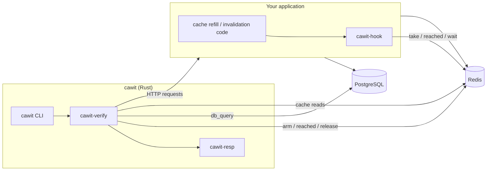
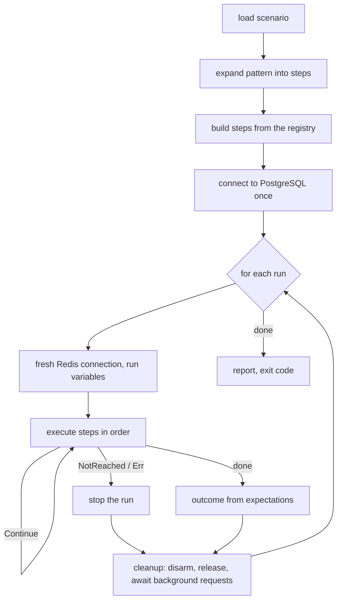

# Architecture Overview

## Components

| Component | Location | Role |
|---|---|---|
| `cawit` | `crates/cawit` | Command line: loads a scenario, runs it, prints and writes reports, sets the exit code |
| `cawit-verify` | `crates/cawit-verify` | Engine: scenario model, pattern expansion, step and check registries, the runner |
| `cawit-resp` | `crates/cawit-resp` | Minimal RESP parser and async Redis client used by the runner |
| `cawit-hook` | `hooks/node` | Node hook: `syncPoint(point, key)`; the application side of the protocol |

## Inside a run

- Steps are built once, before the first run, so a scenario error fails before anything is sent.
- Each run has its own Redis connection, variables (`${run}` is unique), armed points, background tasks, and expectations (`RunCtx`).
- Cleanup always runs, so a failed run never leaves the application blocked.

## Design decisions

| Decision | Alternatives rejected | Why |
|---|---|---|
| Hook + Redis protocol | HTTP control endpoint in the app; a proxy that delays cache commands; random delays | An endpoint means routing changes in every app; a connection-level proxy distorts results through head-of-line queues; random delays are not deterministic |
| Patterns expand into steps | Patterns as special code paths in the runner | Nothing hidden; `--show-steps` shows everything; users can copy and edit the expansion |
| Registries for steps, checks, patterns | A fixed set | New races and verdicts plug in without touching the runner |
| Judge state, with `app_view` | Decode cache values | Hashed keys, compressed or serialized values, and in-process caches are common; what clients get is what matters |
| Discard `NOT_REACHED` runs, exit `2` | Count them as passes | A test that silently stopped testing must not look green |

A longer record of decisions and rejected alternatives is kept in the repository's design notes (Korean): [`docs/PLAN.md`](https://github.com/AsyncNomad/CacheWitness/blob/main/docs/PLAN.md) and [`docs/design/`](https://github.com/AsyncNomad/CacheWitness/tree/main/docs/design).
