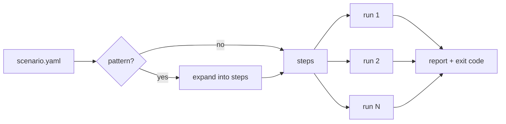

# Core Concepts

## Sync points

A **sync point** is a named place in your application code where a test may pause or fail a request:

```ts
await cawit.syncPoint("refill:after-read", key);
```

Normally the call returns immediately. When a scenario **arms** the point, the next call that reaches it (optionally only for a given `key`) is **taken**: it tells the runner it arrived and then either

- **holds** until the scenario releases it (action `hold`), or
- **throws** `CawitInjectedError` once (action `fail`), simulating a failure of whatever follows the call.

Exactly one call is taken per arm, even when many requests reach the point at the same time.

## Scenarios, steps, and runs

A **scenario** is a YAML file that lists the application servers, Redis, PostgreSQL, named HTTP **request templates**, the **state** to judge, and either a built-in **pattern** or hand-written **steps**.

`cawit verify` executes the steps in order, several times. Each execution is a **run**. Every run gets unique variables (`${run}`), so values written in one run never look like another run's.



## Forcing an order

The steps that force an interleaving work together:

| Step | What it does |
|---|---|
| `arm` | Arm a sync point for one call, under an alias |
| `http` with `async` | Send a request in the background, so the scenario can continue while it is held |
| `reached` | Wait until the armed call arrives. This is the evidence that the interleaving is happening |
| `http` | Send the competing request while the first one is held |
| `release` | Let the held call continue |
| `await` | Wait for the background request to finish |
| `expect` | Judge the result |

## The manipulation check

A run proves something only if the order it was meant to force actually happened. Two things can break that:

- the armed call never arrives (the hook is not on the path the request takes, the app was started without `CAWIT_SYNC_URL`, a bundler baked an old hook into the build), or
- the held call gives up waiting before the scenario releases it (the hook's `CAWIT_SYNC_TIMEOUT_S` expired).

In both cases the run ends as **`NOT_REACHED`** and is discarded: it is neither a pass nor a fail.

## Outcomes and exit code

| Outcome | Meaning |
|---|---|
| `PASS` | every expectation passed |
| `FAIL` | an expectation failed: the race left a stale value, or the cache did not refill |
| `NOT_REACHED` | the forced order did not happen; discarded |
| `ERROR` | a request or step failed; discarded |

The process exits with `0` if every run passed, `1` if any run failed, and `2` if no run failed but some were discarded. Treat `2` as a broken test, not as a pass.

## Verdicts

Checks compare a value from the cache side with the committed value in PostgreSQL:

- **cache entry** (`state.cache_key`): read the Redis key directly, optionally one JSON field;
- **application view** (`state.app_view`): send a request through the application and take a field of the response, optionally noting whether the response was a cache hit.

Built-in patterns end with two expectations: **`not_stale`** (readers get the committed value) and **`refilled`** (the cache holds the committed value again, so a fix that disables caching fails).

A verdict is **strict** by default: the check must pass when it is evaluated. With `within_ms` it is **bounded**: the check is retried and must pass within that time. Choose the one that matches what your service promises.

## Determinism and its limits

A scenario controls the order of the events it arms and the waits it contains. Within that, every run is the same. Outside it, the real duration of steps varies (a cold first request can take hundreds of milliseconds). If the code under test relies on timers (a delayed second invalidation, a TTL), pin the relevant durations with the pattern's `hold_ms` or the verdict's `within_ms`; otherwise the result can depend on how long the steps happened to take.
