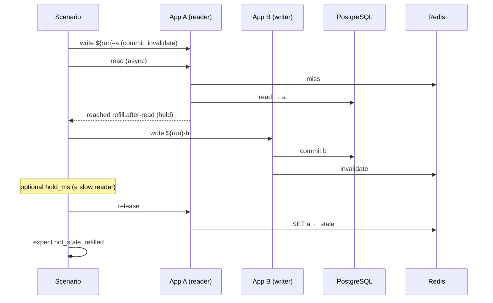
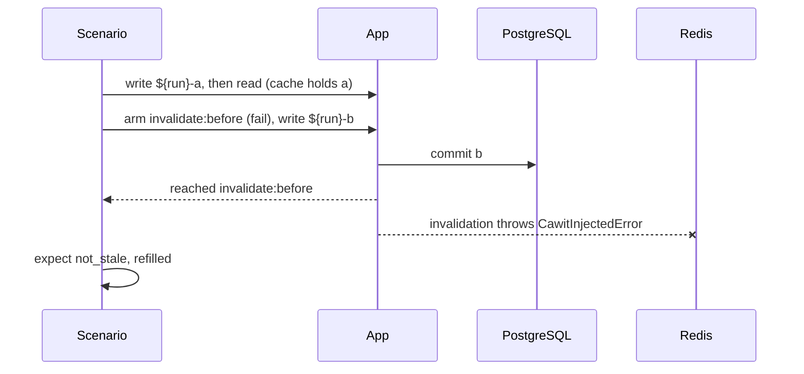
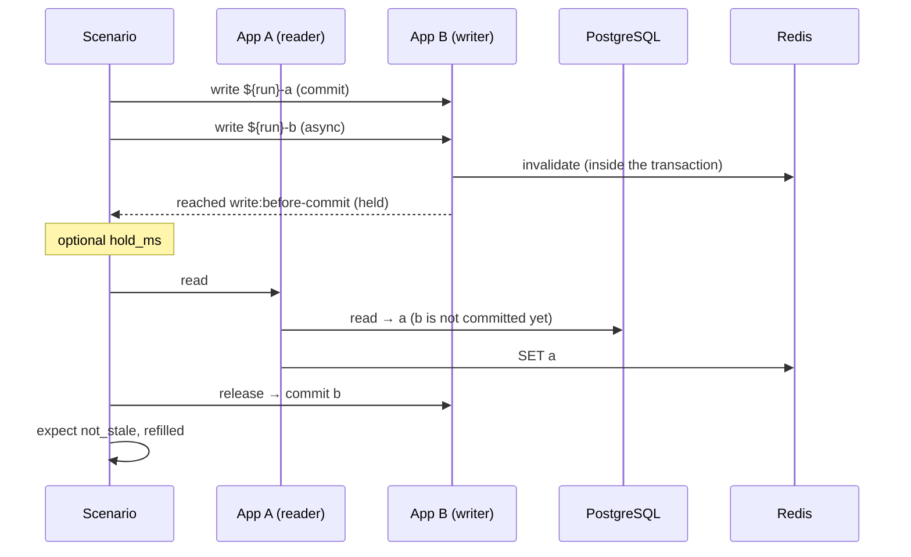

# Race Patterns

A pattern is a named recipe that expands into ordinary steps. Use `cawit verify scenario.yaml --show-steps` to see the expansion; anything a pattern does can also be written by hand.

All patterns:

- write values unique to the run (`${run}-a`, then `${run}-b`) through the request named by `write`, using the variable `value` (change it with `value_var`);
- end with **`not_stale`** (readers get the committed value) and **`refilled`** (the cache holds it again);
- pick checks from `state`: `app_equals_db` and `app_cached_equals_db` when `state.app_view` is set, otherwise `cache_not_stale`, a read, and `cache_equals_db`;
- accept `settle_ms` (default 100: the wait before judging), `within_ms` (bounded verdict), `point` and `key` (which sync point to arm), and `reached_timeout_ms` (default 10000).

## stale-set

A reader misses and reads the old row; a newer write commits and invalidates; then the reader writes what it read.



```yaml
pattern:
  stale-set:
    reader: a          # app whose refill is held; also makes the first write
    writer: b          # app that writes the newer value (may equal reader)
    write: update
    read: read
    key: /articles/1   # optional: hold only this refill
    hold_ms: 0         # keep the reader held this long after the newer write
```

**Hook:** `syncPoint("refill:after-read", key)` after the database read and before the cache write.

## failed-invalidation

The write commits, but its invalidation fails once. Unless the code recovers, the cache keeps the old value until the TTL.



```yaml
pattern:
  failed-invalidation:
    app: a
    write: update
    read: read
```

**Hook:** `syncPoint("invalidate:before", key)` right before the invalidation. The pattern arms it with action `fail`, so the call throws once; the write request is allowed to fail (`allow_error`), because that is what an application usually does when its invalidation throws.

## invalidate-before-commit

The write invalidates inside its transaction. Before it commits, a reader misses and refills with the row that is still committed, the old one. After the commit, nothing removes it.



```yaml
pattern:
  invalidate-before-commit:
    writer: b
    reader: a
    write: update
    read: read
    hold_ms: 0         # keep the write uncommitted this long before the reader reads
```

**Hook:** `syncPoint("write:before-commit", key)` at the end of the write transaction, just before the commit.

Code that invalidates **after** the commit passes this pattern; that is also how you check that a correct implementation is not flagged.

## Fixes that pass and fixes that do not

These results come from the [case studies](../case-studies/directus.md) (20 runs each, every run reached its sync point).

| Race | Fix | Result | Why |
|---|---|---|---|
| stale-set | compare a version before `SET` | **fails** | after the `DEL` there is nothing to compare against |
| stale-set | lease, without re-reading when the lease is lost | **fails** `refilled` | the cache stays empty while an in-process memoizer serves the old value |
| stale-set | lease, re-read on rejection | passes | |
| stale-set | delayed second invalidation (500 ms) | **fails** when the reader is slower than the delay; passes with a fast reader | it only narrows the window |
| stale-set | purge generation, checked after the write | passes | a refill that started under an older generation drops its write |
| failed-invalidation | short TTL (2 s) | **fails** strict, passes `within_ms: 3000` | it bounds the damage, it does not fix it |
| failed-invalidation | retry the invalidation | passes | the injected failure happens once |
| invalidate-before-commit | invalidate after the commit (upstream Directus) | passes | |
| invalidate-before-commit | keep invalidating inside the transaction, add a delayed second invalidation; the reader arrives after it | **fails** | a refill between the second invalidation and the commit survives |

## Timing parameters

Two parameters encode time, and both decide what a scenario can tell apart:

- **`hold_ms`** creates a *slow* participant. In `stale-set` it keeps the reader held after the newer write; in `invalidate-before-commit` it delays the reader inside the uncommitted window. Use it to test fixes that rely on timers: a delayed second invalidation passes when every participant is fast and fails when one is slower than the delay.
- **`within_ms`** changes the verdict from strict to bounded.

Without them, a timer-based fix can be judged differently on different runs: in one case study, a cold first run took longer than the 500 ms timer and flipped the verdict once in 20 runs.
