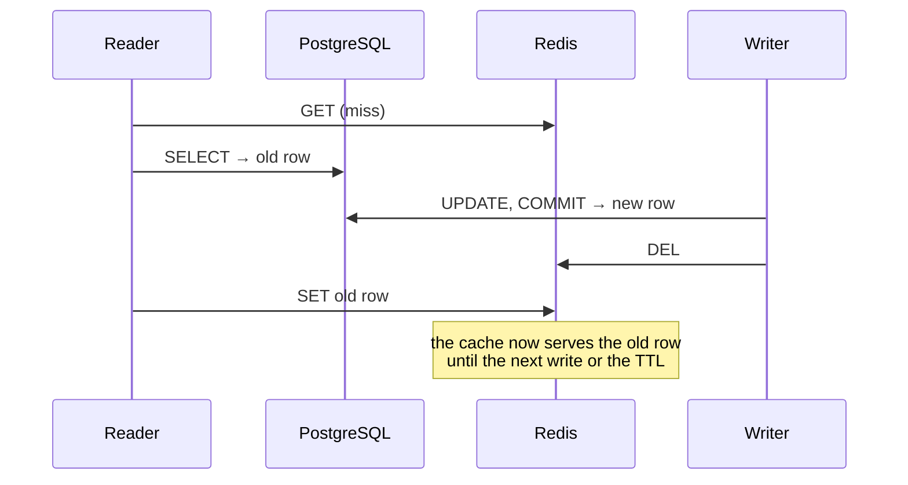

# Introduction

<p align="center"></p>

**CacheWitness** (CLI: `cawit`) is an open-source testing tool for applications that put a Redis cache in front of PostgreSQL. It **makes a cache race happen in exactly the same order on every run, and proves in CI that a fix prevents it.**

> Don't wait for the race. Cause it, and prove the fix.

## The problem

Cache-aside is the default for web backends: read from Redis, and on a miss read the database and fill the cache; on a write, update the database and delete the cache entry. Its races are well known. The classic one:



These races are timing accidents. They rarely show up in tests, vanish when you add logging, and **a fix cannot be tested against an accident that may or may not happen.** We measured this on real applications: under identical conditions (write bursts, with the refill slowed to 50 ms), one run left stale values after 6.5% of bursts and another after 0.17%.

## What CacheWitness does

A one-line **sync hook** in your cache refill path lets a test pause a request at a named point. A **scenario** then drives HTTP requests against your running application in a fixed order: hold the reader right after its database read, commit a newer value through another request, release the reader, and compare what clients get with what the database holds.

The race happens on every run, so the test **fails every time before the fix and passes every time after it**, and it can run in CI next to your other tests.

```text
$ cawit verify stale-set.yaml
run   1  FAIL
          FAIL not_stale (app_equals_db): served=1a14…-1-a (cache hit) db=1a14…-1-b
...
directus-stale-set: 20 runs  pass 0  fail 20  not_reached 0  error 0
  not_stale            passed 0/20
  refilled             passed 0/20
```

## Who it is for

- Teams that write their own cache code and want regression tests for invalidation logic that do not flake.
- Authors of cache libraries and ORMs who want to show their invalidation is safe under a specific interleaving.
- Anyone about to ship a "fix" for a stale-cache bug who wants to know whether it actually closes the race (several plausible fixes do not; see [Race Patterns](guide/patterns.md)).

## What it is not

- It does not discover races you did not describe. `cawit verify` is a regression test for known orders; you choose the pattern and where the hook goes.
- It does not estimate how often a race happens in production.
- It does not fix or replace your cache.
- It is for test environments. The hook is off unless explicitly enabled and refuses to turn on under `NODE_ENV=production` unless you insist.

## Status

CacheWitness is at version 0.1. The verify mode, three built-in patterns, and the Node hook are implemented and tested against two real applications ([Twenty](case-studies/twenty.md) and [Directus](case-studies/directus.md)). A passive check mode that watches Redis and the PostgreSQL WAL without code changes is planned. See the [Roadmap](project/roadmap.md).
