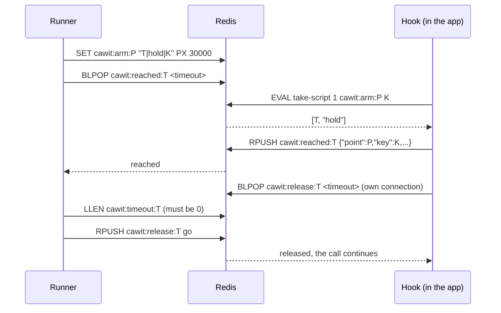

# Hook Protocol

The runner and the hooks talk only through Redis. This page is the specification for writing a hook in another language. Current version: **2**.

All keys start with `cawit:`. `<token>` is unique per armed point and run; `<point>` is the sync point name.

## Keys

| Key | Type | Written by | Meaning |
|---|---|---|---|
| `cawit:arm:<point>` | string, `PX 30000` | runner | `<token>\|<action>\|<key>`: the next matching call is taken. `<action>` is `hold` or `fail`; `<key>` is `*` for any key. The key comes last so it may contain `\|` |
| `cawit:reached:<token>` | list | hook | One JSON element `{"point","key","action","pid"}` per taken call |
| `cawit:release:<token>` | list | runner | Any element releases the held call |
| `cawit:timeout:<token>` | list | hook | The held call stopped waiting before release |

## Sequence



## Hook behaviour

A hook exposes one call, `syncPoint(point, key = "*")`.

1. **Disabled** unless the hook's Redis URL (`CAWIT_SYNC_URL`) is configured. When disabled, return without any I/O. Hooks should also stay disabled in production environments unless explicitly allowed (the Node hook: `NODE_ENV=production` requires `CAWIT_ALLOW_PRODUCTION=1`).
2. **Take the arm atomically** with this script, `KEYS[1] = cawit:arm:<point>`, `ARGV[1] = key`:

   ```lua
   local v = redis.call('GET', KEYS[1])
   if not v then return false end
   local s1 = string.find(v, '|', 1, true)
   if not s1 then return false end
   local s2 = string.find(v, '|', s1 + 1, true)
   if not s2 then return false end
   local want = string.sub(v, s2 + 1)
   if want ~= '*' and want ~= ARGV[1] then return false end
   redis.call('DEL', KEYS[1])
   return {string.sub(v, 1, s1 - 1), string.sub(v, s1 + 1, s2 - 1)}
   ```

   A nil reply means "not for this call": return immediately. The check and the delete must be one atomic step: taking the arm and putting it back for a non-matching key leaves a gap in which the intended call finds nothing.
3. **Signal**: `RPUSH cawit:reached:<token> <json>` with at least `point`, `key`, and `action`.
4. **Act**:
   - `fail`: raise the language's error (Node: `CawitInjectedError`). Do not wait.
   - `hold`: `BLPOP cawit:release:<token> <timeout>` **on a connection used only for this wait**, then close it. If the wait times out, `RPUSH cawit:timeout:<token> <anything>` and continue.

Never use the application's own Redis connection: a blocking `BLPOP` on it would delay the application's commands. Never wait on a connection shared by other calls: a second request reaching any sync point in the same process would queue behind the first one's `BLPOP`.

## Runner behaviour

- **Arm**: `SET cawit:arm:<point> <token>|<action>|<key> PX 30000`; the token is derived from the run's unique id and the alias.
- **Reached**: `BLPOP cawit:reached:<token> <seconds>`; nil means `NOT_REACHED`.
- **Release**: `LLEN cawit:timeout:<token>`; non-zero means the hold expired and the run is `NOT_REACHED`. Otherwise `RPUSH cawit:release:<token> go`.
- **Cleanup** after every run: `DEL cawit:arm:<point>`, `RPUSH cawit:release:<token> cleanup` with `EXPIRE … 60` (releases anything still held), `DEL cawit:reached:<token>`, `DEL cawit:timeout:<token>`.

## Versions

| Version | Arm value | Notes |
|---|---|---|
| 1 | `<token>\|<key>` | hold only; hooks took the arm with `GETDEL` and put it back on a key mismatch (racy) |
| 2 | `<token>\|<action>\|<key>` | adds `fail`; atomic take; per-hold wait connection; runner checks `cawit:timeout:<token>` |

A hook speaking an older version never takes a version 2 arm, so every run shows `NOT_REACHED` rather than a wrong result.
