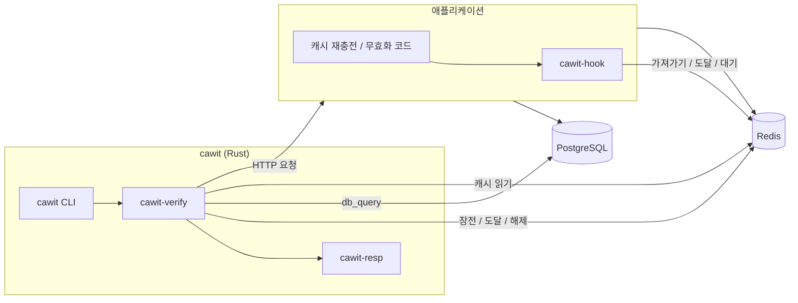
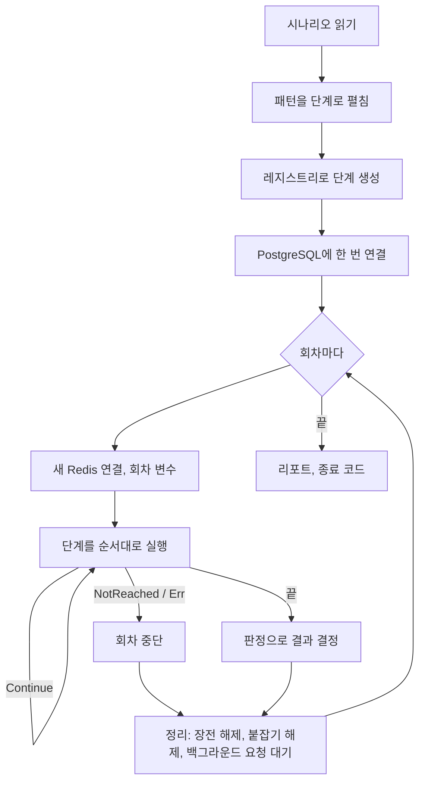

# 아키텍처 개요

## 구성 요소

| 구성 요소 | 위치 | 역할 |
|---|---|---|
| `cawit` | `crates/cawit` | 명령줄: 시나리오를 읽어 실행하고, 리포트를 출력·저장하고, 종료 코드를 정함 |
| `cawit-verify` | `crates/cawit-verify` | 엔진: 시나리오 모델, 패턴 펼치기, 단계·판정 레지스트리, 실행기 |
| `cawit-resp` | `crates/cawit-resp` | 실행기가 쓰는 최소 RESP 파서와 비동기 Redis 클라이언트 |
| `cawit-hook` | `hooks/node` | Node 훅: `syncPoint(point, key)`. 프로토콜의 애플리케이션 쪽 |

## 회차 안에서

- 단계는 첫 회차 전에 한 번 만들어지므로, 시나리오 오류는 아무것도 보내기 전에 실패합니다.
- 회차마다 자기 Redis 연결, 변수(`${run}`은 고유), 장전한 지점, 백그라운드 작업, 판정 결과(`RunCtx`)를 갖습니다.
- 정리는 항상 실행되므로, 실패한 회차가 애플리케이션을 막아 둔 채로 남지 않습니다.

## 설계 결정

| 결정 | 기각한 대안 | 이유 |
|---|---|---|
| 훅 + Redis 프로토콜 | 앱에 HTTP 제어 엔드포인트, 캐시 명령을 늦추는 프록시, 무작위 지연 | 엔드포인트는 앱마다 라우팅을 고쳐야 하고, 연결 수준 프록시는 head-of-line 대기열로 결과를 왜곡하며, 무작위 지연은 결정적이지 않음 |
| 패턴을 단계로 펼침 | 실행기 안의 패턴 전용 코드 경로 | 숨겨진 것이 없음. `--show-steps`로 모두 보이고, 사용자가 펼친 결과를 복사해 고칠 수 있음 |
| 단계·판정·패턴 레지스트리 | 고정된 집합 | 새 경쟁과 판정을 실행기를 고치지 않고 추가 |
| `app_view`를 포함한 상태 판정 | 캐시 값 해독 | 해시 키, 압축·직렬화된 값, 프로세스 안 캐시가 흔함. 중요한 것은 클라이언트가 받는 값 |
| `NOT_REACHED` 회차를 버리고 `2`로 종료 | 통과로 셈 | 조용히 시험을 멈춘 테스트가 초록색으로 보이면 안 됨 |

결정과 기각한 대안의 더 긴 기록은 저장소의 설계 문서에 있습니다: [`docs/PLAN.md`](https://github.com/AsyncNomad/CacheWitness/blob/main/docs/PLAN.md), [`docs/design/`](https://github.com/AsyncNomad/CacheWitness/tree/main/docs/design).
