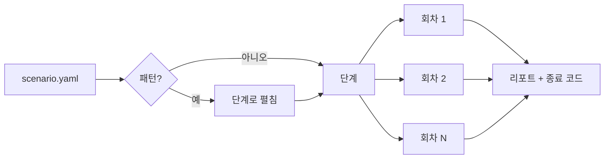

# 핵심 개념

## 동기화 지점

**동기화 지점**은 테스트가 요청을 멈추거나 실패시킬 수 있도록 애플리케이션 코드에 이름 붙인 자리입니다.

```ts
await cawit.syncPoint("refill:after-read", key);
```

평소에는 호출이 바로 돌아옵니다. 시나리오가 그 지점을 **장전**하면, 다음에 그 지점에 닿는 호출 하나(`key`를 지정하면 그 키의 호출만)를 **가져갑니다**. 가져간 호출은 도착했다고 실행기에 알린 뒤, 다음 중 하나를 합니다.

- **붙잡기**(`hold`): 시나리오가 풀어 줄 때까지 기다립니다.
- **실패**(`fail`): `CawitInjectedError`를 한 번 던집니다. 호출 뒤에 오는 작업이 실패한 것처럼 만듭니다.

여러 요청이 동시에 그 지점에 닿아도 장전 한 번에 가져가는 호출은 정확히 하나입니다.

## 시나리오, 단계, 회차

**시나리오**는 애플리케이션 서버, Redis, PostgreSQL, 이름 붙인 HTTP **요청 템플릿**, 판정할 **상태**, 그리고 내장 **패턴** 또는 직접 쓴 **단계**를 적은 YAML 파일입니다.

`cawit verify`는 단계를 순서대로 여러 번 실행합니다. 한 번의 실행이 **회차**입니다. 회차마다 고유한 변수(`${run}`)를 받으므로 한 회차에서 쓴 값이 다른 회차의 값처럼 보이지 않습니다.



## 순서 강제하기

끼어들기를 강제하는 단계들은 함께 움직입니다.

| 단계 | 하는 일 |
|---|---|
| `arm` | 동기화 지점을 별칭 아래 호출 하나에 대해 장전 |
| `async`를 준 `http` | 요청을 백그라운드로 보내, 그것이 붙잡혀 있는 동안 시나리오가 진행 |
| `reached` | 장전한 호출이 도착할 때까지 대기. 끼어들기가 실제로 일어나고 있다는 증거 |
| `http` | 첫 요청이 붙잡혀 있는 동안 경쟁 요청을 보냄 |
| `release` | 붙잡힌 호출을 계속 진행시킴 |
| `await` | 백그라운드 요청이 끝날 때까지 대기 |
| `expect` | 결과 판정 |

## 조작 확인

회차는 강제하려던 순서가 실제로 일어났을 때만 무언가를 증명합니다. 이를 깨는 경우는 두 가지입니다.

- 장전한 호출이 도착하지 않음 (요청이 지나는 경로에 훅이 없음, 애플리케이션을 `CAWIT_SYNC_URL` 없이 띄움, 번들러가 옛 훅을 빌드에 넣음)
- 시나리오가 풀어 주기 전에 붙잡힌 호출이 기다리기를 그만둠 (훅의 `CAWIT_SYNC_TIMEOUT_S` 만료)

두 경우 모두 회차는 **`NOT_REACHED`**로 끝나고 버려집니다. 통과도 실패도 아닙니다.

## 결과와 종료 코드

| 결과 | 의미 |
|---|---|
| `PASS` | 모든 판정 통과 |
| `FAIL` | 판정 실패: 경쟁이 낡은 값을 남겼거나 캐시가 다시 채워지지 않음 |
| `NOT_REACHED` | 강제한 순서가 일어나지 않음. 버림 |
| `ERROR` | 요청이나 단계가 실패함. 버림 |

모든 회차가 통과하면 `0`, 하나라도 실패하면 `1`, 실패는 없지만 버린 회차가 있으면 `2`로 끝납니다. `2`는 통과가 아니라 망가진 테스트로 다루십시오.

## 판정

판정은 캐시 쪽 값과 PostgreSQL에 커밋된 값을 비교합니다.

- **캐시 항목**(`state.cache_key`): Redis 키를 직접 읽고, 필요하면 JSON 필드 하나를 꺼냅니다.
- **애플리케이션 관점**(`state.app_view`): 애플리케이션에 요청을 보내 응답의 필드를 꺼내고, 필요하면 그 응답이 캐시 적중이었는지도 봅니다.

내장 패턴은 판정 두 개로 끝납니다. **`not_stale`**(리더가 커밋된 값을 받음)과 **`refilled`**(캐시가 커밋된 값을 다시 들고 있음. 캐시를 끄는 수정은 실패)입니다.

판정은 기본적으로 **엄격**합니다. 평가하는 순간 통과해야 합니다. `within_ms`를 주면 **상한** 판정이 되어, 반복 확인하다가 그 시간 안에 통과하면 됩니다. 서비스가 약속하는 것에 맞는 쪽을 고르십시오.

## 결정성과 그 한계

시나리오는 자신이 장전한 사건의 순서와 자신이 넣은 대기를 통제합니다. 그 안에서는 모든 회차가 같습니다. 그 밖에서는 단계의 실제 소요 시간이 달라집니다(콜드 스타트의 첫 요청은 수백 ms가 걸리기도 합니다). 시험 대상 코드가 타이머(지연된 두 번째 무효화, TTL)에 기대면 패턴의 `hold_ms`나 판정의 `within_ms`로 관련 시간을 고정하십시오. 그렇지 않으면 결과가 단계가 우연히 걸린 시간에 좌우될 수 있습니다.
