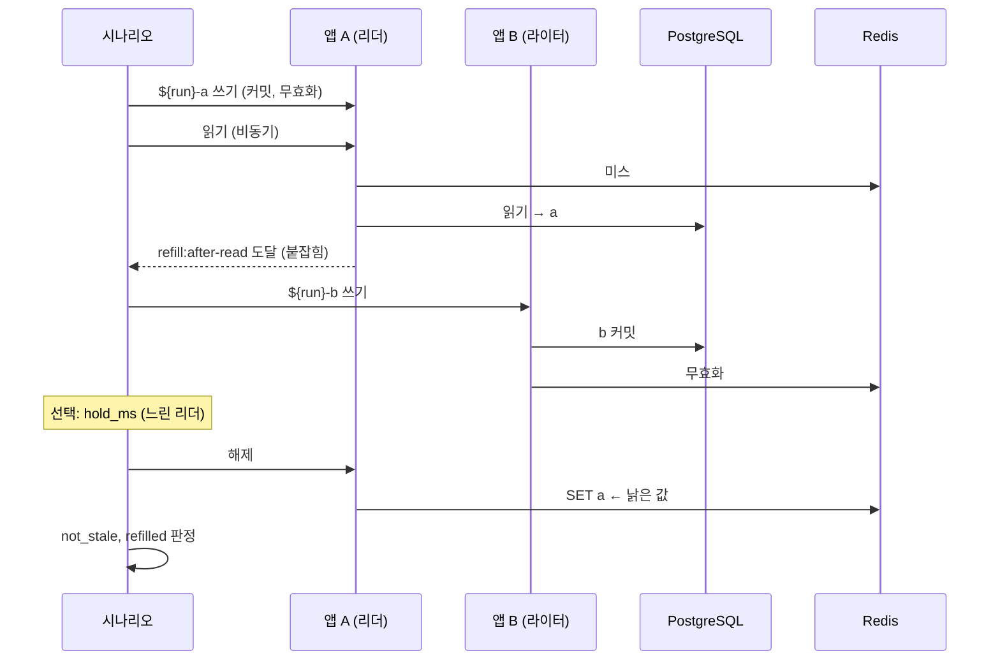
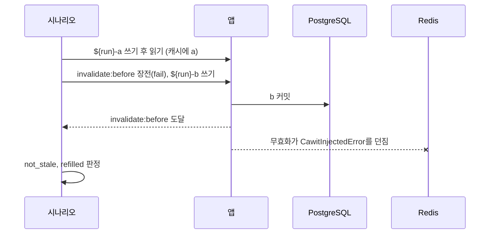
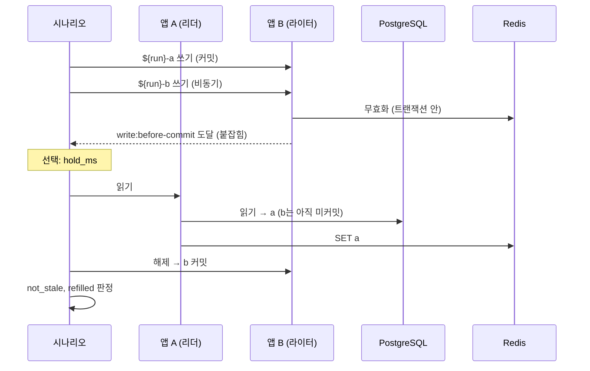

# 경쟁 패턴

패턴은 보통 단계로 펼쳐지는 이름 붙은 레시피입니다. `cawit verify scenario.yaml --show-steps`로 펼친 결과를 볼 수 있고, 패턴이 하는 일은 모두 손으로도 쓸 수 있습니다.

모든 패턴은:

- `write`로 지정한 요청을 통해 회차 고유의 값(`${run}-a`, 그다음 `${run}-b`)을 변수 `value`(`value_var`로 변경)에 넣어 씁니다.
- **`not_stale`**(리더가 커밋된 값을 받음)과 **`refilled`**(캐시가 그 값을 다시 들고 있음)로 끝납니다.
- 판정을 `state`에서 고릅니다. `state.app_view`가 있으면 `app_equals_db`와 `app_cached_equals_db`, 없으면 `cache_not_stale`, 읽기, `cache_equals_db`입니다.
- `settle_ms`(기본 100: 판정 전 대기), `within_ms`(상한 판정), `point`와 `key`(장전할 동기화 지점), `reached_timeout_ms`(기본 10000)를 받습니다.

## stale-set

리더가 미스로 옛 행을 읽고, 더 새로운 쓰기가 커밋하고 무효화한 뒤, 리더가 읽어 둔 값을 씁니다.



```yaml
pattern:
  stale-set:
    reader: a          # 재충전을 붙잡을 앱. 첫 쓰기도 이 앱으로
    writer: b          # 더 새 값을 쓰는 앱 (reader와 같아도 됨)
    write: update
    read: read
    key: /articles/1   # 선택: 이 재충전만 붙잡음
    hold_ms: 0         # 새 쓰기 뒤에도 리더를 이만큼 더 붙잡음
```

**훅:** DB 읽기 뒤, 캐시 쓰기 전에 `syncPoint("refill:after-read", key)`.

## failed-invalidation

쓰기는 커밋되지만 그 무효화가 한 번 실패합니다. 코드가 복구하지 않으면 캐시는 TTL까지 옛 값을 유지합니다.



```yaml
pattern:
  failed-invalidation:
    app: a
    write: update
    read: read
```

**훅:** 무효화 바로 앞에 `syncPoint("invalidate:before", key)`. 패턴은 이 지점을 `fail` 동작으로 장전하므로 호출이 한 번 예외를 던집니다. 무효화가 예외를 던지면 애플리케이션은 보통 요청을 실패로 끝내므로, 쓰기 요청의 실패를 허용합니다(`allow_error`).

## invalidate-before-commit

쓰기가 트랜잭션 안에서 무효화합니다. 커밋 전에 리더가 미스로, 아직 커밋된 상태인 옛 행으로 다시 채웁니다. 커밋 뒤에는 아무도 그것을 지우지 않습니다.



```yaml
pattern:
  invalidate-before-commit:
    writer: b
    reader: a
    write: update
    read: read
    hold_ms: 0         # 리더가 읽기 전에 쓰기를 미커밋 상태로 이만큼 둠
```

**훅:** 쓰기 트랜잭션의 끝, 커밋 직전에 `syncPoint("write:before-commit", key)`.

커밋 **뒤에** 무효화하는 코드는 이 패턴을 통과합니다. 올바른 구현이 오탐되지 않는지 확인하는 방법이기도 합니다.

## 통과하는 수정과 통과하지 못하는 수정

[사례 연구](../case-studies/directus.md)의 결과입니다(각 20회, 모든 회차가 동기화 지점에 도달).

| 경쟁 | 수정 | 결과 | 이유 |
|---|---|---|---|
| stale-set | `SET` 전에 버전 비교 | **실패** | `DEL` 뒤에는 비교할 대상이 없음 |
| stale-set | 리스, 리스를 잃었을 때 다시 읽지 않음 | `refilled` **실패** | 캐시는 비어 있고 프로세스 안 메모이저가 옛 값을 응답 |
| stale-set | 리스, 거부되면 다시 읽기 | 통과 | |
| stale-set | 지연된 두 번째 무효화 (500ms) | 리더가 지연보다 느리면 **실패**, 빠르면 통과 | 창을 좁힐 뿐 |
| stale-set | 퍼지 세대 번호, 쓰기 뒤 확인 | 통과 | 옛 세대에서 시작한 재충전은 자기 쓰기를 버림 |
| failed-invalidation | 짧은 TTL (2초) | 엄격 판정 **실패**, `within_ms: 3000` 통과 | 피해를 묶을 뿐 고치지 않음 |
| failed-invalidation | 무효화 재시도 | 통과 | 주입한 실패는 한 번뿐 |
| invalidate-before-commit | 커밋 뒤 무효화 (원본 Directus) | 통과 | |
| invalidate-before-commit | 트랜잭션 안 무효화는 그대로 두고 지연된 두 번째 무효화 추가, 리더가 그 뒤에 도착 | **실패** | 두 번째 무효화와 커밋 사이의 재충전이 살아남음 |

## 시간 매개변수

시간을 나타내는 매개변수 두 개가 시나리오가 구분할 수 있는 것을 정합니다.

- **`hold_ms`**는 *느린* 참여자를 만듭니다. `stale-set`에서는 새 쓰기 뒤에도 리더를 붙잡아 두고, `invalidate-before-commit`에서는 미커밋 창 안에서 리더를 늦춥니다. 타이머에 기대는 수정을 시험할 때 쓰십시오. 지연된 두 번째 무효화는 모든 참여자가 빠르면 통과하고, 하나가 지연보다 느리면 실패합니다.
- **`within_ms`**는 판정을 엄격에서 상한으로 바꿉니다.

이것이 없으면 타이머 기반 수정이 회차마다 다르게 판정될 수 있습니다. 한 사례 연구에서는 콜드 스타트인 첫 회차가 500ms 타이머보다 오래 걸려 20회 중 한 번 판정이 뒤집혔습니다.
