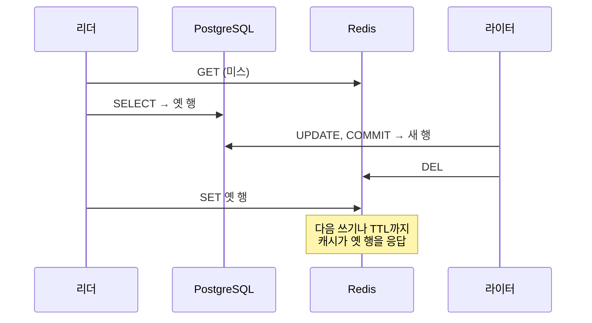

# 소개

**CacheWitness**(CLI: `cawit`)는 PostgreSQL 앞에 Redis 캐시를 둔 애플리케이션을 위한 오픈소스 테스트 도구입니다. **캐시 경쟁을 매번 똑같은 순서로 일으키고, 수정이 그 경쟁을 정말 막는지 CI에서 증명합니다.**

> 경쟁을 기다리지 않는다. 일으키고, 수정을 증명한다.

## 문제

cache-aside는 웹 백엔드의 기본 구조입니다. Redis에서 읽고, 미스가 나면 DB를 읽어 캐시를 채우고, 쓸 때는 DB를 바꾼 뒤 캐시 항목을 지웁니다. 이 구조의 경쟁은 잘 알려져 있습니다. 대표적인 것은 다음과 같습니다.



이런 경쟁은 타이밍 사고입니다. 테스트에서는 거의 나타나지 않고, 로그를 붙이면 사라지며, **일어날지 말지 모르는 사고를 상대로는 수정을 테스트할 수 없습니다.** 실제 앱에서 측정한 결과, 같은 조건(쓰기 몰아치기, 재충전을 50ms로 늦춤)에서 한 실행은 몰아치기의 6.5%에서, 다른 실행은 0.17%에서 낡은 값이 남았습니다.

## CacheWitness가 하는 일

캐시 재충전 경로에 넣는 한 줄짜리 **동기화 훅**으로, 테스트가 요청을 이름 붙인 지점에서 멈출 수 있습니다. **시나리오**는 실행 중인 애플리케이션에 HTTP 요청을 정해진 순서로 보냅니다. 리더를 DB 읽기 직후에 붙잡고, 다른 요청으로 더 새 값을 커밋하고, 리더를 풀어 준 뒤, 클라이언트가 받는 값과 DB 값을 비교합니다.

경쟁이 매 회차 일어나므로 테스트는 **수정 전에는 매번 실패하고 수정 후에는 매번 통과**하며, 다른 테스트와 함께 CI에서 돌릴 수 있습니다.

```text
$ cawit verify stale-set.yaml
run   1  FAIL
          FAIL not_stale (app_equals_db): served=1a14…-1-a (cache hit) db=1a14…-1-b
...
directus-stale-set: 20 runs  pass 0  fail 20  not_reached 0  error 0
  not_stale            passed 0/20
  refilled             passed 0/20
```

## 누구를 위한 도구인가

- 캐시 코드를 직접 작성하고, 흔들리지 않는 무효화 회귀 테스트가 필요한 팀
- 특정 끼어들기에서도 무효화가 안전함을 보이고 싶은 캐시 라이브러리·ORM 작성자
- 낡은 캐시 버그의 "수정"을 배포하기 전에, 그 수정이 정말 경쟁을 막는지 알고 싶은 사람 (그럴듯하지만 막지 못하는 수정이 여럿 있습니다. [경쟁 패턴](guide/patterns.md) 참고)

## 하지 않는 일

- 알려 주지 않은 경쟁을 찾지 않습니다. `cawit verify`는 알려진 순서에 대한 회귀 테스트이며, 패턴과 훅 위치는 사용자가 정합니다.
- 운영 환경에서 경쟁이 얼마나 자주 일어나는지 추정하지 않습니다.
- 캐시를 고치거나 대체하지 않습니다.
- 테스트 환경용입니다. 훅은 명시적으로 켜지 않으면 꺼져 있고, `NODE_ENV=production`에서는 따로 허용하지 않는 한 켜지지 않습니다.

## 상태

CacheWitness는 0.1 버전입니다. verify 모드, 내장 패턴 세 개, Node 훅이 구현되어 실제 앱 두 개([Twenty](case-studies/twenty.md), [Directus](case-studies/directus.md))에서 검증됐습니다. 코드를 고치지 않고 Redis와 PostgreSQL WAL을 관찰하는 check 모드는 계획 중입니다. [로드맵](project/roadmap.md)을 보십시오.
