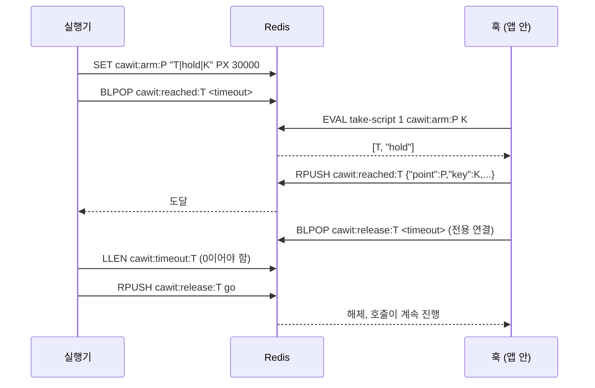

# 훅 프로토콜

실행기와 훅은 Redis로만 통신합니다. 이 페이지는 다른 언어로 훅을 만들기 위한 명세입니다. 현재 버전: **2**.

모든 키는 `cawit:`으로 시작합니다. `<token>`은 장전한 지점과 회차마다 고유하고, `<point>`는 동기화 지점 이름입니다.

## 키

| 키 | 타입 | 쓰는 쪽 | 의미 |
|---|---|---|---|
| `cawit:arm:<point>` | 문자열, `PX 30000` | 실행기 | `<token>\|<action>\|<key>`: 다음에 맞는 호출을 가져감. `<action>`은 `hold` 또는 `fail`, `<key>`가 `*`이면 아무 키. 키에 `\|`가 들어갈 수 있도록 맨 뒤에 둠 |
| `cawit:reached:<token>` | 리스트 | 훅 | 가져간 호출마다 JSON 원소 하나 `{"point","key","action","pid"}` |
| `cawit:release:<token>` | 리스트 | 실행기 | 아무 원소나 들어오면 붙잡힌 호출을 해제 |
| `cawit:timeout:<token>` | 리스트 | 훅 | 붙잡힌 호출이 해제 전에 기다리기를 그만둠 |

## 순서



## 훅의 동작

훅은 호출 하나, `syncPoint(point, key = "*")`를 제공합니다.

1. 훅의 Redis URL(`CAWIT_SYNC_URL`)이 설정되지 않으면 **꺼져 있습니다**. 꺼져 있으면 I/O 없이 돌아옵니다. 훅은 운영 환경에서도 명시적으로 허용하지 않는 한 꺼져 있어야 합니다(Node 훅: `NODE_ENV=production`이면 `CAWIT_ALLOW_PRODUCTION=1` 필요).
2. 다음 스크립트로 **장전을 원자적으로 가져갑니다**. `KEYS[1] = cawit:arm:<point>`, `ARGV[1] = key`:

   ```lua
   local v = redis.call('GET', KEYS[1])
   if not v then return false end
   local s1 = string.find(v, '|', 1, true)
   if not s1 then return false end
   local s2 = string.find(v, '|', s1 + 1, true)
   if not s2 then return false end
   local want = string.sub(v, s2 + 1)
   if want ~= '*' and want ~= ARGV[1] then return false end
   redis.call('DEL', KEYS[1])
   return {string.sub(v, 1, s1 - 1), string.sub(v, s1 + 1, s2 - 1)}
   ```

   nil 응답은 "이 호출 몫이 아님"이므로 바로 돌아옵니다. 확인과 삭제는 원자적인 한 단계여야 합니다. 장전을 가져갔다가 키가 다르면 되돌려 놓는 방식은, 그 사이에 원래 대상이 오면 아무것도 찾지 못하는 틈을 남깁니다.
3. **알림**: `RPUSH cawit:reached:<token> <json>`. 최소한 `point`, `key`, `action`을 담습니다.
4. **동작**:
   - `fail`: 그 언어의 오류를 던집니다(Node: `CawitInjectedError`). 기다리지 않습니다.
   - `hold`: **이 대기에만 쓰는 연결에서** `BLPOP cawit:release:<token> <timeout>`을 하고 연결을 닫습니다. 시간이 지나면 `RPUSH cawit:timeout:<token> <아무 값>`을 하고 계속 진행합니다.

애플리케이션 자신의 Redis 연결은 절대 쓰지 마십시오. 그 위의 블로킹 `BLPOP`이 애플리케이션 명령을 늦춥니다. 다른 호출과 공유하는 연결에서 기다려도 안 됩니다. 같은 프로세스에서 아무 동기화 지점에 닿은 두 번째 요청이 첫 요청의 `BLPOP` 뒤에 줄을 서게 됩니다.

## 실행기의 동작

- **장전**: `SET cawit:arm:<point> <token>|<action>|<key> PX 30000`. 토큰은 회차의 고유 ID와 별칭으로 만듭니다.
- **도달**: `BLPOP cawit:reached:<token> <초>`. nil이면 `NOT_REACHED`.
- **해제**: `LLEN cawit:timeout:<token>`. 0이 아니면 붙잡기가 만료된 것이므로 회차는 `NOT_REACHED`. 아니면 `RPUSH cawit:release:<token> go`.
- 매 회차 뒤 **정리**: `DEL cawit:arm:<point>`, `RPUSH cawit:release:<token> cleanup`과 `EXPIRE … 60`(아직 붙잡힌 것을 해제), `DEL cawit:reached:<token>`, `DEL cawit:timeout:<token>`.

## 버전

| 버전 | 장전 값 | 비고 |
|---|---|---|
| 1 | `<token>\|<key>` | 붙잡기만. 훅이 `GETDEL`로 가져갔다가 키가 다르면 되돌려 놓음 (경쟁 있음) |
| 2 | `<token>\|<action>\|<key>` | `fail` 추가, 원자적 가져가기, 붙잡기마다 대기 연결, 실행기가 `cawit:timeout:<token>` 확인 |

옛 버전의 훅은 버전 2 장전을 가져가지 못하므로, 잘못된 결과 대신 모든 회차가 `NOT_REACHED`로 나옵니다.
