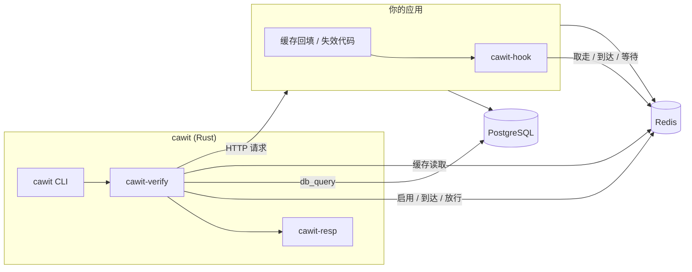
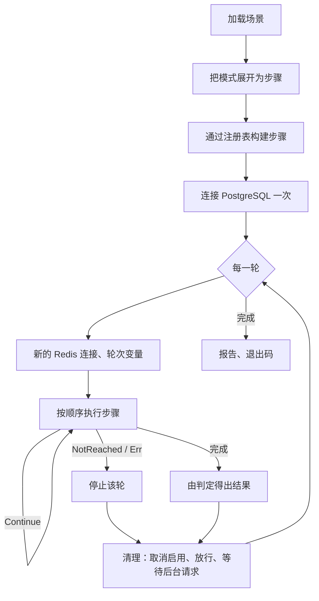

# 架构概览

## 组件

| 组件 | 位置 | 作用 |
|---|---|---|
| `cawit` | `crates/cawit` | 命令行：加载并运行场景，打印和写出报告，设置退出码 |
| `cawit-verify` | `crates/cawit-verify` | 引擎：场景模型、模式展开、步骤与检查注册表、执行器 |
| `cawit-resp` | `crates/cawit-resp` | 执行器使用的最小 RESP 解析器和异步 Redis 客户端 |
| `cawit-hook` | `hooks/node` | Node 钩子：`syncPoint(point, key)`；协议的应用一侧 |

## 一轮之内

- 步骤在第一轮之前构建一次，所以场景错误会在发送任何请求之前就失败。
- 每一轮都有自己的 Redis 连接、变量（`${run}` 唯一）、已启用的同步点、后台任务和判定结果（`RunCtx`）。
- 清理总会执行，所以失败的轮次绝不会让应用保持阻塞。

## 设计决策

| 决策 | 被否决的方案 | 原因 |
|---|---|---|
| 钩子 + Redis 协议 | 应用中的 HTTP 控制端点；延迟缓存命令的代理；随机延迟 | 端点需要在每个应用中修改路由；连接级代理会因队头阻塞扭曲结果；随机延迟不是确定性的 |
| 模式展开为步骤 | 在执行器中为模式设专门的代码路径 | 没有隐藏的东西；`--show-steps` 展示一切；用户可以复制并修改展开结果 |
| 步骤、检查、模式的注册表 | 固定的集合 | 新的竞态和判定无需修改执行器即可接入 |
| 判定状态，包括 `app_view` | 解码缓存值 | 哈希键、压缩或序列化的值以及进程内缓存很常见；重要的是客户端拿到了什么 |
| 丢弃 `NOT_REACHED` 的轮次并以 `2` 退出 | 把它们算作通过 | 悄悄停止测试的测试绝不能显示为绿色 |

更完整的决策和被否决方案的记录保存在仓库的设计文档中（韩文）：[`docs/PLAN.md`](https://github.com/AsyncNomad/CacheWitness/blob/main/docs/PLAN.md) 和 [`docs/design/`](https://github.com/AsyncNomad/CacheWitness/tree/main/docs/design)。
