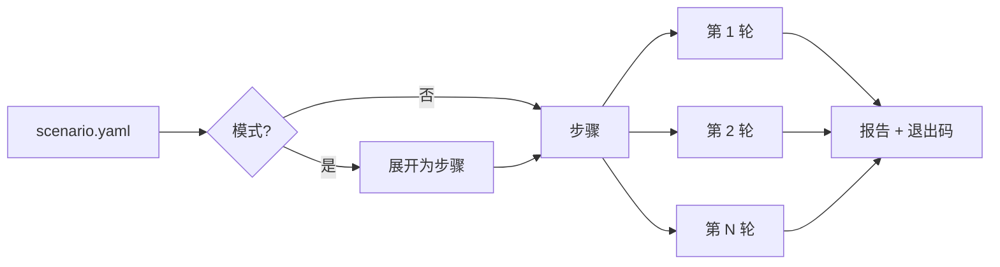

# 核心概念

## 同步点

**同步点**是应用代码中一个具名的位置，测试可以在这里暂停请求或让它失败：

```ts
await cawit.syncPoint("refill:after-read", key);
```

通常这个调用会立即返回。当场景**启用**（arm）该点时，下一个到达该点的调用（如指定了 `key`，则只针对该键）会被**取走**：它通知执行器自己已到达，然后

- **暂停**（`hold`），直到场景放行；或
- **失败**（`fail`）：抛出一次 `CawitInjectedError`，模拟该调用之后的操作失败。

即使许多请求同时到达该点，每次启用也只会取走一个调用。

## 场景、步骤与轮次

**场景**是一个 YAML 文件，列出应用服务器、Redis、PostgreSQL、具名的 HTTP **请求模板**、要判定的**状态**，以及一个内置**模式**或手写的**步骤**。

`cawit verify` 按顺序执行步骤，并重复多次。每次执行称为一**轮**。每一轮都有唯一的变量（`${run}`），所以一轮写入的值永远不会与另一轮混淆。



## 强制一种顺序

强制交错的步骤协同工作：

| 步骤 | 作用 |
|---|---|
| `arm` | 以一个别名为一次调用启用同步点 |
| 带 `async` 的 `http` | 在后台发送请求，使它被暂停时场景可以继续 |
| `reached` | 等待被启用的调用到达。这是交错确实在发生的证据 |
| `http` | 在第一个请求被暂停时发送竞争请求 |
| `release` | 让被暂停的调用继续 |
| `await` | 等待后台请求结束 |
| `expect` | 判定结果 |

## 操纵检查

只有当一轮想要强制的顺序真的发生了，这一轮才能证明什么。有两种情况会破坏它：

- 被启用的调用从未到达（钩子不在请求经过的路径上、应用启动时没有设置 `CAWIT_SYNC_URL`、打包工具把旧版钩子打进了构建产物）；
- 被暂停的调用在场景放行之前就放弃了等待（钩子的 `CAWIT_SYNC_TIMEOUT_S` 到期）。

两种情况下，该轮都以 **`NOT_REACHED`** 结束并被丢弃：既不算通过也不算失败。

## 结果与退出码

| 结果 | 含义 |
|---|---|
| `PASS` | 所有判定都通过 |
| `FAIL` | 有判定失败：竞态留下了陈旧值，或缓存没有重新回填 |
| `NOT_REACHED` | 强制的顺序没有发生；丢弃 |
| `ERROR` | 某个请求或步骤失败；丢弃 |

所有轮次通过时进程以 `0` 退出，有任何一轮失败以 `1` 退出，没有失败但有轮次被丢弃时以 `2` 退出。请把 `2` 视为测试已损坏，而不是通过。

## 判定

检查把缓存一侧的值与 PostgreSQL 中已提交的值比较：

- **缓存项**（`state.cache_key`）：直接读取 Redis 键，可选地取出一个 JSON 字段；
- **应用视角**（`state.app_view`）：通过应用发送请求并取出响应中的字段，可选地记录该响应是否命中缓存。

内置模式以两个判定结束：**`not_stale`**（读者拿到的是已提交的值）和 **`refilled`**（缓存重新持有已提交的值，因此彻底停用缓存的修复会失败）。

判定默认是**严格**的：评估时必须通过。设置 `within_ms` 后变为**有上限**的：检查会重试，在该时间内通过即可。请选择与你的服务承诺相符的一种。

## 确定性及其边界

场景控制它所启用的事件的顺序和它包含的等待。在此范围内，每一轮都一样。范围之外，步骤的实际耗时会变化（冷启动后的第一个请求可能需要几百毫秒）。如果被测代码依赖定时器（延迟的第二次失效、TTL），请用模式的 `hold_ms` 或判定的 `within_ms` 固定相关时长；否则结果可能取决于各步骤碰巧花了多久。
