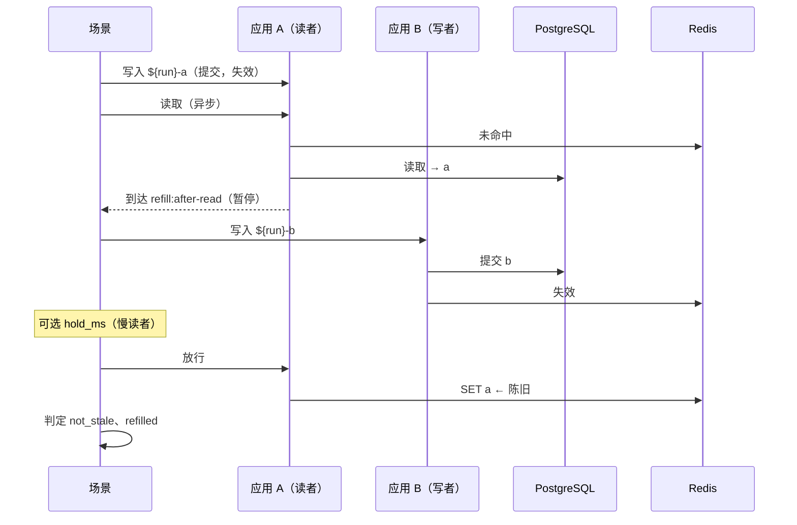
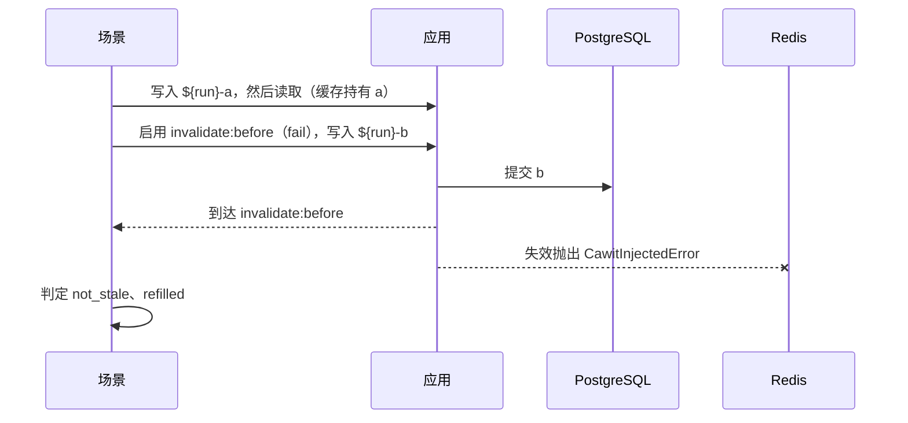
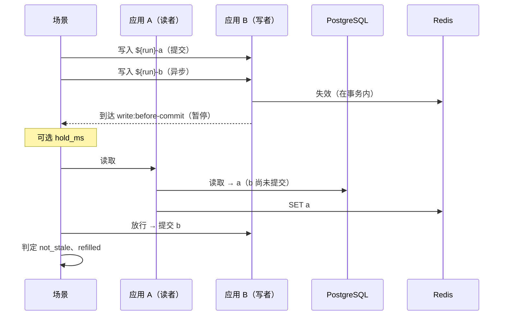

# 竞态模式

模式是一个具名的配方，会展开为普通步骤。用 `cawit verify scenario.yaml --show-steps` 查看展开结果；模式所做的一切也都可以手写。

所有模式：

- 通过 `write` 指定的请求写入该轮独有的值（先 `${run}-a`，再 `${run}-b`），使用变量 `value`（可用 `value_var` 修改）；
- 以 **`not_stale`**（读者拿到已提交的值）和 **`refilled`**（缓存重新持有该值）结束；
- 根据 `state` 选择检查：设置了 `state.app_view` 时用 `app_equals_db` 和 `app_cached_equals_db`，否则用 `cache_not_stale`、一次读取和 `cache_equals_db`；
- 接受 `settle_ms`（默认 100：判定前的等待）、`within_ms`（有上限的判定）、`point` 和 `key`（启用哪个同步点）以及 `reached_timeout_ms`（默认 10000）。

## stale-set

读者未命中并读到旧行；一个更新的写入提交并失效；然后读者写入它读到的值。



```yaml
pattern:
  stale-set:
    reader: a          # 被暂停回填的应用；也负责第一次写入
    writer: b          # 写入更新值的应用（可以与 reader 相同）
    write: update
    read: read
    key: /articles/1   # 可选：只暂停这一次回填
    hold_ms: 0         # 在更新的写入之后继续暂停读者这么久
```

**钩子：** 在读完数据库之后、写入缓存之前调用 `syncPoint("refill:after-read", key)`。

## failed-invalidation

写入已提交，但其失效失败了一次。除非代码能够恢复，否则缓存会保留旧值直到 TTL。



```yaml
pattern:
  failed-invalidation:
    app: a
    write: update
    read: read
```

**钩子：** 在失效之前调用 `syncPoint("invalidate:before", key)`。模式以 `fail` 动作启用它，所以该调用会抛出一次异常；写请求允许失败（`allow_error`），因为失效抛出异常时应用通常就是这样处理的。

## invalidate-before-commit

写入在事务内部使缓存失效。在它提交之前，读者未命中，并用仍处于已提交状态的旧行回填。提交之后，没有任何东西会删除它。



```yaml
pattern:
  invalidate-before-commit:
    writer: b
    reader: a
    write: update
    read: read
    hold_ms: 0         # 读者读取之前，让写入保持未提交这么久
```

**钩子：** 在写事务的末尾、提交之前调用 `syncPoint("write:before-commit", key)`。

在提交**之后**才失效的代码会通过这个模式；这也是确认正确实现不会被误报的方法。

## 能通过的修复与不能通过的修复

以下结果来自[案例研究](../case-studies/directus.md)（各 20 轮，每一轮都到达了同步点）。

| 竞态 | 修复 | 结果 | 原因 |
|---|---|---|---|
| stale-set | `SET` 之前比较版本 | **失败** | `DEL` 之后已没有可比较的值 |
| stale-set | 租约，丢失租约时不重新读取 | `refilled` **失败** | 缓存为空，而进程内 memoizer 返回旧值 |
| stale-set | 租约，被拒绝时重新读取 | 通过 | |
| stale-set | 延迟的第二次失效（500ms） | 读者慢于延迟时**失败**，读者快时通过 | 只是缩小了窗口 |
| stale-set | 清除代号，写入后检查 | 通过 | 在旧代号下开始的回填会丢弃自己的写入 |
| failed-invalidation | 短 TTL（2 秒） | 严格判定**失败**，`within_ms: 3000` 通过 | 只限制损害，不修复 |
| failed-invalidation | 重试失效 | 通过 | 注入的失败只发生一次 |
| invalidate-before-commit | 提交后失效（原版 Directus） | 通过 | |
| invalidate-before-commit | 保留事务内失效，再加一次延迟的第二次失效，读者在其后到达 | **失败** | 在第二次失效与提交之间的回填得以保留 |

## 时间参数

有两个参数表示时间，它们决定了场景能区分什么：

- **`hold_ms`** 制造一个*慢*参与者。在 `stale-set` 中，它在更新的写入之后继续暂停读者；在 `invalidate-before-commit` 中，它让读者在未提交的窗口内晚一些到达。用它测试依赖定时器的修复：延迟的第二次失效在所有参与者都很快时通过，有一个慢于延迟时失败。
- **`within_ms`** 把判定从严格改为有上限。

没有它们，基于定时器的修复在不同轮次中可能得到不同的判定：在一个案例研究中，冷启动的第一轮耗时超过了 500ms 的定时器，20 轮中有一次判定被翻转。
