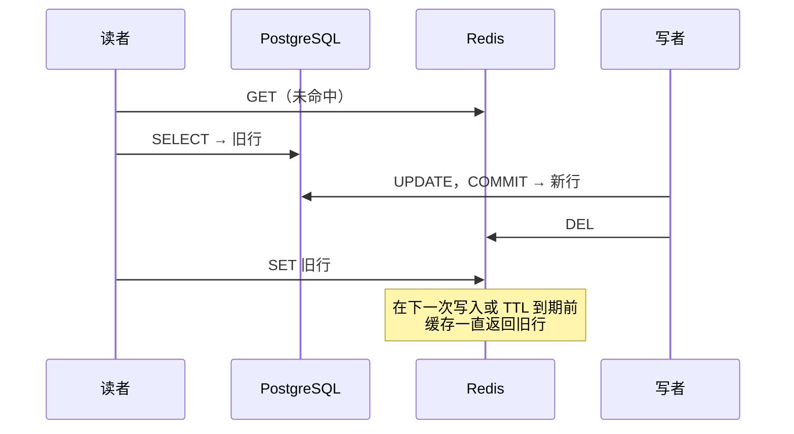

# 简介

**CacheWitness**（CLI：`cawit`）是一款开源测试工具，面向在 PostgreSQL 前放置 Redis 缓存的应用。它**让缓存竞态每次都以完全相同的顺序发生，并在 CI 中证明修复确实能阻止它。**

> 不等竞态出现。主动触发它，并证明修复。

## 问题

cache-aside 是 Web 后端的默认做法：先读 Redis，未命中时读数据库并回填缓存；写入时更新数据库并删除缓存项。其中的竞态广为人知，最典型的是：



这类竞态是时序上的偶然。它们在测试中很少出现，一加日志就消失，而且**无法针对一个可能发生也可能不发生的偶然去测试修复。** 我们在真实应用上实测过：在相同条件下（突发写入，回填放慢到 50ms），一次运行在 6.5% 的突发后留下了陈旧值，另一次只有 0.17%。

## CacheWitness 做什么

缓存回填路径中一行代码的**同步钩子**，让测试可以在一个具名位置暂停请求。**场景**则按固定顺序向运行中的应用发送 HTTP 请求：在读者读完数据库后立刻暂停它，通过另一个请求提交一个更新的值，再放行读者，然后比较客户端拿到的值与数据库中的值。

竞态每一轮都会发生，所以测试**修复前每次都失败，修复后每次都通过**，可以和其他测试一起在 CI 中运行。

```text
$ cawit verify stale-set.yaml
run   1  FAIL
          FAIL not_stale (app_equals_db): served=1a14…-1-a (cache hit) db=1a14…-1-b
...
directus-stale-set: 20 runs  pass 0  fail 20  not_reached 0  error 0
  not_stale            passed 0/20
  refilled             passed 0/20
```

## 适合谁

- 自己编写缓存代码、需要不会时好时坏的失效回归测试的团队。
- 想证明自己的失效逻辑在特定交错下也安全的缓存库和 ORM 作者。
- 准备上线一个"修复"陈旧缓存问题的补丁，想知道它是否真的关闭了竞态的人（不少看似合理的修复并不能，见[竞态模式](guide/patterns.md)）。

## 不做什么

- 不会发现你没有描述的竞态。`cawit verify` 是针对已知顺序的回归测试，模式和钩子位置由你决定。
- 不估计竞态在生产环境中发生的频率。
- 不修复也不替换你的缓存。
- 仅用于测试环境。钩子除非显式启用否则处于关闭状态，在 `NODE_ENV=production` 下除非你坚持，否则不会开启。

## 状态

CacheWitness 目前为 0.1 版本。verify 模式、三个内置模式和 Node 钩子已经实现，并在两个真实应用（[Twenty](case-studies/twenty.md) 和 [Directus](case-studies/directus.md)）上验证。无需修改代码、通过观察 Redis 与 PostgreSQL WAL 工作的 check 模式正在计划中。见[路线图](project/roadmap.md)。
