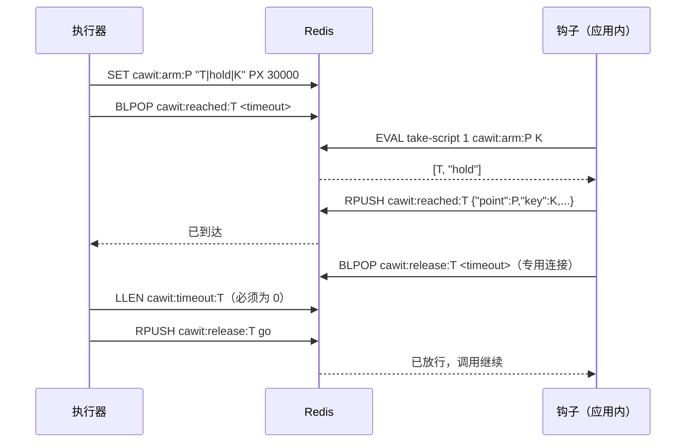

# 钩子协议

执行器与钩子只通过 Redis 通信。本页是用其他语言编写钩子所需的规范。当前版本：**2**。

所有键都以 `cawit:` 开头。`<token>` 对每个被启用的点和每一轮都是唯一的；`<point>` 是同步点名称。

## 键

| 键 | 类型 | 写入方 | 含义 |
|---|---|---|---|
| `cawit:arm:<point>` | 字符串，`PX 30000` | 执行器 | `<token>\|<action>\|<key>`：下一个匹配的调用会被取走。`<action>` 为 `hold` 或 `fail`；`<key>` 为 `*` 表示任意键。键放在最后，因此可以包含 `\|` |
| `cawit:reached:<token>` | 列表 | 钩子 | 每个被取走的调用写入一个 JSON 元素 `{"point","key","action","pid"}` |
| `cawit:release:<token>` | 列表 | 执行器 | 任意元素都会放行被暂停的调用 |
| `cawit:timeout:<token>` | 列表 | 钩子 | 被暂停的调用在放行之前停止了等待 |

## 时序



## 钩子的行为

钩子提供一个调用：`syncPoint(point, key = "*")`。

1. 除非配置了钩子的 Redis URL（`CAWIT_SYNC_URL`），否则**关闭**。关闭时不做任何 I/O 直接返回。钩子在生产环境中也应保持关闭，除非显式允许（Node 钩子：`NODE_ENV=production` 时需要 `CAWIT_ALLOW_PRODUCTION=1`）。
2. 用以下脚本**原子地取走启用**，`KEYS[1] = cawit:arm:<point>`，`ARGV[1] = key`：

   ```lua
   local v = redis.call('GET', KEYS[1])
   if not v then return false end
   local s1 = string.find(v, '|', 1, true)
   if not s1 then return false end
   local s2 = string.find(v, '|', s1 + 1, true)
   if not s2 then return false end
   local want = string.sub(v, s2 + 1)
   if want ~= '*' and want ~= ARGV[1] then return false end
   redis.call('DEL', KEYS[1])
   return {string.sub(v, 1, s1 - 1), string.sub(v, s1 + 1, s2 - 1)}
   ```

   返回 nil 表示"不是给这个调用的"：立即返回。检查与删除必须是一个原子步骤：先取走启用、键不匹配时再放回的做法，会留下一个让目标调用什么也找不到的空档。
3. **通知**：`RPUSH cawit:reached:<token> <json>`，至少包含 `point`、`key` 和 `action`。
4. **执行**：
   - `fail`：抛出该语言的错误（Node：`CawitInjectedError`），不等待。
   - `hold`：在**仅用于这次等待的连接**上执行 `BLPOP cawit:release:<token> <timeout>`，然后关闭该连接。如果等待超时，执行 `RPUSH cawit:timeout:<token> <任意值>` 后继续。

绝不要使用应用自己的 Redis 连接：在其上阻塞的 `BLPOP` 会拖慢应用的命令。也绝不要在与其他调用共享的连接上等待：同一进程中到达任意同步点的第二个请求会排在第一个请求的 `BLPOP` 后面。

## 执行器的行为

- **启用**：`SET cawit:arm:<point> <token>|<action>|<key> PX 30000`；令牌由该轮的唯一 ID 和别名组成。
- **到达**：`BLPOP cawit:reached:<token> <秒>`；nil 表示 `NOT_REACHED`。
- **放行**：`LLEN cawit:timeout:<token>`；非零表示暂停已过期，该轮为 `NOT_REACHED`。否则执行 `RPUSH cawit:release:<token> go`。
- 每一轮之后**清理**：`DEL cawit:arm:<point>`、`RPUSH cawit:release:<token> cleanup` 并 `EXPIRE … 60`（放行仍被暂停的调用）、`DEL cawit:reached:<token>`、`DEL cawit:timeout:<token>`。

## 版本

| 版本 | 启用值 | 说明 |
|---|---|---|
| 1 | `<token>\|<key>` | 只有暂停；钩子用 `GETDEL` 取走，键不匹配时再放回（存在竞态） |
| 2 | `<token>\|<action>\|<key>` | 增加 `fail`；原子取走；每次暂停使用独立的等待连接；执行器检查 `cawit:timeout:<token>` |

使用旧版本的钩子永远取不走版本 2 的启用，因此每一轮都会显示 `NOT_REACHED`，而不是给出错误的结果。
