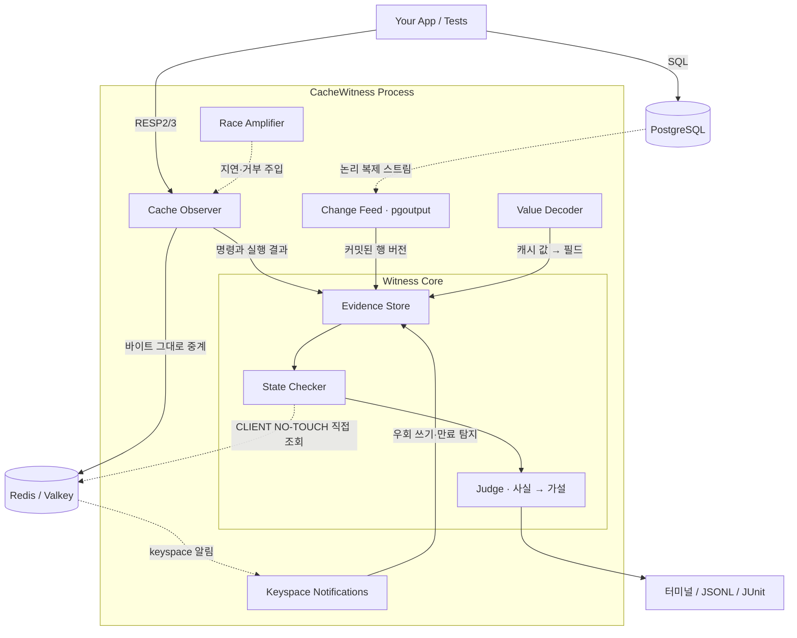

<div align="center">

[English](../../README.md) · [简体中文](README_zh.md) · **한국어**

# CacheWitness

**Redis 캐시와 PostgreSQL 사이의 불일치를 확정하고, 그 증거를 보여주는 도구**

**캐시 위트니스**

</div>

---

## 소개 (Introduction)

   **CacheWitness**는 애플리케이션 코드를 고치지 않고 Redis 캐시와 PostgreSQL 사이의 정합성 위반을 확정하고, **그 위반이 생기기까지의 증거를 보여주며, 경쟁 조건을 CI에서 재현하는** Rust 오픈소스 개발 도구입니다. 한 줄로 말하면 **“캐시가 틀린 값을 들고 있다는 사실은 확정하고, 왜 그렇게 됐는지는 증거와 함께 보여주는 도구”**입니다.

   Redis를 DB 앞에 두는 cache-aside 구조는 웹 백엔드의 기본값입니다. 하지만 캐시 불일치는 **에러도 지연도 없이 조용히 틀리기 때문에** APM과 모니터링에 잡히지 않고, 고객 신고로 발견되는 경우가 많습니다(공개 사례 21건 중 9건). ms 단위의 경쟁 조건은 로그로 재구성하기도 어렵습니다. 그래서 대부분의 회고는 “TTL을 짧게” 또는 “캐시를 걷어낸다”는 우회책으로 끝납니다.

   **CacheWitness는 이 문제를, 캐시 앞의 프로토콜 프록시와 DB의 논리 복제 스트림을 함께 관찰함으로써 해결합니다.** 캐시에 들어간 값이 DB의 어느 커밋 버전인지 판정하고, 그 값이 들어오기까지의 이벤트를 시간 구간이 붙은 타임라인으로 보여줍니다. 관찰한 사실은 확정하고, 관찰하지 못한 인과관계는 **가설로만** 제시합니다. CacheWitness는 다음과 같은 명확한 철학을 바탕으로 설계되었습니다. **“캐시를 바꾸지 않는다. 지금 캐시가 맞는지 증명한다. 그리고 모르는 것은 모른다고 말한다.”**

   Meta는 Polaris로 캐시 일관성을 사내에서 검사하고, Uber는 캐시 신선도를 사내에서 측정합니다. CacheWitness의 목표는 **같은 능력을 여러분의 Postgres + Redis에, 앱 코드 변경 없이** 제공하는 것입니다. 1차 목표는 CI·스테이징 환경에서 출시 전에 위반을 찾아내는 것입니다.

---

## 해결하는 문제 (The Problem)

캐시 불일치란 **“DB에는 새 값이 커밋됐는데, 캐시에는 이전 값이 허용 시간보다 오래 남아 있는 상태”**입니다. 문제는 발생 자체보다, 아무도 모르게 지속되고 원인을 되짚기 어렵다는 점입니다.

| 유형 | 발생 메커니즘 | CacheWitness 판정 |
|---|---|---|
| 무효화 실패 | DEL이 네트워크·권한·OOM으로 실패했는데 재시도 없음 | 확정 |
| 구버전 재충전 | 커밋과 DEL 이후에 옛 값이 다시 SET됨 | 확정 (왜 옛 값이었는지는 가설) |
| stale-set 경쟁 | 리더가 옛 값을 읽음 → 라이터가 커밋·DEL → 리더가 옛 값을 SET | 가설 |
| 복제 지연 재충전 | DEL 후 지연된 리드 레플리카에서 읽어 옛 값을 채움 | 가설 |
| 커밋 전 무효화 | 커밋 전에 DEL → 다른 요청이 옛 값으로 재충전 | 순서는 확정, 인과는 가설 |
| 무효화 누락 | DB를 바꾼 코드 경로 중 하나가 캐시를 지우지 않음 | 가설 |
| 부분 무효화 | 한 행에 묶인 여러 키 중 일부만 지움 | 확정 (묶인 키를 선언한 경우) |
| 부정 캐시 잔존 | “없음”을 캐시한 뒤 행이 INSERT됨 | 확정 (부정 값을 선언한 경우) |
| 롤백된 쓰기의 잔존 | 커밋 전에 캐시를 채웠는데 트랜잭션이 롤백됨 | 가설 |
| write-through 순서 역전 | 새 버전의 SET 뒤에 옛 버전의 SET이 도착함 | 확정 |

특히 **“커밋 후 DEL”이라는 표준 패턴도 안전하지 않습니다.** 2013년 Facebook memcache 논문 이후 알려진 사실이지만, 그 문제가 **여러분의 코드에서 실제로 일어나는지**를 보여주는 도구는 없었습니다.

---

## 빠른 시작 (Quick Start)

> 아래는 계획된 인터페이스입니다. 현재는 프로토타입 단계이며, 명령과 설정 형식은 바뀔 수 있습니다.

### 1. 설정 (Configuration)

CacheWitness는 프로젝트 루트의 `cachewitness.yaml` 파일로 **캐시 키와 DB 테이블의 대응 관계, 그리고 여러분의 정합성 정책**을 선언합니다. 앱에서 바꾸는 것은 **Redis URL 하나**뿐입니다.

```yaml
policy:
  default:
    mode: invalidate_on_write   # invalidate_on_write | write_through | ttl_only
    max_staleness: 500ms        # 서비스가 허용하는 최대 낡음
    observation_grace: 300ms    # 도구가 CDC 지연 등을 기다리는 시간

mappings:
  - key: "app:user:{id}"        # 접두사까지 포함한 실제 키 형식
    table: public.users
    pk: [id]
    value: { format: json }
    fields: { name: name, email: email, updatedAt: updated_at }  # 캐시 필드 → 컬럼
    ignore: [cachedAt]

report:
  values: redact                # 보고서에 실제 값을 남기지 않음 (기본값)
```

이를 통해 다음과 같은 것들을 설정할 수 있습니다:

- 정합성 정책: 쓰기 시 무효화, write-through, TTL 전용

- 서비스가 허용하는 낡음과, 도구의 관찰 유예 시간 (둘은 별개입니다)

- 키 템플릿과 테이블·기본 키의 대응, 캐시 필드 ↔ DB 컬럼 매핑

- 보고서에 실제 값을 남길지 여부

대응할 수 없는 키(목록·집계 캐시)는 보고서에 **“미매핑”**으로 따로 나열해, 누락을 숨기지 않습니다.

### 2. 환경 점검 (Doctor)

```bash
# wal_level, 복제 권한, publication, Redis 버전, keyspace 알림 설정 권한을 점검
cachewitness doctor --pg $DATABASE_URL --redis redis://localhost:6379
```

> “무수정”은 **앱 코드 무수정**이라는 뜻입니다. DB에는 `wal_level=logical`, 복제 권한, publication이 필요하며, CacheWitness는 임시 복제 슬롯만 사용합니다.

### 3. CI에서 실행 (Run in CI)

CacheWitness에는 목적이 다른 두 가지 모드가 있습니다.

```bash
# check 모드: 기존 테스트를 감싸 결정적 버그(무효화 누락·실패, 잘못된 키 등)를 검사
cachewitness check --config cachewitness.yaml -- npm run test:integration

# race 모드: 동시 부하를 감싸고 경쟁 창을 넓혀 경쟁 조건을 검사
cachewitness race --config cachewitness.yaml --amplify stale-set --seed 42 -- k6 run load.js
```

결과는 **PASS(종료 코드 0) / FAIL(1) / INCONCLUSIVE(2)** 중 하나입니다. 매핑된 키에 대한 쓰기 중 관측하지 못한 것(프록시를 우회한 쓰기, 미지원 명령 등)이 기준보다 많으면 “정상”이라고 말하지 않고 INCONCLUSIVE를 냅니다. 확정된 위반은 관측 비율과 상관없이 항상 FAIL입니다.

> 순차 실행 테스트에서는 경쟁 조건이 생기지 않습니다. 경쟁 조건은 race 모드로 검사하세요. 매 테스트를 롤백하는 방식(Django `TestCase` 등)은 커밋이 없어 검사할 수 없으며, CacheWitness가 이를 감지해 알려줍니다.

### 4. 결과 확인 (Report)

위반마다 **확정된 사실, 원인 가설, 부족한 증거**가 나뉘어 나옵니다.

```
FAIL  STALE_STATE  app:user:2128   지속 ≥ 812ms (허용 500ms)   관측: COMPLETE

  확정된 사실
    DB      v2 커밋                    17:12:03.481  [+0.0, +0.4]ms
    conn#1  DEL → 1 (성공)                           [+6.4, +6.9]ms
    conn#2  SET (v1과 일치, ttl 3600s)               [+13.1, +13.6]ms   ← 커밋·DEL 이후 (순서 확정)
    검사    캐시 = v1                                 +812ms
    낡은 읽기 제공: 37회

  원인 가설
    SUSPECTED  STALE_SET_RACE      근거: conn#2의 같은 키 GET miss [-3.6, -3.2]ms (커밋 전)
    SUSPECTED  REPLICA_LAG_REFILL  배제 불가

  부족한 증거
    SQL 읽기 시각, 읽기 대상(primary/replica), 요청 ID

  참고 해법
    무효화 마커 + Lua 비교 SET, 또는 lease
```

---

## 설계 철학 (Design Philosophy)

### 1. “증인(Witness)” 아키텍처

CacheWitness는 캐시가 아니라 **캐시를 지켜보는 증인**입니다.

- Redis 프로토콜(RESP2/RESP3)을 그대로 중계하고, 복사본만 파서에 넣습니다.
- 명령을 **봤다는 것**과 상태가 **실제로 바뀌었다는 것**을 구분합니다 (NX 실패, MULTI/EXEC 취소 등).
- DB 변경은 PostgreSQL 논리 복제 스트림에서 커밋 시각·LSN과 함께 받습니다.
- **프록시를 우회한 쓰기**는 Redis keyspace 알림과 프록시 기록을 맞춰 봐서 찾아냅니다. “모든 쓰기가 프록시를 지난다”고 가정하지 않습니다.
- 검사 연결은 `CLIENT NO-TOUCH`로 조회해, 관찰이 캐시의 eviction 동작을 바꾸지 않게 합니다.

**결과:**

기존 캐시와 앱 코드는 그대로 두고, 캐시 값이 DB의 어느 버전인지와 그 값이 들어온 경위를 기록할 수 있습니다.

### 2. 사실과 가설을 나눈다

같은 관측 기록이 서로 다른 원인에서 나올 수 있습니다. 예를 들어 stale-set 경쟁과 복제 지연 재충전은 프록시와 DB 변경 스트림에 똑같이 보일 수 있습니다.

그래서 CacheWitness는 **아는 만큼만 말합니다.**

- **증거 모델:** 원인은 `UNKNOWN`에서 시작해, 증거가 쌓이면 `SUSPECTED`, 관측만으로 증명될 때만 `CONFIRMED`
- **시간 구간:** 모든 이벤트는 `[t_min, t_max]` 구간으로 기록하고, 구간이 겹치면 순서를 확정하지 않음
- **진행 표시(watermark):** 양쪽 관측 채널이 판정 시점까지 따라온 것을 확인한 뒤에만 판정
- **관측 상태:** 키마다 `COMPLETE` / `PARTIAL` / `GAP_DETECTED` 등을 기록하고, 불완전하면 INCONCLUSIVE

### 3. 경쟁을 우연에 맡기지 않는다 (Race Amplifier)

경쟁 조건은 우연히 터질 때만 보입니다.

CacheWitness는 **경쟁 창을 일부러 넓힙니다.**

- **stale-set 유도:** GET 미스 뒤 같은 키의 SET 전달을 지연
- **무효화 실패 내성:** DEL을 확률적으로 거부하고, 실패 후 정합성이 **회복되는지** 검사
- **시드 기반:** 주입 결정을 `(시드, 키, 키별 순번)`으로 정해, 같은 시드면 같은 키의 n번째 명령에 같은 결정을 내림. 실행 순서까지 재현하지는 않음
- **지연 표기:** 위반마다 관여한 명령에 주입된 지연을 함께 기록

### 4. 왜 Rust인가

“빠르다”가 아니라, **요청 경로에 끼어드는 프로세스가 지켜야 할 조건** 때문입니다.

- **예측 가능한 꼬리 지연:** GC 일시정지가 없는 프록시
- **메모리 상한:** 키별 보관량을 제어하고 할당을 통제
- **단일 정적 바이너리:** CI 러너·사이드카에 그대로 투입
- **메모리 안전성:** 사용자 트래픽을 파싱하는 코드에서 곧 보안 요구사항

---

## 주요 기능 (Key Features)

- **🔍 앱 코드 무수정:** Redis URL과 설정 파일만 바꿔서 붙임
- **🧾 증거 기반 판정:** 확정된 사실, 원인 가설, 부족한 증거를 나눠서 보고
- **👥 낡은 읽기 집계:** 캐시 상태뿐 아니라, 낡은 값이 실제로 몇 번 읽혔는지 측정
- **🎯 경쟁 증폭 모드:** CI에서 경쟁 조건을 재현하고 실패 처리
- **🛡️ 데이터 최소 노출:** 보고서의 실제 값은 기본으로 가림
- **📄 CI 친화 리포트:** 터미널, JSONL, JUnit XML

---

## 아키텍처 개요 (Architecture Overview)

CacheWitness는 캐시와 DB 사이에서 **증인** 역할을 합니다.



1. **Cache Observer:** Redis 프로토콜 프록시. 요청·응답을 연결별 FIFO로 짝지어 각 명령의 실행 결과를 기록합니다.
2. **Change Feed:** PostgreSQL 논리 복제 스트림에서 행 버전과 커밋 시각을 받습니다.
3. **Keyspace Notifications:** 프록시를 우회한 쓰기, 스크립트 안의 쓰기, 만료와 eviction을 탐지하는 2차 관측 채널입니다.
4. **Value Decoder:** 캐시 값을 DB 컬럼과 비교할 수 있는 필드로 디코딩합니다.
5. **Evidence Store:** 키별 이벤트와 버전을 시간 기준으로, 메모리 상한 안에서 보관합니다.
6. **State Checker:** 허용 시간이 지나고 양쪽 진행 표시가 그 시점을 넘으면 캐시를 직접 조회해 사실을 판정합니다.
7. **Judge:** 사실 판정 위에 원인 가설을 세우고, 증거가 충분할 때만 확정합니다.

---

## 사전 검증 (Prototype Results)

약 970줄 프로토타입(Rust 탐지기 + Node 재현 하네스)으로 핵심 가설을 확인했습니다.
환경: 2코어·7GB Linux 컨테이너, PostgreSQL 16, Redis 7.0, node-redis(RESP3), 유예 시간 300ms.

- **버그를 넣지 않은 cache-aside:** 경쟁을 유발하도록 구성한 부하(핫키 200개, 워커 32개, 읽기:쓰기 약 2.3:1)에서 20초 실행 뒤 낡은 값이 끝까지 남은 키 3개를 별도 오라클이 확인했고, 프로토타입은 3건을 모두 탐지했습니다. 실행 중의 일시적인 경쟁 횟수는 도구 자신이 센 값(41건)이라 독립적으로 확인되지 않았습니다.
- **주입 버그 테스트:** 같은 사람이 만든 시나리오에서 정상 패턴과 백그라운드 트래픽에 대한 오탐은 관찰되지 않았지만, 이 결과로 정확도를 주장하지는 않습니다.
- **관찰 비용:** 프록시를 한 단계 거치는 비용은 큽니다(Redis 직접 대비 GET p50 0.28 → 0.74ms). 관찰 로직이 추가하는 비용은 단순 중계 프록시와 측정 노이즈 범위에서 구분되지 않았습니다. 상주 메모리는 25MB였습니다.

> 프록시가 명령마다 지연을 더하므로 측정된 발생률은 운영 환경의 발생률과 같지 않습니다. 또 주입 시나리오와 분류 규칙을 같은 사람이 만들었으므로 분류 정확도는 과대평가되었을 수 있습니다. 다음 단계에서 독립적인 정답 데이터로 다시 측정합니다. 자세한 해석은 [`docs/PLAN.md`](../PLAN.md) 5장을 참고하세요.

---

## 범위 (Scope)

| 항목 | 첫 공개 버전 (v0.x) | v1.0 이후 검토 |
|---|---|---|
| DB | PostgreSQL | MySQL |
| 캐시 | Redis, Valkey 단일 노드 | Redis Cluster |
| 값 형식 | JSON 문자열 | pickle, Marshal, msgpack, 사용자 디코더 |
| 키 매핑 | 테이블 1:1 선언, 묶인 키 선언 | 복합 키, 목록·집계 캐시 |
| 모드 | check, race | 선택적 계측(instrumented, OpenTelemetry 트레이스), 운영 감시(별도 제품) |
| 전송 | 평문 TCP | TLS(`rediss://`) |

**CacheWitness가 하지 않는 것:**

- 캐시 일관성을 직접 보장하거나 자동으로 수정하지 않습니다.
- 캐시를 대체하거나 새 캐시를 제공하지 않습니다.
- 샤딩·커넥션 풀링을 하는 범용 Redis 프록시가 되지 않습니다.
- 관찰하지 못한 애플리케이션 내부의 인과관계를 확정하지 않습니다.

---

## 문서 (Documentation)

| 문서 | 내용 |
|---|---|
| [`docs/PLAN.md`](../PLAN.md) | 최종 개발 계획: 주제와 동기, 판정 모델, 설계 상세, 단계별 관문, 기각한 대안 |

---

## ⚠️ 면책 조항 및 책임 제한 (Disclaimer & Liability)

**반드시 주의 깊게 읽어주세요.**

**CacheWitness는 현재 설계·프로토타입 단계의 개인 프로젝트입니다.**

본 소프트웨어는 **어떠한 형태의 보증도 없이 “있는 그대로(as is)” 제공**됩니다. 여기에는 상품성, 특정 목적 적합성, 비침해에 대한 보증이 포함되며 이에 국한되지 않습니다. 본 소프트웨어를 사용함으로써, 귀하는 다음 사항에 동의하게 됩니다.
1. **자기 책임 하에 사용:** 본 소프트웨어의 사용 또는 재배포 적합성에 대한 책임은 전적으로 사용자에게 있습니다.
2. **책임 부인:** 저작자 또는 권리 보유자는, 본 소프트웨어의 사용 또는 이와 관련하여 발생하는 어떠한 청구, 손해, 책임에 대해서도 책임을 지지 않습니다.
3. **운영 환경 사용 비권장:** 1.0 이전에는 CI·스테이징 용도로만 설계되었습니다. 운영 트래픽을 프록시로 통과시키지 마십시오.

운영 환경에서 CacheWitness를 사용할 계획이라면, **반드시 자체적인 철저한 테스트와 보안 검토를 수행할 것을 강력히 권장합니다.**

---

## 라이선스 (License)

이 프로젝트는 **Apache License 2.0** 하에 배포됩니다.
