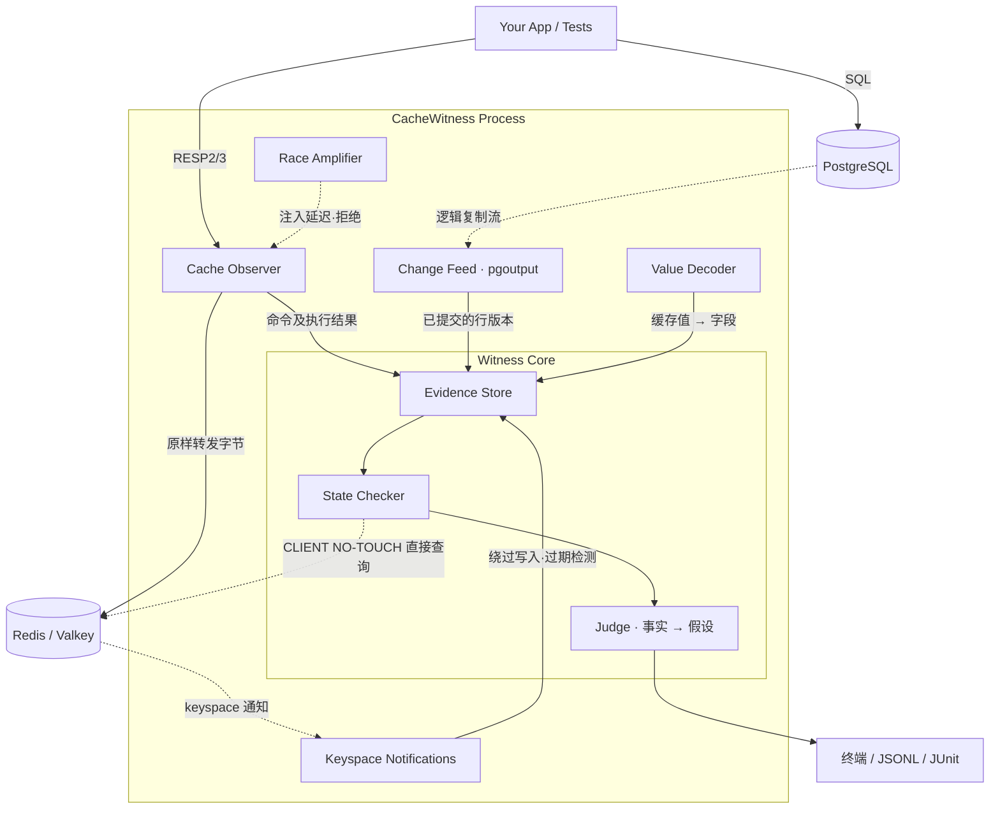

<div align="center">

[English](../../README.md) · **简体中文** · [한국어](README_ko.md)

# CacheWitness

**确认 Redis 缓存与 PostgreSQL 之间的不一致，并给出证据**

**缓存见证者**

</div>

---

## 简介 (Introduction)

   **CacheWitness** 是一款面向现有 PostgreSQL + Redis 应用的 Rust 开源开发工具。它无需修改应用代码，就能**确认缓存一致性违规，展示每次违规形成过程的证据，并在 CI 中复现竞态条件**。一句话概括：**“确认缓存中存的是错误的值，并用证据说明它是怎么变成这样的。”**

   在数据库前放一层 Redis 的 cache-aside 架构，是 Web 后端的默认选择。但缓存不一致**没有报错、也没有延迟，只是悄无声息地出错**，因此 APM 和监控都捕捉不到，很多时候要等到用户反馈才被发现（公开案例 21 起中有 9 起）。毫秒级的竞态条件也很难从日志中还原。所以大多数事后复盘都以权宜之计收场：“把 TTL 调短”或者“干脆去掉缓存”。

   **CacheWitness 通过同时观察缓存前的协议代理和数据库的逻辑复制流来解决这个问题。** 它判定缓存中的每个值对应数据库的哪个已提交版本，并以每个事件都带有时间区间的时间线，展示该值写入之前发生的事件。观察到的事实，它予以确认；无法观察到的因果关系，它**只作为假设**提出。CacheWitness 基于一个明确的理念设计：**“不替换缓存。证明缓存此刻是否正确。不知道的，就说不知道。”**

   Meta 在内部用 Polaris 检查缓存一致性，Uber 也在内部测量缓存的新鲜度。CacheWitness 的目标是**把同样的能力带到你的 Postgres + Redis 上，且无需修改应用代码**。首要目标是在 CI 和预发环境中，于发布前发现违规。

---

## 要解决的问题 (The Problem)

缓存不一致指的是**“数据库已经提交了新值，但缓存中的旧值保留的时间超过了允许范围”**的状态。问题不在于它会发生，而在于它在无人察觉的情况下持续存在，且难以追溯原因。

| 类型 | 发生机制 | CacheWitness 判定 |
|---|---|---|
| 失效失败 | DEL 因网络、权限、OOM 失败且未重试 | 确认 |
| 旧版本回填 | 在提交和 DEL 之后，旧值又被 SET 回去 | 确认（为何是旧值属于假设） |
| stale-set 竞态 | 读者读到旧值 → 写者提交并 DEL → 读者 SET 旧值 | 假设 |
| 复制延迟回填 | DEL 后从延迟的只读副本读到旧值并回填 | 假设 |
| 提交前失效 | 提交前 DEL → 其他请求用旧值回填 | 顺序确认，因果为假设 |
| 失效遗漏 | 修改了数据库的某条代码路径没有清除缓存 | 假设 |
| 部分失效 | 与同一行关联的多个键只清除了一部分 | 确认（声明了关联键时） |
| 负缓存残留 | 缓存了“不存在”之后，该行被 INSERT | 确认（声明了负缓存值时） |
| 回滚写入残留 | 提交前已写入缓存，随后事务回滚 | 假设 |
| write-through 顺序颠倒 | 新版本的 SET 之后，旧版本的 SET 才到达 | 确认 |

尤其是，**即使是“提交后 DEL”这一标准模式也并不安全。** 这一点自 2013 年 Facebook 的 memcache 论文起就已为人所知，但一直没有工具能展示它是否**真的发生在你的代码里**。

---

## 快速开始 (Quick Start)

> 以下为规划中的接口。项目目前处于原型阶段，命令和配置格式可能会变化。

### 1. 配置 (Configuration)

CacheWitness 通过项目根目录下的 `cachewitness.yaml` 声明**缓存键与数据库表的对应关系，以及你的一致性策略**。应用中唯一需要改动的是 **Redis URL**。

```yaml
policy:
  default:
    mode: invalidate_on_write   # invalidate_on_write | write_through | ttl_only
    max_staleness: 500ms        # 服务允许的最大陈旧时间
    observation_grace: 300ms    # 工具等待 CDC 延迟等的时间

mappings:
  - key: "app:user:{id}"        # 包含前缀在内的实际键格式
    table: public.users
    pk: [id]
    value: { format: json }
    fields: { name: name, email: email, updatedAt: updated_at }  # 缓存字段 → 列
    ignore: [cachedAt]

report:
  values: redact                # 报告中不保留真实值（默认）
```

通过它可以配置：

- 一致性策略：写时失效、write-through、仅 TTL

- 服务允许的陈旧时间，以及工具的观察宽限时间（二者是不同的概念）

- 键模板与表、主键的对应，缓存字段与数据库列的映射

- 报告中是否保留真实值

无法映射的键（列表、聚合类缓存）会在报告中单独列为**“未映射”**，不隐瞒遗漏。

### 2. 环境检查 (Doctor)

```bash
# 检查 wal_level、复制权限、publication、Redis 版本以及开启 keyspace 通知的权限
cachewitness doctor --pg $DATABASE_URL --redis redis://localhost:6379
```

> “无需修改”指的是**无需修改应用代码**。数据库需要 `wal_level=logical`、复制权限和 publication，CacheWitness 只使用临时复制槽。

### 3. 在 CI 中运行 (Run in CI)

CacheWitness 有两种用途不同的模式。

```bash
# check 模式：包裹现有测试，检查确定性缺陷（失效遗漏/失败、删错键等）
cachewitness check --config cachewitness.yaml -- npm run test:integration

# race 模式：包裹并发负载并放大竞态窗口，检查竞态条件
cachewitness race --config cachewitness.yaml --amplify stale-set --seed 42 -- k6 run load.js
```

结果为 **PASS（退出码 0）/ FAIL（1）/ INCONCLUSIVE（2）** 之一。如果针对已映射键的写入中，未能观察到的部分（绕过代理的写入、不支持的命令等）超过阈值，CacheWitness 不会判定为“正常”，而是给出 INCONCLUSIVE。已确认的违规无论覆盖率如何，始终为 FAIL。

> 顺序执行的测试不会产生竞态条件，请用 race 模式检查竞态。每个测试都回滚的方式（如 Django 的 `TestCase`）没有提交，因此无法检查；CacheWitness 会检测到这种情况并提示你。

### 4. 查看结果 (Report)

每条违规都分为**已确认的事实、原因假设和缺失的证据**三部分。

```
FAIL  STALE_STATE  app:user:2128   陈旧 ≥ 812ms（允许 500ms）   观察: COMPLETE

  已确认的事实
    DB      提交 v2                    17:12:03.481  [+0.0, +0.4]ms
    conn#1  DEL → 1（成功）                          [+6.4, +6.9]ms
    conn#2  SET（与 v1 一致，ttl 3600s）             [+13.1, +13.6]ms   ← 在提交和 DEL 之后（顺序确认）
    检查    缓存 = v1                                 +812ms
    返回陈旧读取: 37 次

  原因假设
    SUSPECTED  STALE_SET_RACE      依据: conn#2 上同一键的 GET miss 位于 [-3.6, -3.2]ms（提交之前）
    SUSPECTED  REPLICA_LAG_REFILL  无法排除

  缺失的证据
    SQL 读取时间、读取目标（primary/replica）、请求 ID

  参考修复
    失效标记 + Lua 比较后 SET，或 lease
```

---

## 设计理念 (Design Philosophy)

### 1. “见证者（Witness）”架构

CacheWitness 不是缓存，而是**注视着缓存的见证者**。

- 原样转发 Redis 协议（RESP2/RESP3）的字节，只把副本交给解析器。
- 区分**看到了命令**与**状态确实发生了变化**（NX 失败、MULTI/EXEC 被取消等）。
- 从 PostgreSQL 逻辑复制流接收数据库变更，连同提交时间和 LSN。
- 通过比对 Redis keyspace 通知与代理记录，找出**绕过代理的写入**。从不假设所有写入都经过代理。
- 检查连接使用 `CLIENT NO-TOUCH`，确保观察本身不会改变缓存的淘汰行为。

**结果：**

缓存和应用代码保持原样，同时能记录下每个缓存值对应数据库的哪个版本，以及它是如何写入的。

### 2. 区分事实与假设

同样的观察记录可能来自不同的原因。例如，stale-set 竞态和复制延迟回填，在代理和变更流看来可能完全一样。

因此 CacheWitness **只说自己知道的。**

- **证据模型：** 原因从 `UNKNOWN` 开始，证据积累后升为 `SUSPECTED`，只有仅凭观察即可证明时才为 `CONFIRMED`
- **时间区间：** 每个事件都记录为 `[t_min, t_max]` 区间，区间重叠时不确定顺序
- **进度水位（watermark）：** 只有确认两个观察通道都已追上判定时刻，才进行判定
- **观察状态：** 每个键记录 `COMPLETE` / `PARTIAL` / `GAP_DETECTED` 等，观察不完整时结果为 INCONCLUSIVE

### 3. 不把竞态交给运气 (Race Amplifier)

竞态条件只有在恰好触发时才能被看到。

CacheWitness **会刻意放大竞态窗口。**

- **诱发 stale-set：** 在 GET miss 之后，延迟转发同一键的 SET
- **失效失败容错：** 按概率拒绝 DEL，并检查一致性是否能**恢复**
- **基于种子：** 注入决策由 `(种子, 键, 键内序号)` 决定，相同的种子会对同一键的第 n 条命令作出相同的决策，但不复现执行顺序本身
- **延迟标注：** 每条违规都会记录相关命令被注入的延迟

### 4. 为什么选择 Rust

不是因为“快”，而是因为**处在请求路径上的进程必须满足的条件**。

- **可预测的尾延迟：** 没有 GC 停顿的代理
- **内存上限：** 控制每个键的保留量和内存分配
- **单个静态二进制：** 可直接放入 CI 运行器和 sidecar
- **内存安全：** 对于解析用户流量的代码，这本身就是安全要求

---

## 主要功能 (Key Features)

- **🔍 无需修改应用代码：** 只需更改 Redis URL 和一个配置文件即可接入
- **🧾 基于证据的判定：** 报告分为已确认的事实、原因假设和缺失的证据
- **👥 陈旧读取计数：** 不仅看缓存状态，还统计陈旧值实际被读取的次数
- **🎯 竞态放大模式：** 在 CI 中复现竞态条件并使构建失败
- **🛡️ 最小化数据暴露：** 报告中的真实值默认被遮蔽
- **📄 适配 CI 的报告：** 终端、JSONL、JUnit XML

---

## 架构概览 (Architecture Overview)

CacheWitness 在缓存和数据库之间扮演**见证者**的角色。



1. **Cache Observer：** Redis 协议代理。按连接以 FIFO 顺序配对请求与响应，记录每条命令的执行结果。
2. **Change Feed：** 从 PostgreSQL 逻辑复制流接收行版本和提交时间。
3. **Keyspace Notifications：** 第二观察通道，用于检测绕过代理的写入、脚本内的写入以及过期和淘汰。
4. **Value Decoder：** 把缓存值解码为可与数据库列比较的字段。
5. **Evidence Store：** 按时间保留每个键的事件和版本，并控制在内存上限之内。
6. **State Checker：** 允许的陈旧时间过去、且两个进度水位都越过该时刻后，直接查询缓存以判定事实。
7. **Judge：** 在事实判定之上建立原因假设，只有证据充分时才予以确认。

---

## 前期验证 (Prototype Results)

我们用约 970 行的原型（Rust 检测器 + Node 复现测试工具）验证了核心假设。
环境：2 核、7 GB Linux 容器，PostgreSQL 16，Redis 7.0，node-redis（RESP3），宽限时间 300 ms。

- **未注入缺陷的 cache-aside：** 在为诱发竞态而构造的负载下（200 个热点键、32 个 worker、读写比约 2.3:1）运行 20 秒后，独立的校验程序发现有 3 个键仍保留着陈旧值，原型全部检测到了。运行期间瞬时竞态的次数（41 次）是工具自己统计的，尚未经过独立验证。
- **注入缺陷测试：** 在正常模式和后台流量中未观察到误报，但场景出自同一人之手，因此不据此宣称准确率。
- **观察开销：** 经过一层代理本身的开销很大（与直连 Redis 相比，GET p50 从 0.28 ms 升至 0.74 ms）。观察逻辑本身带来的额外开销，在测量噪声范围内与普通转发代理无法区分。常驻内存为 25 MB。

> 代理会给每条命令增加延迟，因此测得的发生率并不等于生产环境的发生率。此外，注入场景和分类规则出自同一人之手，因此分类准确率可能被高估。下一阶段将基于独立的标准答案数据重新测量。详细解读请参阅 [`docs/PLAN.md`](../PLAN.md)（韩文）第 5 章。

---

## 范围 (Scope)

| 项目 | 首个公开版本 (v0.x) | v1.0 之后考虑 |
|---|---|---|
| 数据库 | PostgreSQL | MySQL |
| 缓存 | Redis、Valkey 单节点 | Redis Cluster |
| 值格式 | JSON 字符串 | pickle、Marshal、msgpack、用户解码器 |
| 键映射 | 表 1:1 声明、关联键声明 | 复合键、列表/聚合类缓存 |
| 模式 | check、race | 可选埋点（instrumented，OpenTelemetry 链路）、生产监控（独立产品） |
| 传输 | 明文 TCP | TLS（`rediss://`） |

**CacheWitness 不做的事：**

- 不直接保证或自动修复缓存一致性。
- 不替换缓存，也不提供新的缓存。
- 不会成为负责分片、连接池的通用 Redis 代理。
- 不对无法观察到的应用内部因果关系下定论。

---

## 文档 (Documentation)

| 文档 | 内容 |
|---|---|
| [`docs/PLAN.md`](../PLAN.md) | 最终开发计划（韩文）：主题与动机、判定模型、设计细节、分阶段关卡、被否决的方案 |

---

## ⚠️ 免责声明与责任限制 (Disclaimer & Liability)

**请务必仔细阅读。**

**CacheWitness 目前是处于设计和原型阶段的个人项目。**

本软件**按“原样”（as is）提供，不附带任何形式的担保**，包括但不限于适销性、特定用途适用性和不侵权的担保。使用本软件即表示你同意以下事项：
1. **自担风险：** 你需自行判断使用或再分发本软件是否合适，并承担全部责任。
2. **免除责任：** 对于因使用本软件或与之相关而产生的任何索赔、损害或其他责任，作者或版权持有人概不负责。
3. **不建议用于生产环境：** 1.0 之前仅为 CI 和预发环境设计。请勿让生产流量经过该代理。

如果你计划在生产环境中使用 CacheWitness，**强烈建议你自行进行全面的测试和安全审查。**

---

## 许可证 (License)

本项目基于 **Apache License 2.0** 发布。
